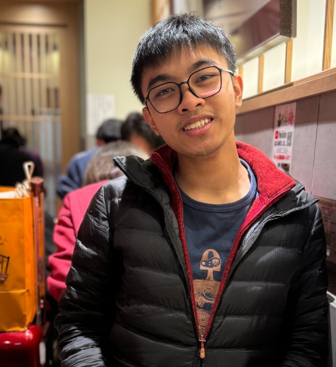
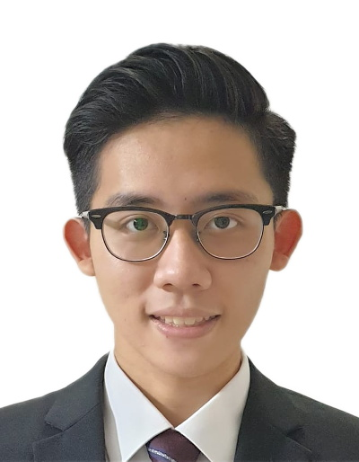
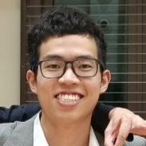
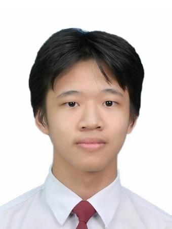
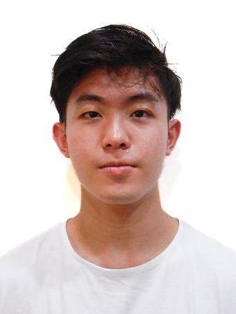

We are team **CS2103T-F11-1** based in the [School of Computing, National University of Singapore](https://www.comp.nus.edu.sg).

## Project Team

### Kieran M

[[homepage](https://kimame04.github.io)]
[[github](https://github.com/Kimame04)]
[[portfolio](team/kimame04.md)]

* Role: Developer
* Responsibilities: Role classification, Duplicate detection, UI layout & Theming

### Xavier

[[github](https://github.com/chiacxx)]
[[portfolio](team/chiacxx.md)]

* Role: Developer
* Responsibilities: Sort, find & delete commands, input validation, testing & documentation

### Chester

[[github](https://github.com/chester-wong-33)]
[[portfolio](team/chester-wong-33.md)]

* Role: Developer
* Responsibilities: Follow-up Management, Undo/Redo Integration & Model Integration

### Noah

[[github](https://github.com/Noyoth)]
[[portfolio](team/noyoth.md)]

* Role: Developer
* Responsibilities: Storage architecture, atomic file persistence, undo/redo & state synchronization

### Ken Tay

[[github](https://github.com/Ken-Tat)]
[[portfolio](team/ken-tat.md)]

* Role: Developer
* Responsibilities: Contact selection & details panel, incremental tag editing, command-specific help, testing & documentation
