* Table of Contents
{:toc}

This guide describes **v1.6 in the project working directory**, ahead of its GitHub release.
Repository source links identify the corresponding files on `master`; the local working tree
is the reference for unreleased v1.6 behaviour.

Start with [Design](#design) for the architecture, [Implementation](#implementation) for command
behaviour and shared mechanisms, [Requirements](#appendix-requirements) for current and future needs,
[Instructions for manual testing](#appendix-instructions-for-manual-testing) for test scenarios, and
[Planned Enhancements](#appendix-planned-enhancements) for known-issue remedies.

--------------------------------------------------------------------------------------------------------------------

## **Acknowledgements**

* Based on [AddressBook-Level 3](https://github.com/se-edu/addressbook-level3) by the [SE-EDU initiative](https://se-education.org), adapting its code, architecture, and documentation.
* Libraries used: [JavaFX](https://openjfx.io/), [Jackson](https://github.com/FasterXML/jackson), and [JUnit 5](https://junit.org/junit5/).
* `Email.VALIDATION_REGEX` adapts the regex published in the
  [WHATWG HTML Standard](https://html.spec.whatwg.org/multipage/input.html#valid-e-mail-address).

### AI use

Notable uses of AI:

#### @Ken-Tat

* OpenAI Codex was used for code review, bug investigation, and test-scenario preparation for contact
  selection, GUI behavior, command handling, and data persistence.
* OpenAI Codex was used to review and refine the User Guide, Developer Guide, and UML diagrams,
  and to check screenshot accuracy.
* OpenAI Codex was used to draft GitHub issues and pull request descriptions.

#### @chiacxx

* OpenAI Codex and Google Antigravity were used to implement and refine sorting, prefixed search,
  delete validation, and input handling.
* OpenAI Codex and Google Antigravity were used to generate and improve tests, debug issues,
  and conduct preliminary code reviews.
* OpenAI Codex and Google Antigravity were used to draft and refine the User Guide, Developer Guide,
  and UML diagrams.

#### @Kimame04

* Google Gemini was used for code architecture, edge-case analysis, and test-scenario preparation
  for role classification, multi-field duplicate detection, parser validation, and UI layout and theming.
* Google Gemini was used to generate and validate PlantUML diagrams and structure Developer Guide
  use cases and manual testing instructions.
* Google Gemini was used to refine User Guide documentation and draft comprehensive pull request
  reviews and issue descriptions.

#### @chester-wong-33

* OpenAI Codex was used to refine follow-up management, undo/redo integration, substring name
  searching, and exit feedback.
* OpenAI Codex was used to generate and improve tests and debug issues.
* OpenAI Codex was used to draft and refine the User Guide, Developer Guide, project portfolio,
  and pull request descriptions.

#### @Noyoth

* Google Gemini and OpenAI ChatGPT were used to implement and refine atomic file persistence,
  corrupted data and preferences backup mechanisms, startup diagnostic warnings, and undo/redo
  state management.
* Google Gemini and OpenAI ChatGPT were used to generate and expand unit and integration tests,
  design and style storage PlantUML sequence diagrams, and debug edge cases.
* Google Gemini and OpenAI ChatGPT were used to draft and refine Developer Guide sections, User
  Guide documentation, and pull request reviews.

--------------------------------------------------------------------------------------------------------------------

## **Setting up, getting started**

Refer to the guide [_Setting up and getting started_](SettingUp.md).

--------------------------------------------------------------------------------------------------------------------

## **Design**

<div markdown="span" class="alert alert-primary">

:bulb: **Tip:** Diagram sources are in `docs/diagrams` and their exported images are in `docs/images`,
with matching filenames. Update both when changing a diagram. Refer to the
[_PlantUML Tutorial_ at se-edu/guides](https://se-education.org/guides/tutorials/plantUml.html) for editing guidance.
</div>

Diagrams are partial views: their surrounding descriptions identify omitted interactions.
`XYZCommand` and `XYZCommandParser` stand for concrete command classes and their parsers;
not every command uses a separate parser. Ellipses mark omitted parameters; examples containing them are illustrative.
Sequence lifelines do not specify Java garbage-collection timing. Click a diagram to open its full-size image.

### Architecture

<a href="images/ArchitectureDiagram.png"></a>

The architecture diagram shows the application components and their dependencies.

The components have the following responsibilities.

**Main components of the architecture**

**`Main`** (consisting of classes [`Main`](https://github.com/AY2627S1-CS2103T-F11-1/tp/blob/master/src/main/java/seedu/address/Main.java) and [`MainApp`](https://github.com/AY2627S1-CS2103T-F11-1/tp/blob/master/src/main/java/seedu/address/MainApp.java)) coordinates application startup and shutdown.
* At app launch, it initializes the other components in the correct sequence, and connects them up with each other.
* At shut down, it shuts down the other components and invokes cleanup methods where necessary.

Four components handle the application's main responsibilities:

* [**`UI`**](#ui-component): The visual interface and command input.
* [**`Logic`**](#logic-component): Command parsing and execution.
* [**`Model`**](#model-component): Contact data, displayed views, preferences, and session history in memory.
* [**`Storage`**](#storage-component): Local JSON persistence and startup backups.

[**`Commons`**](#common-classes) represents a collection of classes used by multiple other components.

**How the architecture components interact with each other**

The sequence diagram shows a successful `delete 1` across component boundaries, assuming displayed
index 1 exists and saving succeeds. It includes the contact-data commit and save; command parsing,
validation branches, and detailed selection bookkeeping are omitted.

<a href="images/ArchitectureSequenceDiagram.png">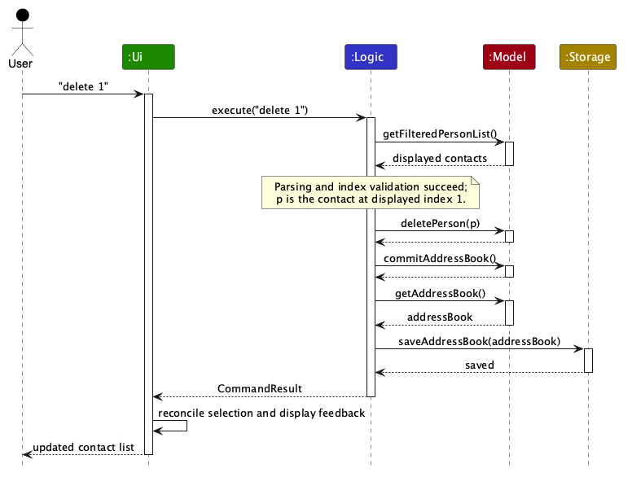</a>

Each of the four main components (also shown in the diagram above),

* defines an API interface: `Ui`, `Logic`, `Model`, or `Storage`.
* provides its functionality through a concrete `{Component Name}Manager` class that implements the corresponding API interface.

For example, the `Logic` component defines its API in `Logic.java` and implements it in `LogicManager.java`. Other components interact with a component through its interface rather than its concrete class, preventing them from coupling to that component's implementation, as illustrated in the following partial class diagram.

<a href="images/ComponentManagers.png"></a>

The sections below give more details of each component.

### UI component

**API:** [`Ui.java`](https://github.com/AY2627S1-CS2103T-F11-1/tp/blob/master/src/main/java/seedu/address/ui/Ui.java)

The UI class diagram focuses on the window parts and shared date tracker. The common `UiPart`
inheritance relationships are omitted; all visual parts listed below extend it.

<a href="images/UiClassDiagram.png">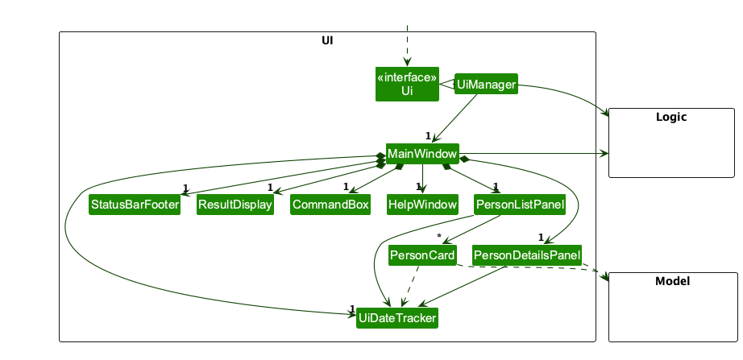</a>

The UI consists of a `MainWindow` and its parts, such as `CommandBox`, `ResultDisplay`, `PersonListPanel`, `PersonDetailsPanel`, and `StatusBarFooter`. All of these, including `MainWindow`, inherit from the abstract `UiPart` class, which captures common behavior among classes that represent visible GUI parts.

The `UI` component uses the JavaFX UI framework. The layouts of these UI parts are defined in matching `.fxml` files in `src/main/resources/view`. For example, [`MainWindow.fxml`](https://github.com/AY2627S1-CS2103T-F11-1/tp/blob/master/src/main/resources/view/MainWindow.fxml) specifies the layout of [`MainWindow`](https://github.com/AY2627S1-CS2103T-F11-1/tp/blob/master/src/main/java/seedu/address/ui/MainWindow.java).

The `UI` component,

* executes user commands using the `Logic` component.
* listens for changes to `Model` data so that the UI can be updated with the modified data.
* keeps a reference to the `Logic` component, because the `UI` relies on the `Logic` to execute commands.
* depends on some classes in the `Model` component because it displays `Person` objects from the model.

#### Contact details and selection

`MainWindow` displays `PersonListPanel` and `PersonDetailsPanel` side by side. Each `PersonCard` provides a compact contact summary, while the details panel displays the selected contact’s complete information.

The contact interface:

* observes `PersonListPanel#selectedPersonProperty()` to update the details panel when selection changes.
* uses `CommandSelectionChange` to preserve selection across edits and sorting, and clears selection when the contact is removed, filtered out, or after undo/redo.
* supports mouse selection, arrow-key navigation, and [`select INDEX`](#selecting-contacts-with-select-index). Escape returns focus to command input while preserving the draft.
* uses a shared `UiDateTracker` to refresh follow-up urgency indicators when the local date changes.
* supports independent scrolling and wrapping content so full contact details remain accessible.

### Logic component

**API:** [`Logic.java`](https://github.com/AY2627S1-CS2103T-F11-1/tp/blob/master/src/main/java/seedu/address/logic/Logic.java)

The partial Logic class diagram shows the parser entry point, command API, command results, and
selection-change metadata. Concrete commands use an `XYZCommand` placeholder; individual command
parsers are shown separately.

<a href="images/LogicClassDiagram.png">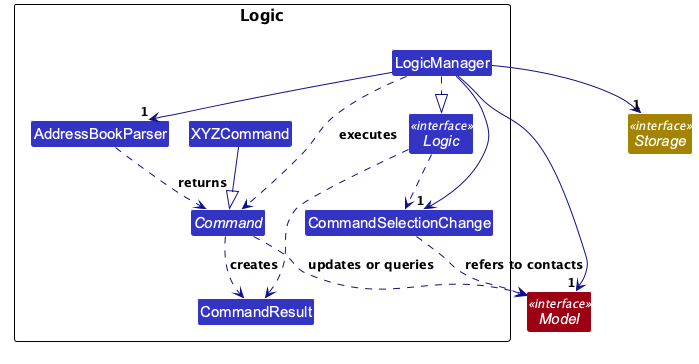</a>

The sequence diagram below illustrates the successful path through the `Logic` component
for `execute("delete 1")`, assuming displayed index 1 exists. Validation branches and
storage interactions are omitted; see [Deleting a contact](#deleting-a-contact) for those details.

<a href="images/DeleteSequenceDiagram.png">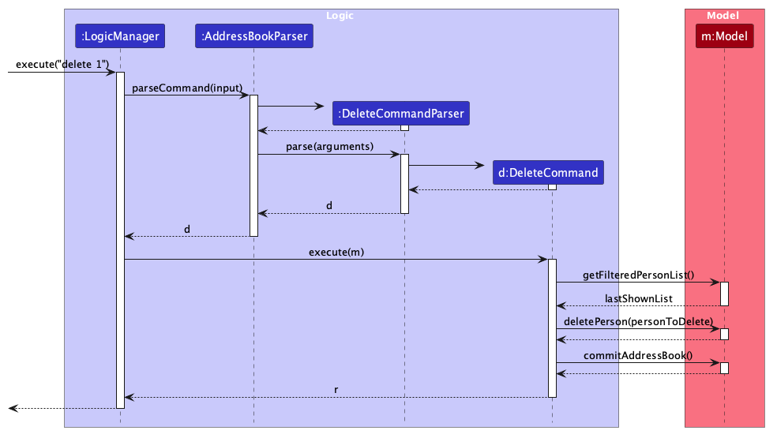</a>

How the `Logic` component works:

1. When `Logic` is called upon to execute a command, the command is passed to an `AddressBookParser` object, which in turn creates a parser that matches the command (e.g., `DeleteCommandParser`) and uses it to parse the command.
1. This results in a `Command` object (more precisely, an object of one of its subclasses e.g., `DeleteCommand`) which is executed by the `LogicManager`.
1. The command can communicate with the `Model` when it is executed (e.g. to delete a person).<br>
   Note that although this is shown as a single step in the diagram above for simplicity, the code can require several interactions between the command object and the `Model` to complete the operation.
1. The command returns a `CommandResult` to `LogicManager`. The manager records selection-change metadata and requests a save through `Storage` before returning a successful result to the UI.
   Parsing or command-validation failures skip the save step. Saving failures are reported as `CommandException`;
   their effects on contact data and history are described under [Persistence and failures](#persistence-and-failures).

The parser class diagram expands the parsing relationships. `ArgumentMultimap` stores values keyed
by `Prefix`; `ParserUtil` validates and constructs model values. The direct help-parsing path is omitted.

<a href="images/ParserClasses.png">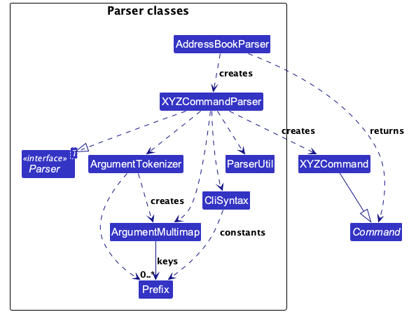</a>

How the parsing works:
* When called upon to parse a user command, the `AddressBookParser` class creates an `XYZCommandParser` (`XYZ` is a placeholder for the specific command name, e.g., `AddCommandParser`). The parser uses the other classes shown above to parse the user command and create an `XYZCommand` object (e.g., `AddCommand`). The `AddressBookParser` returns that object as a `Command` object.
* Command parsers such as `AddCommandParser`, `DeleteCommandParser`, and `ExitCommandParser` implement `Parser<T>`.
  Optional `help` arguments are parsed inside `AddressBookParser`. These paths return a `Command` for execution by `LogicManager`.

### Model component

**API:** [`Model.java`](https://github.com/AY2627S1-CS2103T-F11-1/tp/blob/master/src/main/java/seedu/address/model/Model.java)

The model class diagram shows the current contact data and `VersionedAddressBook` inheritance.
Snapshot internals and view collections are omitted; the latter are shown under
[Displayed contact views](#displayed-contact-views).

<a href="images/ModelClassDiagram.png">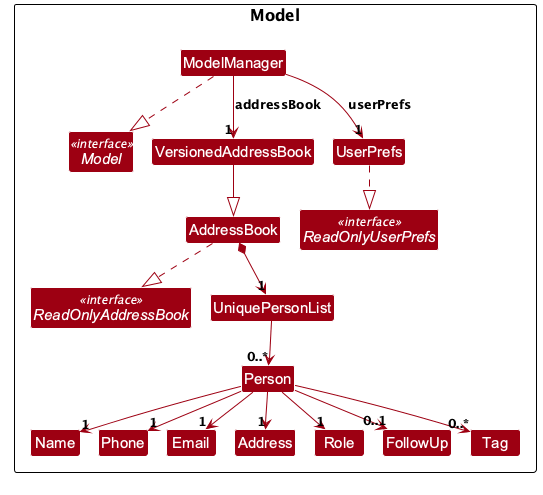</a>


The `Model` component,

* owns a `VersionedAddressBook`, which extends `AddressBook` with session history. Its `UniquePersonList` contains immutable `Person` objects.
  Each contact contains a `Name`, `Phone`, `Email`, `Address`, custom `Role`, a set of `Tag` objects, and an optional `FollowUp`.
  The history snapshots and pointer remain in memory; storage serializes the current contact data.
* maintains a `FilteredList<Person>` backed by the address book's contact list, and a `SortedList<Person>` wrapping that filtered view. The `getFilteredPersonList()` API exposes the filtered and sorted displayed list as an unmodifiable `ObservableList<Person>`. The UI and index-based commands use the same displayed ordering, while the underlying contact order remains unchanged.
* stores a `UserPrefs` object that represents the user’s preferences (currently, just the GUI settings). This is exposed to the outside as a `ReadOnlyUserPrefs` object.
* does not depend on any of the other three components (as the `Model` represents data entities of the domain, they should make sense on their own without depending on other components)

<div markdown="span" class="alert alert-info">:information_source: **Proposed alternative — not implemented:**
The diagram below illustrates a possible shared tag list in `AddressBook`, referenced by each `Person`.
`UniqueTagList` belongs to this alternative design and is not a v1.6 class. The current implementation
stores a tag set in each contact.<br>

<a href="images/BetterModelClassDiagram.png">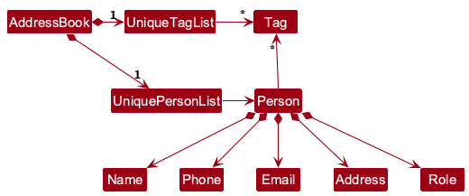</a>

</div>


### Storage component

**API:** [`Storage.java`](https://github.com/AY2627S1-CS2103T-F11-1/tp/blob/master/src/main/java/seedu/address/storage/Storage.java)

The storage class diagram shows delegation to the two JSON storage classes and the contact-data
adapters, including the optional follow-up adapter. Common file utilities are omitted.

<a href="images/StorageClassDiagram.png">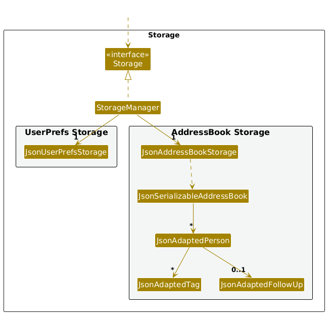</a>

The `Storage` component,
* can save both address book data and user preference data in JSON format, and read them back into corresponding objects.
* is implemented by `StorageManager`, which delegates the actual JSON file access to `JsonAddressBookStorage` and `JsonUserPrefsStorage` (one class per data file).
* can create timestamped backup copies of existing invalid contact-data and preference files during startup recovery.
  See [Startup loading and recovery](#startup-loading-and-recovery) for missing-file and failed-backup behaviour.
* writes through a temporary sibling file using `FileUtil#writeToFile`. Replacement requests an atomic move, with a non-atomic fallback when unsupported;
  see [Atomic file persistence](#atomic-file-persistence) for the guarantee boundary.
* depends on some classes in the `Model` component (because the `Storage` component's job is to save/retrieve objects that belong to the `Model`).

The startup sequence below shows an existing invalid contact-data file whose backup succeeds.
`JsonAddressBookStorage` delegates the copy to `FileUtil`; `MainApp` records a warning and creates an empty model.
Preference loading and failed backups are described under [Startup loading and recovery](#startup-loading-and-recovery).

<a href="images/BackupCorruptedFileSequenceDiagram.png">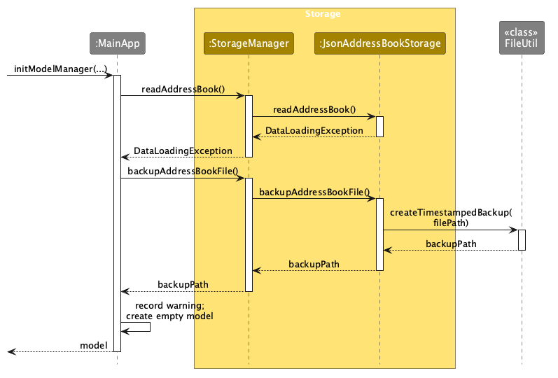</a>

### Common classes

Classes used by multiple components are in the `seedu.address.commons` package.

--------------------------------------------------------------------------------------------------------------------

## **Implementation**

This section describes the v1.6 implementation in the project working directory, ahead of its GitHub release.
Command entries follow the User Guide order. See [Shared mechanisms](#shared-mechanisms) for behaviour used across features.

### Manage contacts

#### Adding a contact: `add`

**Overview**

<a id="adding-a-contact"></a>

KeyBossWarriorsPro allows keyboard shop managers to add new contacts with an industry-specific `Role` (e.g., `Supplier`, `Employee`, `Partner`, `Customer`) and optional tags. Contact uniqueness is governed by communication identifiers (phone number and email address) rather than names.

See the [UG add entry](UserGuide.md#adding-a-contact-add) for syntax and examples.

**Relevant classes and data**

`AddCommandParser` constructs validated value objects and a `Person`; `AddCommand` uses the `Model` API to check uniqueness, insert the contact, and commit history.

**Parsing and validation**

Required prefixes are `n/`, `p/`, `e/`, `a/`, and `r/`, each supplied once. Tags may repeat. The parser rejects unknown prefixes and unexpected preamble text, then validates field values. See the shared [text rules](#contact-text-validation-formatting-and-searching) and [email and phone rules](#email-and-phone-validation).

**Execution and failure handling**

<a id="implementation-details"></a>

The sequence diagram shows successful parsing and execution of an `add` command. Field validation
and `CommandResult` construction are summarised; shared selection bookkeeping and the subsequent
contact-data save are omitted. The parameter names `phone` and `email` refer to the new contact's values.

<a href="images/AddSequenceDiagram.png">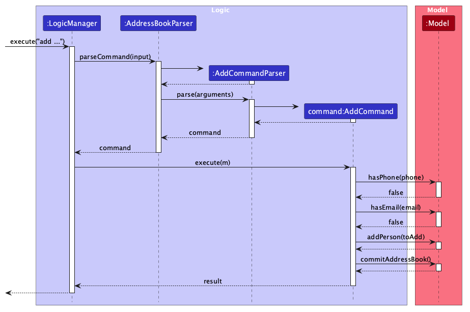</a>

Parsing and execution proceed as follows:

1. `LogicManager#execute()` calls `AddressBookParser#parseCommand()`.
2. `AddressBookParser` instantiates an `AddCommandParser` and invokes its `parse()` method.
3. `AddCommandParser` performs multi-tier input validation:
   * `ArgumentTokenizer#verifyNoUnrecognizedPrefixes()` ensures no unrecognized prefixes are supplied.
   * `ArgumentMultimap#verifyNoMissingPrefixesFor()` verifies that all compulsory prefixes (`n/`, `p/`, `e/`, `a/`, `r/`) are present.
   * Checks that the preamble is empty.
   * `ArgumentMultimap#verifyNoDuplicatePrefixesFor()` rejects repeated compulsory prefixes.
   * Parses individual fields into domain value objects (`Name`, `Phone`, `Email`, `Address`, `Role`, and a set of `Tag` objects) via `ParserUtil`.
4. A new `Person` entity `toAdd` is constructed, and `AddCommandParser` returns an `AddCommand` object (labelled `command`).
5. `LogicManager` executes `AddCommand#execute(Model)`.
6. `AddCommand` queries `Model` to verify uniqueness:
   * `Model#hasPhone(toAdd.getPhone())`
   * `Model#hasEmail(toAdd.getEmail())`
7. If uniqueness validation passes, `Model#addPerson(toAdd)` inserts the contact into `UniquePersonList`, and `Model#commitAddressBook()` saves the state snapshot into `VersionedAddressBook` to support undo/redo.
8. A `CommandResult` containing success feedback (labeled `result`) is returned to `LogicManager`.

<a id="execution-flow"></a>

The activity diagram shows the duplicate-identity branches inside `AddCommand#execute()`.
Parsing and the later save are outside its scope; each duplicate branch throws a `CommandException`.

<a href="images/AddCommandActivityDiagram.png">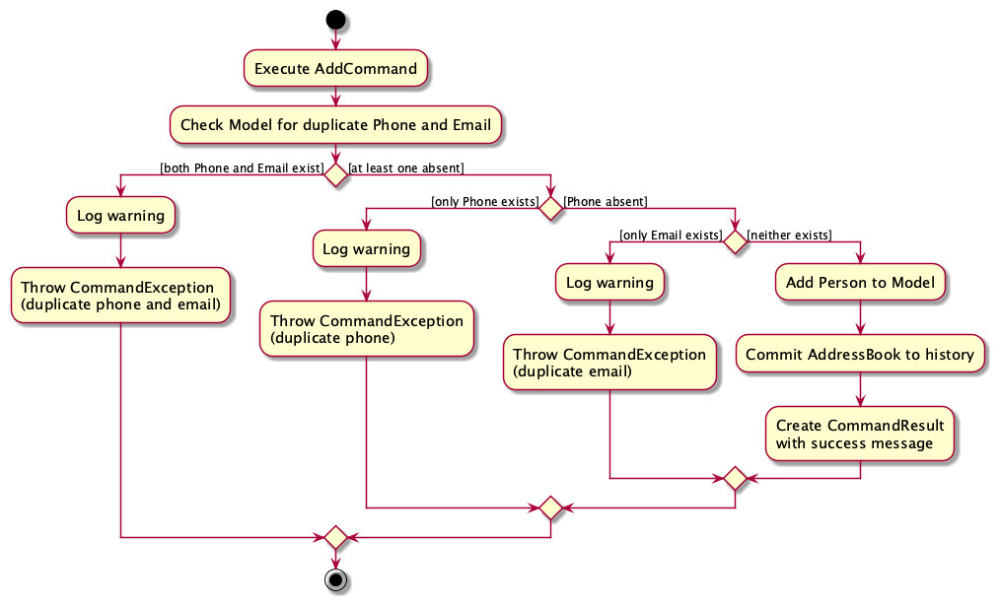</a>

`ModelManager#addPerson()` resets the filter to all contacts and retains sorting. `LogicManager` saves after execution; committed additions are rolled back if saving fails. See [Persistence and failures](#persistence-and-failures).

**Design considerations**

<a id="design-considerations"></a>

**Aspect: Contact identity and duplicate criteria**

* **Alternative 1 (current choice):** Identity uniqueness enforced independently on phone number and email address.
  * Pros: Matches realistic keyboard shop management where multiple contacts may share identical names (e.g., common customer names), but communication channels must remain unique. Provides targeted error feedback indicating whether the phone, email, or both clashed.
  * Cons: Requires multiple uniqueness checks against `UniquePersonList` before insertion.
* **Alternative 2:** Identity determined solely by contact name (baseline AB3).
  * Pros: Simpler lookup logic.
  * Cons: Disallows contacts sharing a name and allows duplicate phone numbers and email addresses to enter the pipeline undetected.

**Aspect: Phone number representation and future work**

The v1.6 implementation stores one `Phone` per contact and uses exact-string equality for the phone part of
duplicate detection. This simplifies comparison but excludes useful formats and multiple contact numbers.
Simply accepting separators would let `91234567` and `9123 4567` bypass a phone match.
Future support should define canonical comparison values, country-code and extension handling while
preserving display formatting. Multiple numbers would also require model, command and storage changes,
with duplicate checks across all numbers. These enhancements are outside the v1.6 implementation.

**Aspect: Input prefix validation**

* **Alternative 1 (current choice):** Strict rejection of unrecognized prefixes via `ArgumentTokenizer#verifyNoUnrecognizedPrefixes()`.
  * Pros: Prevents user typos from failing silently (e.g., mistyping `r/Supplier` as `w/Supplier` or supplying extra unsupported prefixes).
  * Cons: Requires maintaining explicit prefix whitelists for each command parser.
* **Alternative 2:** Permissive parsing where unrecognized prefixes are treated as part of preamble or ignored.
  * Pros: Simpler parsing code.
  * Cons: Causes silent input drops where mistyped fields are omitted without warning the user.

**Testing references**

`AddCommandParserTest` covers prefix and field validation; `AddCommandTest` and `AddCommandIntegrationTest` cover insertion and duplicate identifiers. `LogicManagerTest` covers persistence and rollback. See the [manual add tests](#adding-contacts-with-add).

#### Editing a contact: `edit`

**Overview**

<a id="adding-and-deleting-contact-tags"></a>

The `edit` command supports incremental tag changes using `edit INDEX [t/TAG_TO_ADD]... [dt/TAG_TO_DELETE]...`, alongside the existing contact fields. Additions preserve existing tags, and deletions remove only explicitly named tags. Parsing and command-validation failures leave all contact details and the displayed view unchanged. A successful edit displays all contacts;
if its subsequent save fails, contact data is rolled back and the restored view also displays all contacts, as described under [Persistence and failures](#persistence-and-failures).

The same command edits names, phone numbers, emails, addresses, and roles. See the [UG edit entry](UserGuide.md#editing-a-contact-edit).

**Relevant classes and data**

`EditCommandParser`, `EditCommand.EditPersonDescriptor`, and `EditCommand` separate supplied changes from the original immutable `Person`. Optional scalar fields and independent tag-operation sets describe the requested edit.

**Parsing and validation**

<a id="parsing-and-descriptor"></a>

`CliSyntax` defines `PREFIX_TAG` (`t/`) and `PREFIX_DELETE_TAG` (`dt/`). `EditCommandParser` recognizes both prefixes and permits repeated occurrences of each.

`EditCommand.EditPersonDescriptor` stores `tagsToAdd` and `tagsToDelete` separately. Each setter makes a defensive copy, and each getter returns an `Optional<Set<Tag>>` containing an unmodifiable set. An absent optional means that operation was not supplied. Both sets participate in the copy constructor, `isAnyFieldEdited()`, `equals()`, and `toString()`.

Before tokenizing the arguments, `EditCommandParser` calls
`ArgumentTokenizer#verifyNoUnrecognizedPrefixes()` with all supported edit
prefixes (`n/`, `p/`, `e/`, `a/`, `r/`, `t/`, and `dt/`). This prevents unknown
prefixes from being silently ignored.

The parser requires a displayed index, rejects duplicate scalar prefixes, and parses each supplied name, phone, email, address, or role into the descriptor. Omitted fields stay absent.

After parsing these fields, `EditCommandParser`:

1. Parses additions, then deletions, using `parseTagsForEdit()`. An absent prefix produces an empty optional. A supplied blank tag is rejected, including bare `t/` and `dt/`; neither clears all tags.
2. Uses `ParserUtil.parseTags()` to validate tag names and construct sets. `Tag` collapses repeated ordinary spaces, and its equality and hash code support case-insensitive comparison and deduplication.
3. Rejects any tag present in both sets. If several tags conflict, the first tag alphabetically, ignoring case, is reported using the spelling from the additions set.
4. Rejects a command with no fields or tag operations, or returns an `EditCommand` containing a copy of the descriptor.

Invalid tag values are rejected before add/delete conflicts. Missing deletions require the selected contact's current data and are checked during execution.

**Execution and failure handling**

<a id="execution-and-validation"></a>

`EditCommand#execute()` resolves the index against the currently displayed list. `createEditedPerson()` checks every requested deletion against the original contact's tags before constructing the edited contact. If any requested tag is absent, it throws a `CommandException`; if several are absent, the first alphabetically, ignoring case, is reported.

For valid deletions, `createEditedPerson()` copies the original tag set into a new `HashSet`, removes `tagsToDelete`, adds `tagsToAdd`, and constructs a new `Person` using the supplied or existing contact details. Adding an existing tag succeeds without creating a duplicate. Removing every tag requires explicitly listing every tag for deletion.

`execute()` then performs the existing duplicate phone and email checks. Only after all validation succeeds does it call `Model#setPerson()` and reset the displayed list with `PREDICATE_SHOW_ALL_PERSONS`. A validation failure therefore changes neither the original contact nor the displayed list, including when a command combines valid deletions, a missing deletion, additions, and other field edits.

Condition | Error constant | Exception
--------|------------------|----------
Blank value after `t/` or `dt/` | `EditCommand.MESSAGE_EMPTY_TAG` | `ParseException`
Invalid tag name | `Tag.MESSAGE_CONSTRAINTS` | `ParseException`
Same tag in both operations | `EditCommand.MESSAGE_TAG_CONFLICT` | `ParseException`
Requested deletion absent from the selected contact | `EditCommand.MESSAGE_TAG_NOT_FOUND` | `CommandException`

Supplied scalar fields replace existing values; omitted fields and the optional follow-up are preserved. Duplicate checks exclude the contact being edited. The valid replacement is committed once and saved through `LogicManager`. A storage failure follows [Persistence and failures](#persistence-and-failures).

**Design considerations**

Validate requested deletions and duplicate communication identifiers before replacing the original contact. This makes combined field and tag edits succeed as one change. The descriptor represents omitted fields explicitly, so ordinary field edits preserve existing tags and follow-ups.

**Testing references**

<a id="test-coverage-2"></a>

* `EditPersonDescriptorTest` covers independent tag operations, defensive copying, unmodifiable getters, equality, and string output.
* `EditCommandParserTest` covers recognised and unrecognised prefixes, repeated and empty values, invalid names, case-insensitive conflicts, and validation order.
* `EditCommandTest` covers additions, selective deletions, combined operations, filtered lists, existing tags, missing deletions, and preservation of the full model on failure. It also parses command text through `AddressBookParser` before execution to cover the acceptance examples and failure cases.
* `AddressBookParserTest` checks that an edit containing both operations is routed to the edit parser.

#### Managing a contact's follow-up: `followup`

**Overview**

<a id="contact-follow-up-management"></a>

Each `Person` owns an `Optional<FollowUp>`. A contact can have zero or one follow-up.

See the [UG followup entry](UserGuide.md#managing-a-contacts-follow-up-followup) for setting and clearing syntax.

**Relevant classes and data**

<a id="model-and-persistence"></a>

`FollowUp` stores an immutable `LocalDate` due date and description. Both fields are mandatory when a follow-up exists.
* Due dates accept past values and restrict years to `0000`–`9999`.
* Descriptions use `strip()` and `StringUtil.isValidText()` with the [shared text rules](#contact-text-validation-formatting-and-searching), preserving capitalisation and internal spacing. The limit is 200 UTF-16 code units (`String.length()`) after slash decoding and trimming.
* Equality and hashing include both fields, with case-sensitive description comparison.
  `FollowUp` has no back-reference to `Person`. The owning contact establishes the association, so changing contact details does not require updating a separate contact identifier.

`Person.equals()` and `hashCode()` include the optional follow-up. `isSamePerson()` retains its existing phone/email identity rules. Contact edits preserve the follow-up, while deleting a contact removes it.

`JsonAdaptedFollowUp` converts the nested JSON representation to and from the model. `JsonAdaptedPerson` treats missing or null follow-ups as absent, preserving compatibility with older files. A present follow-up with missing or invalid fields is rejected through the existing invalid-data handling mechanism.

**Parsing and validation**

`FollowUpCommandParser` recognises either `INDEX clear` or an index with exactly one `by/` and one `abt/` value. It rejects mixed forms, unknown or repeated prefixes, invalid dates, and invalid descriptions. Command execution checks the index against the displayed list; clearing also requires an existing follow-up.

**Execution and failure handling**

<a id="setting-and-clearing-follow-ups"></a>

`AddressBookParser` routes `followup` to `FollowUpCommandParser`, which returns one of two commands:
* `SetFollowUpCommand` creates or replaces a follow-up using a displayed contact index, due date, and description.
* `ClearFollowUpCommand` removes the selected contact's follow-up and rejects contacts without one.

The abstract `FollowUpCommand` holds the shared command word and usage message.

The parser uses the existing tokenizer and prefix-validation utilities. Both set fields are mandatory, duplicate and unknown prefixes are rejected, and clear syntax cannot be combined with set parameters. `ParserUtil.parseFollowUpDate()` enforces the exact four-digit-year format and rejects impossible calendar dates.

Each modifying command resolves the index against the currently displayed list, constructs a replacement `Person`, calls `Model#setPerson()`, and commits once to undo history. Other contact fields and the current filter are preserved. Failed validation does not modify data or history. Automatic persistence uses the existing logic/storage flow.

The sequence diagram shows successful parsing and execution of
`followup 1 by/2026-11-01 abt/Confirm quotation`, assuming displayed index 1 exists.
`oldPerson` is that contact and `updatedPerson` contains the replacement follow-up.
Field validation, result construction, selection bookkeeping, and the subsequent save are omitted.

<a href="images/FollowUpSequenceDiagram.png">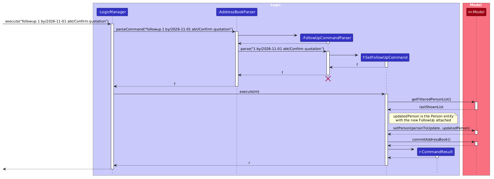</a>

Parsing and execution proceed as follows:

1. `LogicManager#execute()` calls `AddressBookParser#parseCommand()`.
2. `AddressBookParser` instantiates a `FollowUpCommandParser` and invokes its `parse()` method.
3. `FollowUpCommandParser` performs validation:
   * `ArgumentTokenizer#verifyNoUnrecognizedPrefixes()` ensures no unrecognized prefixes are supplied.
   * `ParserUtil#parseIndex()` parses the target contact index.
   * `ArgumentMultimap#verifyNoMissingPrefixesFor()` verifies that both `by/` and `abt/` prefixes are present.
   * `ArgumentMultimap#verifyNoDuplicatePrefixesFor()` rejects repeated prefixes.
   * `ParserUtil#parseFollowUpDate()` parses the due date into a `LocalDate`.
   * `ParserUtil#unescapeSlashes()` and `FollowUp#isValidDescription()` validate the description string.
4. A `SetFollowUpCommand` object (labelled `f`) containing the parsed index and new `FollowUp` is returned.
5. `LogicManager` executes `SetFollowUpCommand#execute(Model)`:
   * The command retrieves `personToUpdate` from the filtered list using the zero-based index.
   * `createPersonWithFollowUp()` constructs a replacement `Person` entity `updatedPerson` containing the new `FollowUp`.
   * `Model#setPerson(personToUpdate, updatedPerson)` updates the contact in the address book.
   * `Model#commitAddressBook()` saves the state to history for undo/redo support.
6. A `CommandResult` object (labeled `r`) containing the success feedback is created and returned to `LogicManager`.

Each valid change preserves the current comparator as well as the filter. Changing or clearing a follow-up can remove its contact from an active query, which also clears its selection. See [Follow-up urgency and details](#follow-up-urgency-and-details) and [Persistence and failures](#persistence-and-failures).

**Design considerations**

Store the follow-up inside its owning contact so replacement, deletion, persistence, and snapshots include it. The two concrete commands share `FollowUpCommand` usage constants but have distinct validation and execution responsibilities.

**Testing references**

<a id="test-coverage-3"></a>

* Model tests cover validation, normalization, equality, and contact identity.
* Storage tests cover JSON round trips, older records, and malformed nested follow-ups.
* Command tests cover creation, replacement, removal, filtered indexes, failure preservation, and undo/redo.
* Query tests use fixed clocks to verify date boundaries, time zones, filtering, and history preservation.
* Parser tests cover supported forms, invalid arguments, shared date parsing, and command routing.

#### Deleting a contact: `delete`

**Overview**

<a id="deleting-a-contact"></a>

`delete` removes one contact identified by its position in the current displayed list.
The [User Guide](UserGuide.md#deleting-a-contact-delete) describes its syntax and user-facing behaviour.
The [sequence diagram in the Logic component](#logic-component) shows the successful execution path.

**Relevant classes and data**

`DeleteCommandParser` produces an `Index`; `DeleteCommand` resolves it through `Model#getFilteredPersonList()`, then removes the `Person` from the underlying contact book.

**Parsing and validation**

<a id="parsing-and-validation-1"></a>

`AddressBookParser` delegates the arguments to `DeleteCommandParser#parse()`, which:

1. Trims the arguments and rejects empty input with `INDEX is required.`
2. Splits the trimmed input on whitespace and rejects multiple arguments with
   `delete accepts only one INDEX.`
3. Calls `ParserUtil#parseIndex()` to obtain an `Index`. The helper accepts integers from
   1 to `Integer.MAX_VALUE` and rejects zero, negative, nonnumeric, and overflowing values
   with `INDEX must be a whole number between 1 and 2147483647.`

These failures raise `ParseException` before execution. Parsing checks the numeric format
and supported range; whether the index refers to a displayed contact is checked by the command.

**Execution and failure handling**

<a id="execution-and-model-integration"></a>

`DeleteCommand#execute()`:

1. Retrieves `Model#getFilteredPersonList()`, which exposes the filtered and sorted displayed view.
2. Rejects an empty displayed list with `No contacts are currently displayed.`
3. Rejects an index beyond the displayed list using `Messages#getIndexOutOfRangeMessage()`.
   The feedback names the valid range, or the sole valid index when one contact is displayed.
4. Resolves the `Person` at the index, calls `Model#deletePerson()`, then calls
   `Model#commitAddressBook()` once to record the deletion.
5. Returns a `CommandResult` containing `Deleted contact: ...`, using `Messages#format()`
   to include the deleted contact's details and any follow-up.

The empty-list and out-of-range checks raise `CommandException`. All argument and index
validation failures preserve contact data, the displayed view, and undo/redo history.

The command removes the selected `Person` from the underlying contact list. It does not
reset the filter or comparator, so the remaining displayed contacts retain the active
search criteria and sort order. Displayed indices are recalculated automatically.
Deleting the contact currently selected in the UI clears its details; deleting another
contact preserves the selection, as described under [Contact details and selection](#contact-details-and-selection).

<a id="persistence-history-and-design-considerations"></a>

`LogicManager` saves the underlying address book after successful execution. If saving
fails, it rolls back the committed deletion, restores the contact data, and reports a
saving error. The restored view shows all contacts. The shared
[persistence and failure handling](#persistence-and-failures) section describes this mechanism.

**Design considerations**

* **Resolve against the displayed view:** Using the same view as the UI ensures that
  filtered and sorted indices identify the contact the user sees, rather than its stored position.
* **Commit after validation:** Rejected requests create no history entry. A successful deletion
  creates one undoable change and discards any remaining redo history. Undo restores the entire
  contact, including its follow-up; redo removes it again. Both operations show all contacts
  while retaining the active sort order.

**Testing references**

<a id="test-coverage-1"></a>

`DeleteCommandParserTest` covers missing, extra, and invalid arguments. `ParserUtilTest`
checks numeric boundaries and overflow. `DeleteCommandTest` covers empty and filtered lists,
out-of-range indices, follow-up restoration through undo/redo, and redo preservation after
failed validation. `LogicManagerTest` covers sorted deletion, history, and saving failures;
`MainWindowTest` covers selection updates after deletion.
The [manual delete tests](#deleting-contacts-with-delete) provide reproducible acceptance cases.

#### Clearing all contacts: `clear`

**Overview**

Removes every stored contact, including contacts hidden by a filter. See the [UG clear entry](UserGuide.md#clearing-all-contacts-clear).

**Relevant classes and data**

`ClearCommandParser` records whether extra arguments were supplied. `ClearCommand` replaces the model data with an empty `AddressBook`.

**Parsing and validation**

Extra non-blank text is recorded rather than rejected; it does not limit the deletion scope.

**Execution and failure handling**

If the underlying book is empty, return empty-book feedback without committing. Otherwise call `Model#setAddressBook(new AddressBook())`, commit once, and return success feedback with an ignored-arguments warning when needed. The view becomes empty and selection clears. A failed save rolls back the committed clear through the shared persistence path.

**Design considerations**

Check the underlying book rather than the displayed list so a filter never changes the scope of clearing. Treat an already-empty book as a no-op that preserves redo history.

**Testing references**

`ClearCommandParserTest`, `ClearCommandTest`, `UndoRedoIntegrationTest`, and `LogicManagerTest` cover extra arguments, empty-book behaviour, history, and rollback.

### Browse contacts

#### Listing all contacts: `list`

**Overview**

Restores the full displayed contact list. See the [UG list entry](UserGuide.md#listing-all-contacts-list).

**Relevant classes and data**

`ListCommandParser` records extra arguments; `ListCommand` changes the predicate through `Model#updateFilteredPersonList()`.

**Parsing and validation**

Whitespace-only arguments are treated as absent. Other extra text is accepted and produces a warning.

**Execution and failure handling**

Apply `PREDICATE_SHOW_ALL_PERSONS`, retain the sort comparator, and return normal or empty-book feedback based on the underlying contact count. Contact data and snapshot history are unchanged. `LogicManager` still attempts to save the current contact book after successful execution.

**Design considerations**

Reuse the filtered/sorted view pipeline rather than creating a separate list. See [Displayed contact views](#displayed-contact-views).

**Testing references**

`ListCommandParserTest`, `ListCommandTest`, and `LogicManagerTest` cover extra arguments, filtered views, empty books, and sorting preservation.

#### Locating contacts: `find`

**Overview**

<a id="finding-contacts"></a>

`find` filters the displayed contacts using either prefixed name, role, and tag phrases
or quick name search keywords. The [User Guide](UserGuide.md#locating-contacts-find)
describes both command formats and their user-facing behaviour.

**Relevant classes and data**

`FindCommandParser` constructs field-specific `Predicate<Person>` objects. `FindCommand` combines them and delegates view changes to the model; `Messages` formats the result count.

**Parsing and validation**

<a id="parsing-and-validation"></a>

`AddressBookParser#parseCommand()` delegates the arguments to `FindCommandParser#parse()`.
It uses the shared parser classes shown in the [Logic component](#logic-component) and
processes input in this order:

1. Reject empty or whitespace-only arguments, then reject prefixes other than `n/`, `r/`, and `t/`
   using `ArgumentTokenizer#verifyNoUnrecognizedPrefixes()`.
2. Tokenize the supported prefixes. `ArgumentMultimap#getAllValues()` retains every value
   for a repeated prefix, and tokenization trims leading and trailing whitespace.
   `normaliseSearchPhrases()` collapses repeated ordinary spaces within each value without
   splitting a phrase into separate keywords.
3. If any supported prefix is present, reject any blank value, then reject a nonempty
   preamble (unprefixed keywords before the first prefix). Create one predicate for each
   supplied field, containing all its search phrases.
4. Otherwise, if no supported prefixes are present, default to performing a quick name search: split the trimmed arguments on whitespace and
   create one `NameContainsKeywordsPredicate` containing the resulting keywords.

Invalid input raises a `ParseException` with a specific reason before a command is executed,
so the current filter and contact data are preserved. Prefix recognition follows the
shared syntax described under [Name, role, and tag formatting](#name-role-and-tag-formatting).

**Execution and failure handling**

<a id="predicate-composition-and-execution"></a>

`NameContainsKeywordsPredicate`, `RoleContainsKeywordsPredicate`, and
`TagContainsKeywordsPredicate` implement `Predicate<Person>`. They apply `StringUtil.normalizeCase()`
to field values and search criteria before using `String#contains()`. The helper maps each Unicode code point through
`Character.toUpperCase()` and then `Character.toLowerCase()`, supporting case equivalents such as `σ` and `ς`
without changing stored spelling or removing accents. The shared [text-processing explanation](#contact-text-validation-formatting-and-searching) describes validation and spacing.
Each predicate uses `anyMatch()` to implement OR within its field. The tag predicate
matches when at least one tag contains at least one supplied phrase; a contact with
no tags cannot satisfy a tag criterion.

`FindCommand#execute()` combines the field predicates using `allMatch()`, implementing
AND across fields. For example, `find n/ali n/bob r/supp` creates a name predicate for
`ali` OR `bob` and a role predicate for `supp`; both predicates must match the contact.
A contact appears once even when several criteria match it.

The command passes this combined predicate to `Model#updateFilteredPersonList()`.
`ModelManager` replaces the predicate on its `FilteredList<Person>`, which is backed by
the full contact list. Each search therefore replaces the previous filter. The wrapping
`SortedList<Person>` retains its comparator, so the selected sort order still applies.
The [model view diagram](#model-integration-persistence-and-history) shows these source
relationships. `Messages#getContactsFoundMessage()` uses the displayed list's size to
produce singular, plural, or `No contacts found.` feedback in a `CommandResult`.

Search changes only the displayed view and does not call `commitAddressBook()`, so it
neither creates an undo snapshot nor discards redo history. `LogicManager` still saves
the underlying address book after successful execution; the search filter is not serialized.

The activity diagram below summarises validation, both parsing paths, and filter execution.
It focuses on `FindCommandParser` and `FindCommand`.

<a href="images/FindActivityDiagram.png">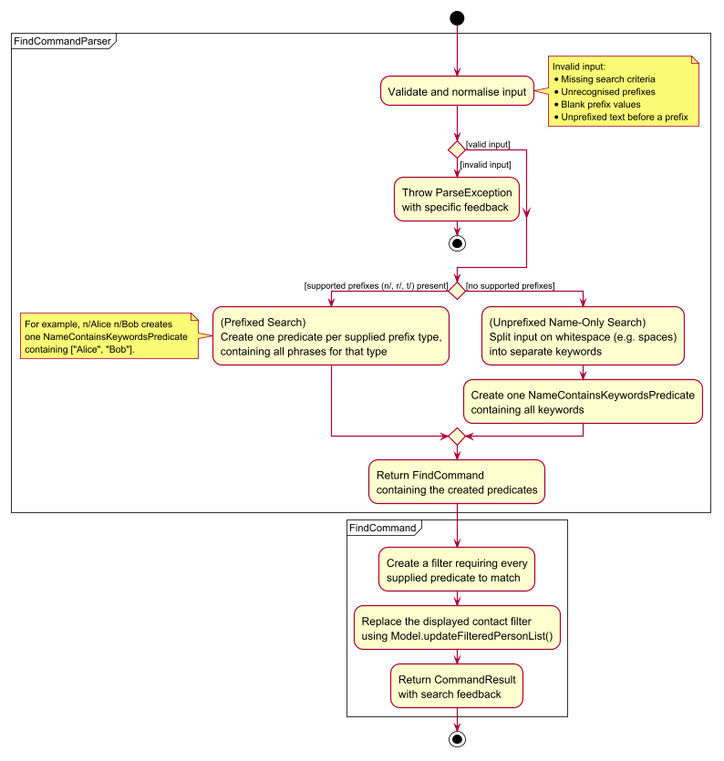</a>

The [find command sequence diagram](diagrams/FindSequenceDiagram.puml) shows the parsing
and execution of `find n/Alice n/Bob r/Supplier`. It focuses on search-specific interactions;
shared `LogicManager` bookkeeping and storage calls are omitted. The command holds two predicates: both `n/` values belong to one name predicate, while `r/` produces
a separate role predicate. The parser combines them in the returned `FindCommand`; predicate creation
and result construction are omitted from the sequence diagram. Quick name search follows the same execution flow, using one
`NameContainsKeywordsPredicate` containing all whitespace-separated keywords.

<a href="images/FindSequenceDiagram.png">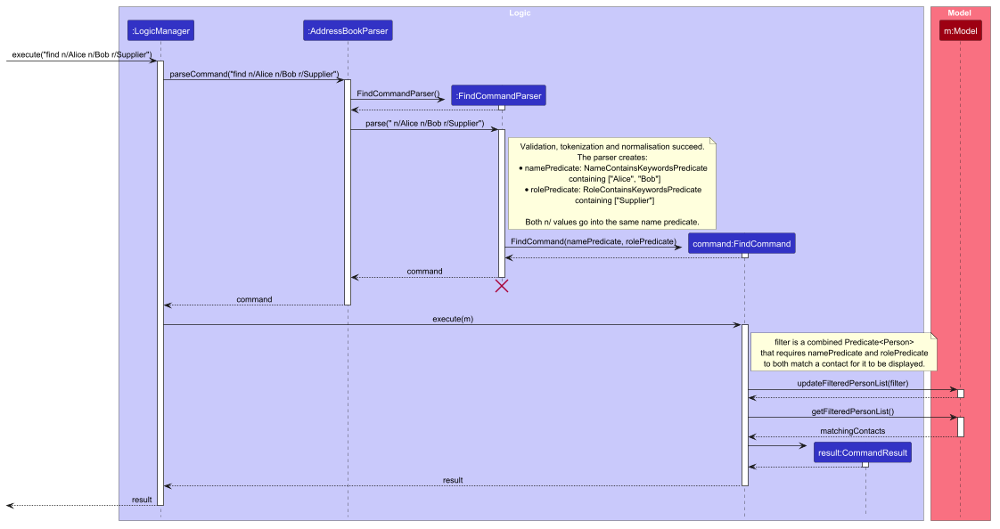</a>

**Design considerations**

<a id="design-considerations-1"></a>

* **Separate field predicates:** Keeping OR matching inside each predicate and AND matching
  in `FindCommand` allows alternatives within a field while narrowing across fields. Both
  search formats reuse the name predicate.
* **Accept partial phrases:** Search criteria do not pass through `ParserUtil`'s whole-field
  validation. This allows useful substrings, including partial phrases containing punctuation,
  while the parser still enforces command syntax and nonblank values.

**Testing references**

<a id="test-coverage"></a>

`FindCommandParserTest` covers both formats, multiword phrases, repeated prefixes and spaces,
and the missing-criteria, blank-value, mixed-format, and unsupported-prefix errors.
`NameContainsKeywordsPredicateTest`, `RoleContainsKeywordsPredicateTest`, and
`TagContainsKeywordsPredicateTest` cover field-specific substring and case matching. `FindCommandTest` checks combined predicates and overlapping matches.
`LogicManagerTest` covers adding and searching normalised fields, OR/AND composition,
restoring all contacts with `list`, and preserving sorting across searches.
The [manual find tests](#finding-contacts-with-find) provide a reproducible dataset and
expected results for these user-visible behaviours.

#### Sorting all contacts: `sort`

**Overview**

<a id="sorting-contacts"></a>

The sort feature changes the displayed contact order without rearranging the address book's underlying contact list.
It supports case-insensitive, ascending ordering by name, role, or both, with field order determining priority.

See the [UG sort entry](UserGuide.md#sorting-all-contacts-sort), including `sort clear`.

**Relevant classes and data**

`SortCommandParser` selects an ordered list of `SortField` values or the clearing mode. `SortCommand` builds comparators and changes the model view; [Displayed contact views](#displayed-contact-views) describes the source relationships.

**Parsing and validation**

<a id="parsing-and-validation-2"></a>

`AddressBookParser` delegates sort arguments to `SortCommandParser`. Empty or
whitespace-only arguments default to `SortField.NAME`. Otherwise, the parser
accepts standalone `n/` and `r/` tokens in the supplied priority order, or the
standalone `clear` argument. Duplicate fields, values attached to prefixes,
unsupported tokens, and combinations such as `clear n/` produce specific
`ParseException` messages before any model state changes.

`SortCommand` independently requires one or two distinct, non-null fields and makes an immutable defensive copy of
the supplied list. This preserves field priority even if the caller later modifies its original list.

**Execution and failure handling**

For field-based sorting, the following comparator path applies.

<a id="comparator-construction-and-execution"></a>

`SortCommand#execute()`:

1. Creates a comparator for the first field using `Comparator.comparing()` with `String.CASE_INSENSITIVE_ORDER`.
2. Chains any subsequent field using `thenComparing()`, so it breaks ties in the preceding field.
3. Clears the active filter using `Model#updateFilteredPersonList(PREDICATE_SHOW_ALL_PERSONS)`.
4. Applies the comparator using `Model#updateSortedPersonList()`.
5. Returns a `CommandResult`, selecting empty-address-book feedback when the underlying contact list is empty.

The empty-address-book check affects feedback only: sorting is still applied so
contacts added afterwards follow the selected order. The user receives an
informational message instead of an error. An empty search result does not
trigger this feedback if the underlying address book contains contacts.
Executing another sort command replaces the previous comparator rather than
adding to the previous sorting criteria.

`sort clear` takes an earlier branch: it clears the filter, sets the comparator to `null`, and returns clearing feedback. Both modes show all contacts and retain stored insertion order. Sorting is a view change and creates no snapshot; the comparator is not persisted.

**Design considerations**

<a id="design-considerations-2"></a>

**Aspect: Sorting a displayed view rather than the stored list**

* **Current choice:** Wrap the filtered list in a `SortedList`. This separates presentation order from stored data
  and undo history, keeps displayed indices consistent, and automatically maintains ordering after contact changes.
* **Alternative:** Reorder the underlying contact list. This would change the order saved to storage and require
  additional handling to separate sorting from contact-data history and maintain ordering after later changes.

**Aspect: Sorting all contacts rather than only search results**

Sort explicitly resets the filter so it provides a way to browse the complete address book in a chosen order.
Filtering remains independent: users can run find afterwards to narrow the sorted view without losing its comparator.

**Testing references**

<a id="test-coverage-4"></a>

* `SortCommandParserTest` covers default sorting, field priority, whitespace,
  `clear`, invalid arguments, and invalid combinations of `clear` with sorting
  fields.
* `SortCommandTest` covers constructor validation, defensive copying, comparator
  priority, case handling, empty and single-contact lists, filter clearing,
  replacement sorting, clearing the sort, restoring insertion order, and sorting
  contacts added after an empty-book sort.
* `ModelManagerTest` covers displayed ordering, chained comparators, filtering, live add/edit/delete updates through
  an existing list reference, and model equality.
* `AddressBookParserTest` checks command dispatch to the sort parser.
* `LogicManagerTest` exercises complete command sequences involving displayed indices, filtering, editing,
  deletion, undo/redo, invalid sorts, equal-key contact identities, and preservation of saved contact order.

#### Selecting a contact: `select`

**Overview**

<a id="selecting-contacts-with-select-index"></a>

Selects a contact by its displayed index and requests its full details. See the [UG select entry](UserGuide.md#selecting-a-contact-select).

**Relevant classes and data**

`SelectCommandParser` constructs an indexed `SelectCommand`. The command resolves the chosen immutable `Person` and returns its exact reference in `CommandResult`. The [shared reconciliation mechanism](#contact-selection-reconciliation) applies the request through `LogicManager` and the UI.

**Parsing and validation**

`AddressBookParser` dispatches `select` to `SelectCommandParser`, which accepts exactly one positive integer using
`ParserUtil.parseIndex()`. Whether that index exists in the current view is checked during execution.

Condition | Handling
----------|---------
Missing index | `ParseException` with `SelectCommand.MESSAGE_INDEX_REQUIRED`.
Extra arguments | `ParseException` with `SelectCommand.MESSAGE_EXTRA_ARGUMENTS`.
Malformed, non-positive, or overflowing integer | `ParseException` with `ParserUtil.MESSAGE_INVALID_INDEX`.
Empty displayed list | `CommandException` with `SelectCommand.MESSAGE_NO_CONTACTS_TO_SELECT`.
Index outside the current view | `CommandException` with the range message, or the single-valid-index variant.

**Execution and failure handling**

`SelectCommand#execute()` resolves the index against the current filtered and sorted `Model#getFilteredPersonList()`.
It returns feedback and the exact contact reference without changing data, filter predicates, comparators, or history.
It does not call `commitAddressBook()`.

The existing automatic saving flow still runs after selection. Because the explicit request is recorded before
saving, a storage exception does not discard a valid selection. Rejected parsing or index validation leaves no
new request, so the UI preserves the previous selection. `help select` returns usage with no selection request;
it neither executes a selection nor opens the full Help window.

An explicit request highlights and reveals the target while keeping command-input focus. Repeated selection of the same object retains the details panel reading position.

**Design considerations**

Use the existing command-result and selection pipeline rather than storing selected state in the model or saved JSON. Object identity allows two contacts with equal names to remain distinct and supports replacement tracking when editable identity fields change.

**Testing references**

Tests cover the command through the real parser, logic, storage, and JavaFX UI pipeline:

* `SelectCommandParserTest` and `AddressBookParserTest`: argument validation, integer boundaries, and dispatch.
* `SelectCommandTest`: exact targets, filtered/sorted indexes, unchanged model state, and invalid displayed indexes.
* `CommandResultTest` and `CommandSelectionChangeTest`: request defaults, value methods, identity, and reset precedence.
* `LogicManagerTest`: request forwarding/reset, unchanged saved contact JSON, undo/redo preservation, and storage failures.
  A package-private parser-injection constructor also supports isolated command-result tests.
* `MainWindowTest`: focus, duplicate names, invalid-input recovery, empty results, edits/deletion after selection,
  saving errors, off-screen and newly added rows, and repeated selection retaining the details scroll position.
  Visibility checks wait for the real viewport row rather than a fixed number of frames, without issuing extra scrolls.
  Regression tests cover dropped index-scroll events, stale endpoint offsets, transient visibility, and cancellation
  after another command, selection, or manual scroll. Failures report the target/selected indexes and visible row bounds.
* `HelpCommandTest` and `HelpWindowTest`: targeted usage, supported-command guidance, browse-category placement,
  formatting, and absence of a selection side effect.

#### Viewing contacts with follow-ups: `followups`

**Overview**

Queries contacts with pending follow-ups without changing their data. See the [UG followups entry](UserGuide.md#viewing-contacts-with-follow-ups-followups).

**Relevant classes and data**

`FollowUpsCommandParser` creates a `FollowUpsCommand` through its `all()`, `overdue()`, or `dueBy()` factory. The command owns its mode, optional cutoff, and injectable `Clock`; it reads the optional `FollowUp` on each contact.

**Parsing and validation**

Accept no arguments, the standalone `overdue` keyword, or one `by/` cutoff. Modes cannot be combined. The parser rejects extra tokens, repeated or unsupported prefixes, and invalid dates.

**Execution and failure handling**

<a id="querying-follow-ups"></a>

`FollowUpsCommandParser` supports an empty query, `overdue`, or a single `by/` date cutoff. These map to the `all()`, `overdue()`, and `dueBy()` factories of `FollowUpsCommand`.
The command replaces the model's current contact predicate, searching the entire address book:

* `ALL` accepts contacts with a follow-up.
* `OVERDUE` accepts follow-ups due strictly before today.
* `BY_DATE` accepts follow-ups due on or before the cutoff.

The overdue query uses an injectable `Clock`. Today's date is captured when the command executes and remains fixed in the predicate until the query is rerun.
Results retain the comparator on the model's wrapping `SortedList<Person>`; without a comparator they follow insertion order.
Queries replace the filter over the complete contact list, so an earlier search does not restrict their input.

Queries do not commit snapshots or alter contact data. An empty result displays `No follow-ups found.`

**Design considerations**

Capture today once when executing an overdue query so membership uses one date throughout that query. UI badge refresh has a separate lifetime and does not silently rerun the filter. Replacing only the predicate preserves sorting and avoids creating undo snapshots.

**Testing references**

`FollowUpsCommandParserTest` checks modes and invalid input; `FollowUpsCommandTest` uses fixed clocks for date boundaries, zones, filtering, and history preservation. See the [manual follow-up tests](#managing-and-viewing-follow-ups).

### Undo and redo

**Shared snapshot mechanism**

<a id="undoredo-feature"></a>

**Relevant classes and data**

<a id="implementation-1"></a>

The implemented undo/redo mechanism is facilitated by `VersionedAddressBook`. It extends `AddressBook` with an undo/redo history, stored internally as an `addressBookStateList` and `currentStatePointer`. Additionally, it implements the following operations:

* `VersionedAddressBook#commit()` — Saves the current address book state in its history.
* `VersionedAddressBook#undo()` — Restores the previous address book state from its history.
* `VersionedAddressBook#redo()` — Restores a previously undone address book state from its history.
* `VersionedAddressBook#canUndo()` — Indicates whether a previous snapshot exists.
* `VersionedAddressBook#canRedo()` — Indicates whether a next snapshot exists.
* `VersionedAddressBook#rollbackCommit()` — Discards a newly committed state after a failed save and reinstates the redo states that commit displaced.

`ModelManager` delegates these operations through the `Model` API: `commitAddressBook()`, `undoAddressBook()`, `redoAddressBook()`,
`canUndoAddressBook()`, `canRedoAddressBook()`, and `rollbackAddressBook()`. Undo, redo, and rollback reset the displayed filter to show all contacts;
they retain the current sort comparator. History is cleared when the application closes.

`AddCommand`, `DeleteCommand`, `EditCommand`, `ClearCommand`, `SetFollowUpCommand` and `ClearFollowUpCommand` commit once after successful execution, immediately before returning their result. Validation failures do not commit. A valid edit or follow-up replacement can commit even when its result equals the previous data. Clearing an already-empty book is an exception:
it returns feedback without committing, so any available redo history is preserved.

`UndoCommandParser` and `RedoCommandParser` accept empty or whitespace-only arguments and reject additional arguments. Their commands check availability before requesting the corresponding model operation. Undo and redo do not create new snapshots.

The underlying `VersionedAddressBook` also checks its boundaries and throws `NoUndoableStateException` or `NoRedoableStateException` when navigation is unavailable.

The following example shows how snapshots and the integer history pointer change. Command arguments
are abbreviated for illustration; each addition is assumed valid with unique phone and email values.
The pointer arrows identify history entries, rather than Java object references.

Step 1. On first launch, `VersionedAddressBook` contains one snapshot of the sample contact book.
`currentStatePointer` is 0, selecting that initial snapshot.

<a href="images/UndoRedoState0.png">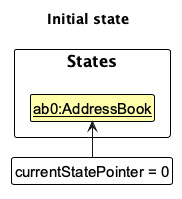</a>

Step 2. The user executes `delete 5` command to delete the 5th person in the address book. The `delete` command calls `Model#commitAddressBook()`, causing the modified state of the address book after the `delete 5` command executes to be saved in the `addressBookStateList`, and the `currentStatePointer` is shifted to the newly inserted address book state.

<a href="images/UndoRedoState1.png">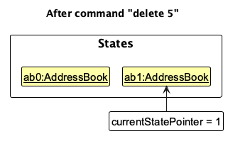</a>

Step 3. The user executes `add n/David …​` to add a new person. The `add` command also calls `Model#commitAddressBook()`, causing another modified address book state to be saved into the `addressBookStateList`.

<a href="images/UndoRedoState2.png">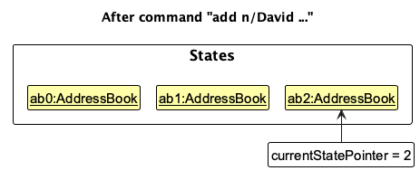</a>

<div markdown="span" class="alert alert-info">:information_source: **Note:** Parsing and command-validation
failures do not commit a snapshot. A later save failure is handled separately: a newly committed state
is rolled back, while an applied undo/redo remains in memory. See [Persistence and failures](#persistence-and-failures).
</div>

Step 4. The user now decides that adding the person was a mistake, and decides to undo that action by executing the `undo` command. The `undo` command will call `Model#undoAddressBook()`, which will shift the `currentStatePointer` once to the left, pointing it to the previous address book state, and restores the address book to that state.

<a href="images/UndoRedoState3.png">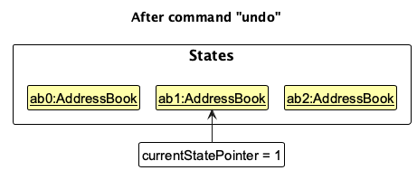</a>

<div markdown="span" class="alert alert-info">:information_source: **Note:** If the `currentStatePointer` is at index 0, pointing to the initial AddressBook state, then there are no previous AddressBook states to restore. The `undo` command uses `Model#canUndoAddressBook()` to check if this is the case. If so, it will return an error to the user rather
than attempting to perform the undo.

</div>

The Logic sequence shows a successful `undo`, including `UndoCommandParser` and the availability
check. Empty arguments are accepted; unavailable history and extra arguments are error paths omitted
from the diagram. `CommandResult` construction is summarised; selection bookkeeping and the later save are omitted.

<a href="images/UndoSequenceDiagram-Logic.png">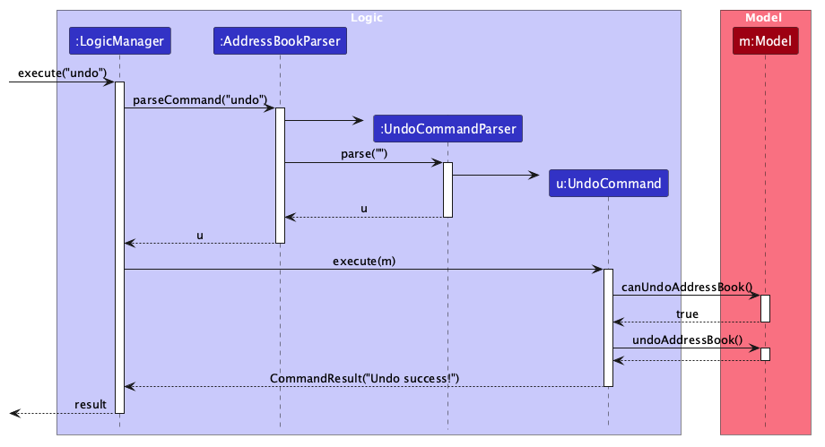</a>

The Model sequence expands the successful restore: decrement the pointer, reset contact data from
the selected snapshot, then show all contacts. Availability has already been checked; the sort comparator
is retained. Snapshot access is abbreviated in the message label.

<a href="images/UndoSequenceDiagram-Model.png">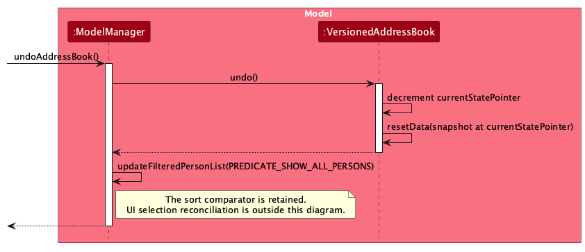</a>

The `redo` command does the opposite — it calls `Model#redoAddressBook()`, which shifts the `currentStatePointer` once to the right, pointing to the previously undone state, and restores the address book to that state.

<div markdown="span" class="alert alert-info">:information_source: **Note:** If the `currentStatePointer` is at index `addressBookStateList.size() - 1`, pointing to the latest address book state, then there are no undone AddressBook states to restore. The `redo` command uses `Model#canRedoAddressBook()` to check if this is the case. If so, it will return an error to the user rather than attempting to perform the redo.

</div>

Step 5. The user then decides to execute the command `list`. Commands that do not modify the address book, such as `list`, do not call `Model#commitAddressBook()`, `Model#undoAddressBook()` or `Model#redoAddressBook()`. Thus, the `addressBookStateList` remains unchanged.

<a href="images/UndoRedoState4.png">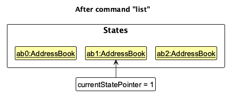</a>

Step 6. The user executes `clear`, which calls `Model#commitAddressBook()`. Since the `currentStatePointer` is not pointing at the end of the `addressBookStateList`, all address book states after the `currentStatePointer` will be purged. Reason: It no longer makes sense to redo the `add n/David …​` command. This is the behavior that most modern desktop applications follow.

<div markdown="span" class="alert alert-info">:information_source: **Note:** If the address book is already empty, `clear` does not modify contact data or invoke `Model#commitAddressBook()`, keeping the existing `addressBookStateList` and redo history intact.
</div>

<a href="images/UndoRedoState5.png">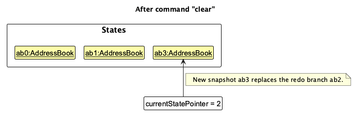</a>

The activity diagram expands `VersionedAddressBook#commit()`: retain displaced redo states for
possible save-failure rollback, replace that branch with a new snapshot, and advance the pointer.
It does not describe undo, redo, or commands that do not commit.

<a href="images/CommitActivityDiagram.png">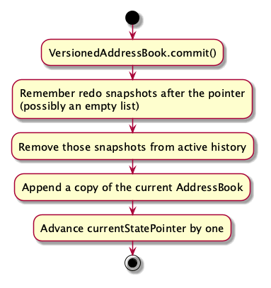</a>

**Design considerations**

<a id="design-considerations-3"></a>

**Aspect: How undo & redo execute:**

* **Alternative 1 (current choice):** Saves the entire address book.
  * Pros: Easy to implement.
  * Cons: May have performance issues in terms of memory usage.

* **Alternative 2:** Individual command knows how to undo/redo by
  itself.
  * Pros: Will use less memory (e.g. for `delete`, just save the person being deleted).
  * Cons: We must ensure that the implementation of each individual command is correct.

#### Undoing a change: `undo`

**Overview**

Restores the previous contact-data snapshot. See the [UG undo entry](UserGuide.md#undoing-a-change-undo).

**Relevant classes and data**

`UndoCommandParser` and `UndoCommand` use `Model#canUndoAddressBook()` and `Model#undoAddressBook()`. The snapshot mechanism described above owns the history list and pointer.

**Parsing and validation**

The parser accepts empty or whitespace-only arguments and rejects extra text. The command reports `No more commands to undo!` if no earlier snapshot exists.

**Execution and failure handling**

`ModelManager` delegates to `VersionedAddressBook#undo()`, then displays all contacts without changing the comparator. Successful execution clears selection. `LogicManager` saves the restored data; a failed save leaves the undo and history-pointer movement in memory. See [Persistence and failures](#persistence-and-failures).

**Design considerations**

Restore snapshots rather than re-executing inverse commands. Each undo is one history step and does not append another snapshot.

**Testing references**

`UndoCommandParserTest`, `UndoCommandTest`, `VersionedAddressBookTest`, and `UndoRedoIntegrationTest` cover boundaries, restored states, and multi-step history. `LogicManagerTest` covers save failures. See the [manual undo/redo tests](#undoing-and-redoing-commands-with-undo-and-redo).

#### Redoing a change: `redo`

**Overview**

Restores the next available snapshot after an undo. See the [UG redo entry](UserGuide.md#redoing-a-change-redo).

**Relevant classes and data**

`RedoCommandParser` and `RedoCommand` use `Model#canRedoAddressBook()` and `Model#redoAddressBook()` over the same history.

**Parsing and validation**

The parser accepts empty or whitespace-only arguments and rejects extra text. The command reports `No more commands to redo!` when no next snapshot remains.

**Execution and failure handling**

`VersionedAddressBook#redo()` moves the pointer forward and restores that snapshot. The model displays all contacts, preserves sorting, and the UI clears selection. A new successful commit discards the available redo branch; validation failures and view-only commands preserve it. A failed save after redo leaves its in-memory result applied.

**Design considerations**

Replay the recorded snapshot rather than rerunning the original command, avoiding dependence on indexes that may identify different contacts in the current view.

**Testing references**

`RedoCommandParserTest`, `RedoCommandTest`, `VersionedAddressBookTest`, and `UndoRedoIntegrationTest` cover availability, branch invalidation, and restored contact fields. See the [manual undo/redo tests](#undoing-and-redoing-commands-with-undo-and-redo).

### Application

#### Viewing help: `help`

**Overview**

<a id="command-specific-help"></a>

Opens full help or displays command-specific usage. See the [UG help entry](UserGuide.md#viewing-help-help).

**Relevant classes and data**

`AddressBookParser` creates `HelpCommand`; `COMMAND_USAGE_BY_NAME` supplies targeted text. `CommandResult#isShowHelp()` controls whether `MainWindow` opens `HelpWindow`.

**Parsing and validation**

Optional help arguments are parsed directly in `AddressBookParser`. No target requests full help; one token becomes a target command name; multiple tokens are rejected. Unsupported single-token targets produce guidance during execution.

**Execution and failure handling**

`AddressBookParser` parses the optional command name after `help` and creates a `HelpCommand`. Bare `help` opens the full help window, while `help COMMAND` displays usage for a supported command in the result area.

The activity diagram shows help response selection and UI handling. Argument-validation failures
and the shared save request are omitted. If parsing or saving fails, the requested Help window is not opened.

<a href="images/HelpActivityDiagram.png">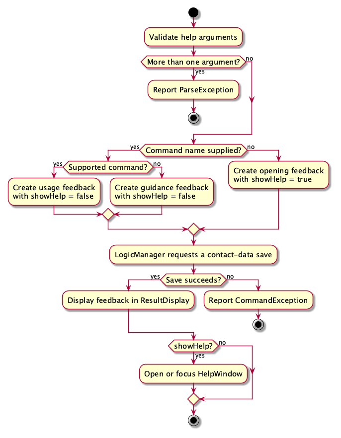</a>

* Bare `help` returns opening feedback in a `CommandResult` with `showHelp` set to `true`.
* For a supported target, `HelpCommand` retrieves the command's `COMMAND_USAGE` from `COMMAND_USAGE_BY_NAME` and returns it as feedback with `showHelp` set to `false`.
* An unsupported target returns guidance with `showHelp` set to `false`. The supported command names in the guidance are derived from the same map.

`MainWindow` displays the feedback in `ResultDisplay` and opens or focuses `HelpWindow` only when `showHelp` is `true`. The activity diagram assumes at most one command target; input with multiple target words is rejected during parsing, and the parser error is displayed in the result area.

**Help window categories**

<a id="help-window-categories"></a>

`HelpWindow.HELP_MESSAGE` groups commands by user task:

| Category | Commands |
| --- | --- |
| Manage contacts | `add`, `edit`, `delete`, `clear`, `followup` |
| Browse contacts | `list`, `find`, `sort`, `select`, `followups` |
| Undo and redo | `undo`, `redo` |
| Application | `help`, `exit` |

`select` belongs under Browse contacts because it changes only the displayed selection. `followup` belongs under Manage contacts because it changes contact data. `followups` belongs under Browse contacts because it filters the displayed contacts without modifying their data.

When adding a user command, define its help constants, register its `COMMAND_USAGE` in `HelpCommand.COMMAND_USAGE_BY_NAME`, and add it to the appropriate category in `HelpWindow.HELP_MESSAGE`. Update `HelpCommandTest` and `HelpWindowTest` to cover targeted help, category placement, and formatting. Update parser tests when usage text changes, and keep the User Guide's command list, categories, and help screenshot consistent with the implementation.

**Design considerations**

<a id="help-text-conventions"></a>

Each user command defines its help text in the command class. `COMMAND_USAGE` is the shared source for both command-specific help and the full help window. `HelpWindow.formatCommandUsage` converts the command name into an uppercase heading while preserving the rest of the usage text.

* Use `COMMAND_WORD`, `COMMAND_DESCRIPTION`, and `COMMAND_USAGE` for help content.
* Commands without parameters define `COMMAND_USAGE` as `COMMAND_WORD + ": " + COMMAND_DESCRIPTION`. Do not add parameter or example fields for these commands.
* Most commands with required or optional parameters define `COMMAND_PARAMETERS` and `COMMAND_EXAMPLE`.
  Their `COMMAND_USAGE` combines the description with `Parameters:` and `Example:` lines. Commands
  with optional arguments, such as `help`, `sort`, and `followups`, follow this format even though
  they can run without arguments. `find` instead uses `COMMAND_FORMATS` and `COMMAND_EXAMPLES`
  with separate `Formats:` and `Examples:` blocks to distinguish prefixed search from quick name search.
* Use the `MESSAGE_` prefix for result feedback and errors, such as `MESSAGE_SUCCESS` and `MESSAGE_FAILURE`. Parsers that include usage instructions in an error should reference `COMMAND_USAGE` rather than duplicate its text.

**Testing references**

`HelpCommandTest` and `HelpWindowTest` cover target lookup, guidance, grouping, and formatting. `AddressBookParserTest` covers argument handling. See the [manual help tests](#viewing-contextual-help-with-help).

#### Exiting the program: `exit`

**Overview**

Requests application shutdown after a short closing message. See the [UG exit entry](UserGuide.md#exiting-the-program-exit).

**Relevant classes and data**

`ExitCommandParser` creates `ExitCommand`. Its `CommandResult#isExit()` flag is consumed by `MainWindow`, while `MainApp#stop()` saves preferences.

**Parsing and validation**

The parser records extra non-blank arguments. The command accepts them and chooses feedback explaining that they are ignored.

**Execution and failure handling**

`ExitCommand` returns an exit flag without changing contacts. After the normal save step succeeds, `MainWindow` disables command input, waits one second, captures window settings, and hides the application windows. If that save fails, the result does not reach the closing handler and the application remains open. Session history is not serialized.

**Design considerations**

Keep command parsing and feedback separate from JavaFX window management. The result flag allows the UI to control the closing delay and preference capture.

**Testing references**

`ExitCommandParserTest`, `ExitCommandTest`, and the UI shutdown checks in `MainWindowTest` cover argument handling, result flags, and closing behaviour.

### Shared mechanisms

#### Contact text validation, formatting, and searching

`Name`, `Role`, `Tag` and `Address` validate trimmed input with `StringUtil.isValidText()`, rejecting
blank/invisible-only values, ISO controls and Unicode line/paragraph separators. Names, roles and tags
accept Unicode, punctuation and literal backslashes.

`normalizeSpaces()` strips Java whitespace and collapses ordinary U+0020 spaces for names, roles and tags.
Addresses only strip their edges. Non-breaking spaces and formatting characters remain literal alongside
visible text; capitalisation is preserved. Tags have a 50-unit limit after decoding and normalisation,
measured by `String.length()` (UTF-16); names, roles and addresses have no maximum.

Name/address equality is case-sensitive; role/tag/email equality uses `equalsIgnoreCase()`.
`normalizeCase()` applies `toLowerCase(toUpperCase(...))` per code point for locale-independent searches
and role/tag/email hashes, preserving stored spelling and accent distinctions.

Prefixes are recognised before `ParserUtil.unescapeSlashes()` decodes each `\/` once. Models and JSON
adapters never decode escapes. Phone, email and date values do not use slash decoding.

`FindCommandParser.normaliseSearchPhrases()` applies `normalizeSpaces()` to prefixed queries, retaining
substring matching, OR within fields and AND across fields. Queries have no whole-field validation or
length limit. Simple name search retains whitespace-based keyword splitting.

#### Email and phone validation

`Email.VALIDATION_REGEX` uses the WHATWG HTML pattern with Java `String.matches()`; the
[UG lists its supported syntax](UserGuide.md#supported-email-syntax). Parsing trims input and preserves
case. Validation checks syntax only, without mailbox verification or IDN conversion.

`Phone.VALIDATION_REGEX` accepts 3–20 ASCII digits, preserving leading zeroes.

Contact identity is separate from full value equality: `Person#isSamePerson()` matches either the phone number or email,
while `Person#equals()` compares all stored fields, including tags and the optional follow-up. Duplicate checks examine
all stored contacts, including those hidden by a filter. A role is custom validated text rather than an enumeration of fixed categories.

#### Follow-up urgency and details

<a id="ui-integration"></a>

`PersonDetailsPanel` populates the follow-up date and description defined in `PersonDetailsPanel.fxml` when a contact
is selected. Contacts without follow-ups hide the section and set it unmanaged so it occupies no layout space.
The compact `PersonCard` shows only a `Follow-up`, `Due today`, or `Overdue` badge beside the role when a follow-up is
present, leaving its date and description in the details panel. Replacement contacts rebuild the card through the
existing list-cell factory, so setting, replacing, clearing, undoing, or redoing a follow-up refreshes the badge without
new model state. The shared `UiDateTracker` exposes a `ReadOnlyObjectProperty<LocalDate>` to the cards and details panel on the JavaFX application thread.
It checks the injected clock once per minute while the window is shown and immediately when the window is shown or regains focus.
It notifies observers only when the date changes. These presentation updates preserve the command draft, selection, and scroll positions;
they do not mutate contacts, commit history, or trigger a save. The `followups overdue` query keeps its separately captured date;
rerun it to update result membership.

The command selection handling described under contact details and selection tracks replacement contacts and refreshes
the details panel after follow-up changes. A contact that no longer matches a follow-up filter clears selection.

#### Displayed contact views

<a id="model-integration-persistence-and-history"></a>

`ModelManager` constructs `filteredPersons` from the address book's observable contact list, then constructs
`sortedPersons` from `filteredPersons`. `updateFilteredPersonList()` changes the predicate on the filtered view;
`updateSortedPersonList()` changes the comparator on the sorted view. Neither operation rearranges stored contacts.
With no comparator, the sorted view follows its source order.

`sort clear` takes a separate branch before comparator construction. It first resets the filter to `PREDICATE_SHOW_ALL_PERSONS`,
then calls `updateSortedPersonList(null)` and returns clearing feedback. A `SortedList` without a comparator follows its source order,
so this displays all contacts in insertion order without rearranging stored data.

<a href="images/SortModelClassDiagram.png">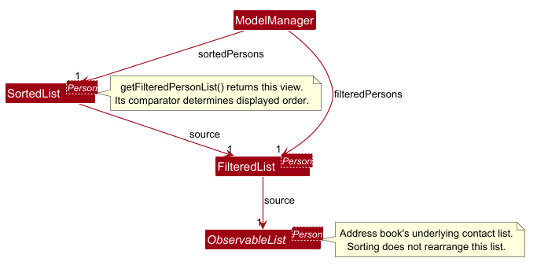</a>

The partial class diagram shows each view's source relationship. The sorted view supplies displayed order;
the underlying contact list retains its source order for persistence. Unrelated model classes and list inheritance
relationships are omitted for clarity.

`getFilteredPersonList()` retains its existing API name but returns `sortedPersons`. The UI and commands such as
`EditCommand` and `DeleteCommand` therefore resolve displayed indices against the same list. Changes to the source
contacts propagate through both views, including repositioning a contact when an edit changes its sort keys.
`ModelManager#equals()` also compares the displayed lists so models with different visible ordering are distinguished.

After successful execution, `LogicManager` saves `model.getAddressBook()`, not the displayed view. The comparator is
not serialized, so sorting does not change saved contact order and is reset on restart.

Sort and `sort clear` do not call `commitAddressBook()`, so neither creates an
undo snapshot or discards redo history. Undo and redo restore contact data and
retain the active sort order unless the user explicitly runs `sort clear`.
Subsequent find and list commands retain the selected sort order.

#### Contact selection reconciliation

`CommandResult#getSelectedPerson()` carries an optional explicit selection request. Existing constructors default to
no request; `CommandResult(String, Person)` retains the exact immutable contact reference. Equality, hashing, and the
string representation include the request. `LogicManager` forwards it into `CommandSelectionChange` before saving.
Each command attempt resets this information before parsing. Selection precedence is:

1. Successful undo/redo resets clear selection.
2. An explicit selection request chooses its target, even when there was no previous selection.
3. Otherwise, retain the previous contact or its recorded replacement when it remains visible.

`MainWindow` applies the result through its existing `finally` block and `PersonListPanel#endCommand(Person)`.
The panel resolves the current index by object identity, updates the highlight, and scrolls to the contact without
moving focus out of command input. It resolves pending styling/layout and completes any required scroll after the
scene's layout pass so freshly added rows are positioned correctly. Repeated selection of the same object retains
the details panel's reading position.
There are no new Model or Storage fields and no selection data is persisted.

#### Persistence and failures

After successful command execution, `LogicManager` requests a save of `model.getAddressBook()` through `Storage`.
This includes browsing and help commands. Parsing and command-validation failures exit before the save step.
Only the current contact data is serialized; filters, sorting, selection, snapshots, and the history pointer remain in memory.

The manager records the history pointer before execution. Its error handling depends on whether the command committed a new state:

Outcome | Contact data and history | Display and selection
--------|--------------------------|----------------------
A modifying command commits, but saving fails | `rollbackAddressBook()` delegates to `rollbackCommit()`: the previous snapshot is restored, the new state is removed, and displaced redo states are reinstated. | The filter resets to all contacts while sorting is retained. Replacement metadata is cleared; the UI retains the original selected object when it is present in the restored view.
Saving after `undo` or `redo` fails | No rollback is performed. The restored data and moved history pointer remain in memory. | The all-contact view and selection reset from the executed undo/redo remain applied.
Saving a command that did not advance the history pointer fails | No earlier contact-data change is rolled back. | The command's view effects remain. For example, a valid explicit selection request is retained.

`AccessDeniedException` and other `IOException` failures are converted to `CommandException` feedback.
`MainWindow` reconciles selection in its `finally` block even when execution reports an error. Selection resets take precedence over an explicit request;
an explicit request takes precedence over retaining the previous contact or its recorded replacement. The UI then checks that the chosen object is still visible.

Memory rollback and file-replacement guarantees are separate concerns. See [Atomic file persistence](#atomic-file-persistence) for filesystem limitations.

#### Atomic file persistence

**Overview**

<a id="overview"></a>

File persistence uses `FileUtil#writeToFile` to write a complete temporary file before replacing the destination.
It requests atomic replacement where supported. If the filesystem rejects atomic moves, the fallback replaces the file without requesting atomicity;
the application therefore cannot guarantee atomic replacement on every filesystem.

**Implementation details**

<a id="implementation-details-1"></a>

After a command executes successfully, `LogicManager` requests `Storage` to persist the current address book.
The following steps describe a contact-data save; preference JSON uses the same file-writing utility.

1. `JsonAddressBookStorage` first calls `FileUtil#createIfMissing()`, which creates an empty destination and missing parent directories when needed. It then serializes the address book into JSON via `JsonUtil#saveJsonFile`. Preference saves use `JsonUtil` directly without this initial empty-file creation.
2. `JsonUtil` delegates writing to `FileUtil#writeToFile(Path file, String content)`.
3. `FileUtil#writeToFile` creates any missing parent directories, then creates a temporary file in the same parent directory (`tmp_<filename>.<rand>.tmp`). Using the same directory ensures the temporary file resides on the same filesystem volume, enabling atomic file replacement.
4. The serialized JSON content is written to the temporary file using UTF-8 encoding.
5. `FileUtil#writeToFile` atomically replaces the destination file using `Files.move(..., StandardCopyOption.ATOMIC_MOVE, StandardCopyOption.REPLACE_EXISTING)`.
6. If the filesystem does not support atomic moves (`AtomicMoveNotSupportedException`), it falls back to `StandardCopyOption.REPLACE_EXISTING`.
7. A `finally` block attempts to delete any remaining temporary file using `Files.deleteIfExists()`. I/O failures propagate to the caller.
8. For contact-data saves during command execution, `LogicManager` converts `AccessDeniedException` or another `IOException` into `CommandException` feedback.
   In-memory recovery follows [Persistence and failures](#persistence-and-failures). Preference-save errors are handled separately by `MainApp`.

Within `FileUtil#writeToFile()`, failures before replacement leave an existing destination unmodified.
For a first contact-data save, the earlier `createIfMissing()` call can leave an empty file if the
subsequent write fails. An exception during final cleanup can also be reported after replacement
has already completed. The non-atomic fallback provides no all-or-nothing replacement guarantee.
Consequently, a reported save failure and in-memory rollback do not prove that disk contents are
unchanged. This mechanism also does not establish a power-loss durability guarantee.

The sequence diagram shows the successful atomic-move path across components. Parameters are
abbreviated, and self-messages summarise `FileUtil`'s internal file operations. The fallback and
failure paths are described above; directory preparation and initial-file creation are omitted.

<a href="images/AtomicWriteSequenceDiagram.png">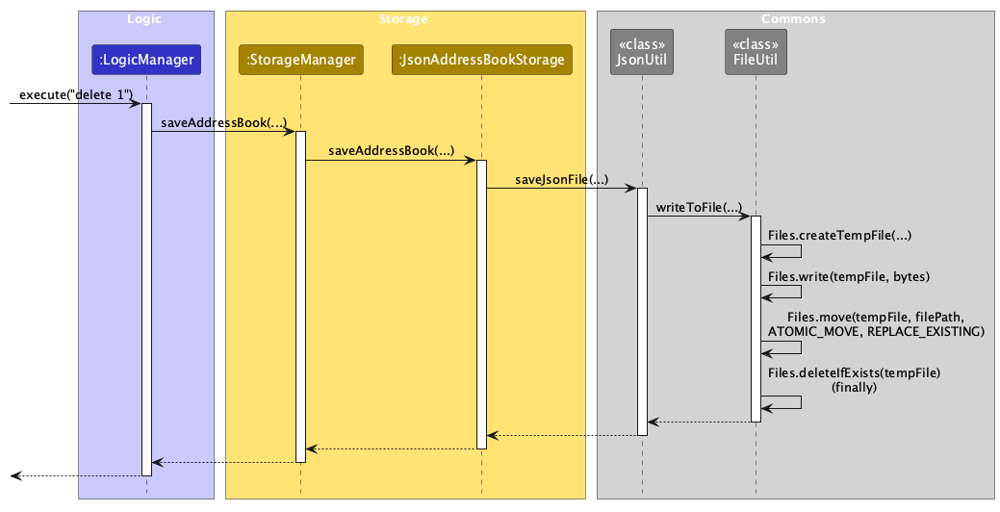</a>

**Design considerations**

<a id="design-considerations-4"></a>

**Aspect: How file writes are performed**
* **Alternative 1 (current choice):** Write to a sibling temporary file and atomically replace the destination file.
  * Pros: Keeps serialization and temporary-file writing separate from the destination file; an atomic move, when supported, prevents a partially replaced destination.
  * Limitation: The fallback move is not guaranteed atomic, and the implementation does not explicitly flush file or directory metadata for power-loss durability.
  * Cons: Requires temporary disk space equal to the size of the saved file during the write operation.
* **Alternative 2:** Direct in-place file write using `Files.writeString` with standard truncation.
  * Pros: Simpler implementation without temporary files.
  * Cons: The file is truncated before new content is written. A crash or disk error mid-write leaves the data file empty or partially written, corrupting user data.

#### Startup loading and recovery

`MainApp` initializes preferences and contact data independently. Paths are relative to the launch folder:
`preferences.json` and `data/addressbook.json`.

File state | Contact data | Preferences
-----------|--------------|------------
Missing | Load sample contacts into memory. A contact-data save is attempted only after a successfully executed command. | Use defaults and attempt to save the initialized preferences during startup.
Existing but invalid | Attempt a timestamped backup, report the backup path or failure, and initialize an empty contact book. One invalid contact rejects the whole file. | Attempt a timestamped backup, report the outcome, and use default preferences. Startup still attempts to save those initialized preferences.
Valid | Load the saved contacts, including optional follow-ups. | Load saved GUI settings.

Backup copies are made beside the original file using `FileUtil#createTimestampedBackup()`. They preserve the existing file contents,
including invalid content, and are not a history of successful saves. Failed backup creation does not prevent fallback initialization.
Warnings from preferences and contact loading are combined for display when the main window opens.

An empty fallback contact book can overwrite the saved contact file after any successful command, including a browsing command or `exit`.
Recovery therefore requires preserving the available backup or original file and closing the window without entering more commands.
See the [User Guide recovery procedure](UserGuide.md#recovering-data-that-fails-to-load) for the user-facing steps.

### Future design notes

#### Proposed data archiving

**Status: not implemented in v1.6; design not yet specified.** The current implementation has no archiving command
or archive-file format. A future proposal would need requirements
for archive contents, retention, and restoration before an implementation design can be documented.
Session undo history and startup recovery backups are separate mechanisms, not an archive feature.

--------------------------------------------------------------------------------------------------------------------

## **Documentation, logging, testing, dev-ops**

* [Documentation guide](Documentation.md)
* [Testing guide](Testing.md)
* [Logging guide](Logging.md)
* [DevOps guide](DevOps.md)

--------------------------------------------------------------------------------------------------------------------

## **Appendix: Requirements**

### Product scope

**Baseline:** This appendix describes the current working implementation, referred to as **v1.6**.
It does not imply that v1.6 has been released on GitHub. Coverage statements below describe the source;
they are not a claim that every acceptance or platform test has passed.

**Target user profile**:

* owns or manages a small artisan keyboard shop
* needs to organise contacts for employees, suppliers, and service providers
* prefers a desktop application and is comfortable typing commands

**Value proposition:** KeyBossWarriorsPro brings shop contacts, role and tag searches, and pending
follow-ups into one local desktop application with a command input and a visual contact list.

**Implemented scope:** Create, edit, delete, and clear contacts; browse, search, sort, and select them;
manage one pending follow-up per contact; undo and redo contact-data changes within a session;
view in-app help; and save and load contact data locally. Each contact has a name, phone number,
email, address, one custom primary role, optional tags, and an optional pending follow-up.

**Scope boundary:** This is a single-user contact-management application. Inventory, payroll, project
records, transaction history, and external shipment services are not implemented. Tags can hold user-supplied
labels, but do not provide structured records, verification, or calculations for those domains.
Future and partially supported needs are retained separately below.

### User stories

For every story, the actor is an **artisan keyboard shop manager**. Priorities retain their original
meaning: High (must have) — `* * *`; Medium (nice to have) — `* *`; Low (unlikely to have) — `*`.
Priority expresses importance, not implementation status.

Story IDs US01–US35 follow the original story order so that moved rows remain traceable.
US36–US43 capture existing v1.6 behaviour missing from the original list and are assigned
Medium priority (`* *`). The original priorities for US01–US35 are retained.

#### Supported in v1.6

The stories follow the same broad sequence as the User Guide: manage contacts, browse contacts,
undo and redo, application commands, then persistence and recovery. Skill verification in US18
happens outside the application. Multi-tag search currently matches any supplied phrase (OR);
the broader combination-of-tags story US24 is listed as partial below because requiring all tags
to match is not supported.

| ID | Priority | I want to … | So that I can … |
|----|----------|-------------|----------------|
| US01 | `* * *` | add contacts with their names, phone numbers, emails, addresses, and primary roles | keep all shop contacts in one place. |
| US03 | `* * *` | edit contact details | reach the right people using updated communication details. |
| US38 | `* *` | set or replace a contact's pending follow-up date and description | record the next action needed for that contact. |
| US39 | `* *` | remove a contact's pending follow-up | clear an action that is no longer needed. |
| US02 | `* * *` | delete outdated contacts by their displayed indices | have a contact list that stays relevant. |
| US36 | `* *` | clear all contacts | reset my contact book when I no longer need its contents. |
| US04 | `* * *` | list all contacts as compact contact cards | quickly review staff, suppliers, and service providers. |
| US05 | `* * *` | assign primary roles such as Employee, Supplier, or Service Provider | distinguish staff from external partners. |
| US14 | `* *` | tag contacts with finer-grain details like suppliers by the components supplied | find suitable suppliers and service providers for custom keyboard builds. |
| US18 | `* *` | tag technicians with assembly skills verified outside the application | find staff with suitable skills for custom builds. |
| US06 | `* * *` | search contacts by full or partial names regardless of letter case | quickly find a particular contact's details. |
| US07 | `* * *` | filter contacts by component tags | find alternative suppliers when stock is low. |
| US08 | `* * *` | combine name, role, and tag search criteria | narrow my search to relevant staff or suppliers. |
| US13 | `* *` | sort contacts by name, role, or both in my chosen priority | browse contacts alphabetically or group contacts with matching roles. |
| US37 | `* *` | select a contact by its displayed index and view its full details | read contact fields and follow-up information in the details panel. |
| US40 | `* *` | view all pending follow-ups, overdue follow-ups, or those due on or before a date | identify contacts that need attention. |
| US41 | `* *` | undo a committed contact-data change in the current session | recover from an unwanted change. |
| US42 | `* *` | redo an undone contact-data change in the current session | reapply a change when appropriate. |
| US11 | `* * *` | view command syntax and parameters using the help command | learn commands within the application. |
| US12 | `* * *` | exit the desktop application using a command | close the application from the command input. |
| US09 | `* * *` | contact and tag changes to be saved automatically to a local JSON file | persist changes between sessions. |
| US10 | `* * *` | load saved contacts automatically at startup | begin work without re-entering all details. |
| US43 | `* *` | receive a warning and a recovery option when saved data cannot be loaded | preserve the available original or backup before continuing. |

#### Future and partially supported needs

These stories retain their original priorities and requested outcomes. They are **not promises of
v1.6 functionality**. A free-form tag that happens to contain a value does not implement the
corresponding structured feature.

| ID | Priority | I want to … | So that I can … | v1.6 coverage or gap |
|----|----------|-------------|----------------|---------------------|
| US15 | `* *` | record suppliers' minimum order quantities | check order requirements before placing group-buy orders. | Not implemented: no dedicated minimum-order-quantity field. |
| US16 | `* *` | record suppliers' manufacturing and shipping lead times in days | estimate delivery dates for keyboard pre-orders. | Not implemented: no manufacturing or shipping lead-time fields. |
| US17 | `* *` | record payment terms on supplier profiles | arrange payments according to agreements with suppliers. | Not implemented: no payment-terms field. |
| US19 | `* *` | associate contacts with keyboard group-buy projects | view all suppliers and artisans involved in a particular project. | Partial: free-form project tags can label contacts; there are no project records or dedicated project associations. |
| US20 | `* *` | record emergency phone numbers for part-time soldering staff | contact them during urgent builds. | Not implemented: a contact has one phone field, with no separate emergency number. |
| US21 | `* *` | record hourly pay rates of staff | calculate payroll for my employees. | Not implemented: no pay-rate or payroll fields. |
| US22 | `* *` | record part-time staff's weekly availability | schedule shifts without repeatedly asking when they are free. | Not implemented: no structured weekly availability. |
| US23 | `* *` | filter staff by their availability on a specific weekend | quickly arrange staffing for major assembly sessions. | Not implemented: no date-based staffing-availability query. |
| US24 | `* *` | filter contacts using a combination of tags | find contacts matching several requirements. | Partial: multiple tag phrases use OR. Requiring every tag criterion to match (AND) is not supported. |
| US25 | `* *` | view a supplier's notes, tags and transaction history in an expanded card | review the relationship before negotiating a contract renewal. | Partial: the details panel shows contact fields, tags, and a pending follow-up; notes and transaction history are absent. |
| US26 | `* *` | use single-letter command aliases and shortened prefixes | manage my contacts with fewer keystrokes. | Not implemented: no single-letter command aliases. Existing field prefixes do not provide command aliases. |
| US27 | `* *` | browse recent commands using the Up and Down arrow keys | reuse or edit commands without retyping them. | Not implemented: Up/Down navigate the contact list, rather than previous commands. |
| US28 | `* *` | export all contacts to a formatted CSV file using one command | share supplier details or use them in spreadsheets. | Not implemented: no CSV export command. |
| US29 | `* *` | import contacts from a CSV backup with automatic format validation | migrate existing contact lists into KeyBossWarriorsPro. | Not implemented: no CSV import command. |
| US30 | `*` | create timestamped contact backups automatically after operations | restore data after accidental changes or deletions. | Not implemented after operations: startup recovery attempts a timestamped backup of an unreadable existing file. |
| US31 | `*` | record defect rates and quality ratings for suppliers | avoid suppliers with recurring product defects. | Not implemented: no structured supplier-quality metrics. |
| US32 | `*` | toggle terminal notifications for upcoming supplier contract expiries and restocking dates | place orders before assembly supplies run out. | Not implemented: no contract-expiry, restocking, or terminal-notification feature. |
| US33 | `*` | customize CLI theme colors | personalize my workspace | Not implemented: no user-selectable CLI colour theme. |
| US34 | `*` | check shipment tracking from a supplier's contact card using a tracking code | monitor incoming product deliveries. | Not implemented: no shipment-tracking integration. |
| US35 | `*` | track past unit-price quotes for products | compare prices and negotiate better deals. | Not implemented: no quote or price-history records. |

### Use cases

**System:** KeyBossWarriorsPro. **Actor:** the user. **Common precondition:** the application is
running. **MSS** means main success scenario. Use cases are listed in numerical order, UC1–UC12.
They describe user intentions and observable outcomes; command syntax and detailed input rules
belong in the [User Guide](UserGuide.md#command-reference).

#### Common failure outcomes

A rejected request leaves contact data unchanged. Each use case identifies its relevant validation
errors below. A saving error during browsing (UC2, UC5–UC7, UC10, or viewing contact details) is
reported to the user without reversing the displayed results, ordering, or selection.

Data-changing use cases describe their distinct saving-error responses individually. These responses
refer to the running application; a saving error does not guarantee unchanged file contents.
See [Persistence and failures](#persistence-and-failures) and
[Atomic file persistence](#atomic-file-persistence) for technical details.

#### UC1 — Add a contact

**MSS**

1. The user provides the new contact's details.
2. The system validates the details and checks that the phone number and email are not already used.
3. The system adds the contact and confirms the addition.

   Use case ends.

**Extensions**

* **2a.** The supplied details are incomplete or invalid.
  * **2a1.** The system reports the problem without adding a contact.
  * Use case ends.
* **2b.** The phone number or email is already used by another stored contact.
  * **2b1.** The system reports the duplicate details without adding a contact.
  * Use case ends.
* **3a.** The system cannot save the addition.
  * **3a1.** The system restores the previous contact data in the running application and reports the saving error.
  * Use case ends.

**Implementation reference:** [Adding a contact](#adding-a-contact).

#### UC2 — Find and browse contacts

**MSS**

1. The user specifies criteria for finding contacts by name, role, or tag.
2. The system validates the request and searches all stored contacts.
3. The system displays the matching contacts and their count.

   Use case ends.

**Extensions**

* **2a.** The search criteria are missing or invalid.
  * **2a1.** The system reports the problem without changing the displayed results.
  * Use case ends.
* **3a.** No contacts match the criteria.
  * **3a1.** The system displays an empty result and reports that no contacts were found.
  * Use case ends.

**Related flow — View contact details:** The user identifies a contact in the displayed results.
The system selects it and displays its full details. If the requested contact is unavailable or
the selection request is invalid, the system reports an error without changing the selection.

**Related use cases:** [UC5](#uc5--list-contacts) lists all contacts;
[UC10](#uc10--view-follow-ups) finds contacts with follow-ups.

**Implementation references:** [Finding contacts](#finding-contacts) and
[Selecting contacts](#selecting-contacts-with-select-index).

#### UC3 — Delete contacts

**MSS**

1. The user identifies the contact to delete.
2. The system validates the request and identifies the stored contact.
3. The system removes the contact and its pending follow-up, and confirms the deletion.

   Use case ends.

**Extensions**

* **2a.** The request is invalid or the contact is unavailable.
  * **2a1.** The system reports an error without deleting any contact.
  * Use case ends.
* **3a.** The system cannot save the deletion.
  * **3a1.** The system restores the deleted contact and its follow-up in the running application and reports the saving error.
  * Use case ends.

**Related flow — Clear all contacts:** The user requests removal of the entire contact book.
The system removes all contacts and pending follow-ups, including hidden contacts, without requesting
confirmation, then confirms the clearing. If the book is already empty, the system reports that
nothing was cleared. If saving fails, the system restores the previous contacts and follow-ups
in the running application and reports the error.

**Implementation references:** [Deleting a contact](#deleting-a-contact) and
[Clearing all contacts](#clearing-all-contacts-clear).

#### UC4 — Edit contact details and tags

**MSS**

1. The user identifies a contact and supplies changes to its details or tags.
2. The system validates the requested changes.
3. The system updates the supplied details, preserves omitted details and the pending follow-up,
   and confirms the edit.

   Use case ends.

**Extensions**

* **2a.** The request is incomplete or invalid, or the contact is unavailable.
  * **2a1.** The system reports the problem without changing the contact.
  * Use case ends.
* **2b.** The new phone number or email duplicates another contact, or the tag changes conflict
  or request removal of a tag the contact does not have.
  * **2b1.** The system reports the problem and rejects the entire edit; no partial changes are applied.
  * Use case ends.
* **3a.** The system cannot save the edit.
  * **3a1.** The system restores the contact's previous details in the running application and reports the saving error.
  * Use case ends.

**Implementation reference:** [Editing a contact](#adding-and-deleting-contact-tags).

#### UC5 — List contacts

**MSS**

1. The user requests the full contact list.
2. The system displays all stored contacts in the current sort order.

   Use case ends.

**Extensions**

* **2a.** No contacts are stored.
  * **2a1.** The system displays an empty list and reports that no contacts were found.
  * Use case ends.

**Implementation reference:** [Listing all contacts](#listing-all-contacts-list).

#### UC6 — Sort contacts

**MSS**

1. The user requests sorting by name, role, or both in a chosen priority.
2. The system validates the sorting request.
3. The system displays all contacts in ascending, case-insensitive order and confirms the sorting.

   Use case ends.

**Extensions**

* **1a.** The user requests sorting without specifying a field.
  * **1a1.** The system uses name as the sorting field.
  * Use case resumes from step 2.
* **2a.** The sorting request is invalid.
  * **2a1.** The system reports an error without changing the displayed order.
  * Use case ends.
* **3a.** No contacts are stored.
  * **3a1.** The system displays an empty list and explains that the chosen order will apply to contacts added later.
  * Use case ends.

**Related flow:** [UC7](#uc7--clear-sort-order) restores insertion order.

**Implementation reference:** [Sorting contacts](#sorting-contacts).

#### UC7 — Clear sort order

**MSS**

1. The user requests to remove the selected sorting order.
2. The system validates the request.
3. The system displays all contacts in insertion order and confirms the change.

   Use case ends.

**Extensions**

* **2a.** The request is invalid.
  * **2a1.** The system reports an error without changing the displayed list.
  * Use case ends.

**Implementation reference:** [Sorting contacts](#sorting-contacts).

#### UC8 — Set or replace a follow-up

**MSS**

1. The user identifies a contact and supplies a follow-up date and description.
2. The system validates the request.
3. The system sets the pending follow-up, replacing any existing one, and confirms the change.

   Use case ends.

**Extensions**

* **2a.** The date or description is missing or invalid, the contact is unavailable, or the request is otherwise invalid.
  * **2a1.** The system reports the problem without changing the contact or its follow-up.
  * Use case ends.
* **3a.** The updated contact no longer matches the current follow-up query.
  * **3a1.** The system excludes it from the results and confirms the follow-up change; the contact remains stored.
  * Use case ends.
* **3b.** The system cannot save the change.
  * **3b1.** The system restores the previous follow-up details in the running application and reports the saving error.
  * Use case ends.

**Implementation reference:** [Contact follow-up management](#contact-follow-up-management).

#### UC9 — Remove a follow-up

**MSS**

1. The user identifies a contact and requests removal of its pending follow-up.
2. The system validates the request and checks that a pending follow-up exists.
3. The system removes the follow-up and confirms its removal.

   Use case ends.

**Extensions**

* **2a.** The request is invalid or the contact is unavailable.
  * **2a1.** The system reports an error without changing the contact or its follow-up.
  * Use case ends.
* **2b.** The contact has no pending follow-up.
  * **2b1.** The system reports that no follow-up exists and leaves the contact unchanged.
  * Use case ends.
* **3a.** The contact no longer matches the current follow-up query.
  * **3a1.** The system excludes it from the results and confirms the removal; the contact remains stored.
  * Use case ends.
* **3b.** The system cannot save the removal.
  * **3b1.** The system restores the pending follow-up in the running application and reports the saving error.
  * Use case ends.

**Implementation reference:** [Contact follow-up management](#contact-follow-up-management).

#### UC10 — View follow-ups

**MSS**

1. The user requests all pending follow-ups, overdue follow-ups, or those due on or before a chosen date.
2. The system validates the query.
3. The system displays the matching contacts and their count. Follow-ups due today are not overdue;
   those on a supplied cutoff date are included.

   Use case ends.

**Extensions**

* **2a.** The query is invalid.
  * **2a1.** The system reports an error without changing the displayed results.
  * Use case ends.
* **3a.** No follow-ups match the query.
  * **3a1.** The system displays an empty result and reports that no follow-ups were found.
  * Use case ends.

**Implementation reference:** [Querying follow-ups](#querying-follow-ups).

#### UC11 — Undo a contact-data change

**MSS**

1. The user requests to undo the most recent undoable contact-data change in the current session.
2. The system validates the request and checks that an earlier change is available.
3. The system restores the previous contact data and confirms the undo.

   Use case ends.

**Extensions**

* **2a.** The request is invalid.
  * **2a1.** The system reports an error without changing contact data or available undo/redo actions.
  * Use case ends.
* **2b.** No earlier change is available to undo.
  * **2b1.** The system reports that no more changes can be undone and leaves contact data unchanged.
  * Use case ends.
* **3a.** The system cannot save the restored contact data.
  * **3a1.** The system reports a saving error; the undo remains applied in the running application.
  * Use case ends.

**Implementation reference:** [Undo/redo feature](#undoredo-feature).

#### UC12 — Redo a contact-data change

**MSS**

1. The user requests to redo a previously undone contact-data change in the current session.
2. The system validates the request and checks that a change is available to redo.
3. The system reapplies the change and confirms the redo.

   Use case ends.

**Extensions**

* **2a.** The request is invalid.
  * **2a1.** The system reports an error without changing contact data or available undo/redo actions.
  * Use case ends.
* **2b.** No change is available to redo, including after a new successful contact-data change following an undo.
  * **2b1.** The system reports that no more changes can be redone and leaves contact data unchanged.
  * Use case ends.
* **3a.** The system cannot save the reapplied change.
  * **3a1.** The system reports a saving error; the redo remains applied in the running application.
  * Use case ends.

**Implementation reference:** [Undo/redo feature](#undoredo-feature).

### Non-Functional Requirements

The IDs below retain the original requirement order. **Source-backed** means the implementation
provides the stated mechanism, not that platform, performance, or usability acceptance has been
measured. **Pending validation** identifies targets with no recorded measurements in this appendix;
**Partial** identifies a known implementation limitation.

| ID | Requirement or target | Current evidence and acceptance status |
|----|-----------------------|----------------------------------------|
| NFR01 | **Operating environment:** Run on Windows 10/11, macOS, and Linux with Java 25 or above. | **Pending validation.** The build targets Java 25. Launch and core workflows must be checked on the named operating systems and intended Java runtimes; build settings alone do not establish compatibility. |
| NFR02 | **Portability:** Distribute a single executable JAR that requires no application installer, with a Java runtime installed separately. | **Source-backed packaging; packaged launch pending validation.** The Shadow JAR configuration names the artifact `keybosswarriorspro.jar`. |
| NFR03 | **Network independence:** Support core contact workflows and in-app help offline without a remote server. | **Source-backed.** Data and help content are local. Opening the external online User Guide from help requires an internet connection; this is outside the offline core workflows. |
| NFR04 | **Capacity:** Manage 1,000 contacts and 5,000 tags without noticeable sluggishness in typical usage. | **Pending validation.** Agree whether 5,000 means distinct tags or tag assignments and define a representative fixture before measuring. This is a workload target, not a hard storage limit established by tests here. |
| NFR05 | **Responsiveness:** Standard commands such as `list`, `find`, `add`, and `delete` should update feedback and the displayed contact list within 1.0 second under normal workloads. | **Pending validation.** Measure from command submission to feedback/list refresh using an agreed workload, including the capacity fixture. Record OS, CPU, RAM, Java version, and cold/warm conditions. There is no `filter` command. |
| NFR06 | **Package size:** The release JAR must not exceed 100 MB. | **Pending validation.** Measure the actual v1.6 distribution artifact and record its size; an older build is not evidence for this baseline. |
| NFR07 | **Data persistence:** Store contact data as human-editable JSON at the default path `data/addressbook.json`. | **Source-backed.** The configured path is relative to the launch folder; editing must preserve the JSON schema and field constraints. See [Startup loading and recovery](#startup-loading-and-recovery). |
| NFR08 | **Fault tolerance:** An unreadable or invalid contact-data file should trigger a warning and a usable fallback rather than an unexpected startup crash. | **Source-backed; recovery acceptance pending validation.** Startup attempts a timestamped backup of an existing bad file and starts with an empty contact book, warning even if backup creation fails. One invalid contact rejects the whole file. Existing `MainAppTest` cases cover corrupt-file and backup-failure paths; no new test result is asserted here. |
| NFR09 | **Database independence:** Do not require an RDBMS such as MySQL or SQLite. | **Source-backed.** The storage implementation uses local JSON files. |
| NFR10 | **Typing-preferred usability:** A user with above-average English typing speed should complete routine contact-management tasks faster with commands than with a mouse. | **Pending validation.** Define comparable tasks and measure completion times with representative users. Inventory management is outside the implemented scope. |
| NFR11 | **Display adaptability:** Keep the UI functional and legible at 1920×1080 with scaling up to 150%, and at 1280×720 with 100% scaling. | **Pending validation.** Check both configurations, including long fields and help/details panels. The configured minimum window size of 800×600 does not prove that these display targets pass. |
| NFR12 | **Single-user scope:** Support one manager working locally; concurrent multi-user access is outside scope. | **Source-backed scope constraint.** No shared multi-user synchronisation is implemented. |
| NFR13 | **Data integrity:** Saves must be atomic so unexpected crashes or write errors cannot leave truncated or partially written contact-data files. | **Partial; strict guarantee not met on every filesystem.** `FileUtil` writes a temporary sibling file and requests an atomic replacement, but falls back to a non-atomic replacement when atomic moves are unsupported. There is no guaranteed power-loss durability. See [Atomic file persistence](#atomic-file-persistence); do not report this requirement as universally satisfied. |

### Glossary

#### Keyboard terms

* **Artisan keyboard**: A custom mechanical keyboard built from individual parts such as custom cases, switches, printed circuit boards (PCBs), and keycaps.
* **Switch**: The mechanical mechanism seated under each keycap that opens and closes an electrical circuit on keypress. Common types include linear, tactile, and clicky switches.
* **PCB (Printed Circuit Board)**: The internal circuit board that registers switch activations and connects to the computer, some using hot-swap sockets so users can replace switches without soldering.
* **Keycap**: A removable plastic cover mounted on a switch stem. Keycaps are commonly molded from PBT or ABS plastic.
* **Stabilizer**: A mechanical wire and housing assembly used on wider keys (such as space, enter, and shift) to keep the key level when pressed off-center.

#### Contact terms

* **Contact**: A person or commercial entity stored in the address book.
* **Duplicate contact**: Two contact entries that share either the same phone number or the same email address.
* **Primary role**: The required custom-text classification assigned to a contact. Examples include `Employee`, `Supplier`, and `Service Provider`; these are not an exhaustive set of permitted values. Every contact has exactly one role.
* **Tag**: An optional label added to a contact to record categories, supplied parts (such as `switches` or `keycaps`), or services. A contact can have zero or more tags.
* **Pending follow-up**: A contact's optional next action, consisting of a due date and description. A contact has at most one pending follow-up, with no completed-action history.
* **Displayed index**: A one-based contact position in the current filtered and sorted list. It can change when the view or contact data changes.

#### Technical terms

* **Mainstream OS**: For this guide's operating-environment target, Windows 10/11, macOS, or Linux.
* **CLI (Command Line Interface)**: A text-based interface where the user types commands into a prompt to operate the application.
* **GUI (Graphical User Interface)**: A visual interface created with JavaFX that displays contact cards, command outputs, and application status.
* **JSON (JavaScript Object Notation)**: A lightweight, human-readable text file format used to save address book records locally on disk.
* **MSS (Main Success Scenario)**: The normal sequence of actor and system steps that achieves a use case's goal.
* **NFR (Non-Functional Requirement)**: A quality target or operating constraint, such as responsiveness, portability, or data integrity.
* **Session history**: In-memory contact-data snapshots used by undo and redo until the application closes; not a persistent backup or command-input history.

--------------------------------------------------------------------------------------------------------------------

## **Appendix: Instructions for manual testing**

These scenarios provide a starting point for exploratory testing of the current **v1.6 working
implementation**. They describe expected results, rather than a record of tests already passed.
For full command syntax and input rules, see the [User Guide](UserGuide.md#command-reference).

### Test setup

* Use a JAR built from the current v1.6 working tree, such as `build/libs/keybosswarriorspro.jar`,
  and Java 25 or above. Copy the JAR into a separate, disposable test folder.
* Launch from that folder using `java -jar keybosswarriorspro.jar` so the data paths are predictable.
  Unless configured otherwise, contact data is in `data/addressbook.json` and window preferences
  are in `preferences.json`, relative to the launch folder.
* Run each section independently using its stated setup, then run its table rows in order.
  Enter commands separately, including when a row lists several. After a rejected command,
  replace the text still in the command input before submitting the next command.
* Record the source revision, OS, Java version, display resolution/scaling, and actual results when testing.
* For validation errors below, expect unchanged contact data, view, and history. Save failures
  have different outcomes; test those separately under [Saving data](#saving-data).

**Four-contact fixture:** Whenever a section says to reset to this fixture, run these commands
separately. This replaces the test folder's contacts and resets filtering and sorting.

```text
clear
sort clear
add n/Alice Tan p/81009101 e/alice.tan@find.example.com a/Test Address r/Employee t/tactile switch t/keycap
add n/Alice Lee p/81009102 e/alice.lee@find.example.com a/Test Address r/Regional Supplier t/tactile switch t/trusted partner
add n/Bob Tan p/81009103 e/bob.tan@find.example.com a/Test Address r/Regional Supplier t/keycap
add n/Carol Lim p/81009104 e/carol.lim@find.example.com a/Test Address r/Distributor
```

Expected: Alice Tan, Alice Lee, Bob Tan, and Carol Lim appear at indices 1–4, with no follow-ups.
Indices below always refer to the current displayed list. Do not assume the fixture's indices
still apply after a filter, sort, edit, or deletion.

### Launch and shutdown

**Setup:** Use a new test folder with no contact-data or preferences files. Keep the same launch
folder when restarting. Keep the window on a connected display when checking saved position.

| Action | Expected result |
|--------|-----------------|
| Launch the JAR. | The GUI opens with six sample contacts and an empty details panel. The missing contact-data file is not yet created; no contact-data backup is made. |
| Run `list`. | All sample contacts remain visible and `data/addressbook.json` is created. Even a successful browsing command requests a save. |
| Resize and move the main window, then close it using its close button. Relaunch from the same folder. | The saved size and position are restored, subject to the 800×600 minimum window size. The same contacts are loaded. |
| Run `exit`, then relaunch. | The app closes normally and the saved contacts and window preferences are available on restart. |

### Manage contacts {#manual-manage-contacts}

#### Adding contacts with `add`

**Setup:** Run `clear`, then `sort clear`. Run the rows in order.

| Command | Expected result |
|---------|-----------------|
| `add n/John Doe p/98765432 e/johnd@example.com a/311, Clementi Ave 2, #02-25 r/Supplier t/friends t/owesMoney` | John Doe is added with role `Supplier` and both tags. Feedback starts with `New person added: John Doe;`. Tag display order is not significant. |
| `add n/David s\/o Muthu p/81001234 e/david@example.com a/Blk 456 Jurong r/R\/D Partner t/lubed\/filmed switches` | Slash escapes decode once: the name is `David s/o Muthu`, role `R/D Partner`, and tag `lubed/filmed switches`. |
| `add n/Jane Doe p/98765432 e/jane@example.com a/Test Address r/Employee` | `This phone number already belongs to an existing contact.` |
| `add n/Johnny Doe p/81009999 e/johnd@example.com a/Test Address r/Employee` | `This email address already belongs to an existing contact.` |
| `add n/Jack Doe p/98765432 e/johnd@example.com a/Test Address r/Employee` | `This phone number and email address are already used by existing contacts.` |
| `add n/No Role p/81005555 e/norole@example.com a/Test Address` | `Missing mandatory parameter(s): r/.` |
| `add n/David s/o Muthu p/81008888 e/david.unescaped@example.com a/Test Address r/Supplier` | `Unrecognized prefix(es) provided: s/.` |
| `add n/Bad Phone p/12 e/badphone@example.com a/Test Address r/Supplier` | `Phone numbers should only contain digits, and should be 3 to 20 digits long.` Also try 21 digits; the same constraint applies. |

##### Name, role, and tag formatting

**Setup:** Run `clear`, then `sort clear`, and add this contact:

```text
add n/Anne-Marie   O'Connor p/81009001 e/formatting@example.com a/Test Address r/R&D   Partner t/lubed/filmed   switches
```

Expected: The name is `Anne-Marie O'Connor`, role `R&D Partner`, and tag `lubed/filmed switches`.
Repeated internal spaces collapse; punctuation and capitalisation are preserved.

| Command / action | Expected result |
|------------------|-----------------|
| `find n/Anne-Marie   O'Connor`, then `find n/Anne-Marie O'Connor` | Both return the test contact. Repeat with `find r/R&D   Partner` and `find t/lubed/filmed   switches`. |
| `edit 1 n/Anne-Marie    O'Connor r/R&D    Partner t/PCB    Supplier` | Supplied text has single internal spaces; `PCB Supplier` is added and the original tag remains. |
| `edit 1 n/Changed xx/value` | Unknown-prefix error; all fields and tags remain unchanged. |
| `add n/Élodie p/81009002 e/unicode@example.com a/Test Address r/組立担当 t/手作り` | The Unicode name, role, and tag are accepted and displayed. |
| `find n/élodie`, then `find n/elodie` | The accented query finds Élodie, ignoring case; the unaccented query has no result. |
| Restart, then run `find n/Anne-Marie O'Connor` and `find n/Élodie` separately. | The normalised text, punctuation, Unicode values, and tags persist. |

#### Editing contact details with `edit`

**Setup:** Reset to the four-contact fixture. Run `find n/Alice Tan`, then `select 1`.

| Command | Expected result |
|---------|-----------------|
| `edit 1 p/81009201 e/alice.updated@example.com a/New Address r/Custom Workshop Partner` | Alice Tan's supplied fields change; name and both tags remain. All four contacts are shown after the edit, and the selected contact's details refresh. The custom role is accepted. |
| `find n/Alice Tan`, then `edit 1 p/81009102` | Duplicate-phone error, including though Alice Lee is hidden. Alice Tan and the one-contact view remain unchanged. |
| `edit 1 n/Changed e/alice.lee@find.example.com` | Duplicate-email error. The name also remains Alice Tan: no partial edit is applied. |
| `edit 1`, then `edit 1 r/Employee r/Supplier` | Missing-edit and duplicate-field errors, respectively. |
| `edit 0 r/Employee`, then `edit 2 r/Employee` | Invalid-index and out-of-view-index errors, respectively. The filtered view contains only Alice Tan. |

##### Editing contact tags

**Setup:** Run `clear`, then `sort clear`, then add:

```text
add n/TagEditExample p/12345678 e/tagedit@example.com a/Test Address r/Employee t/trainee t/supplier
```

Before **each row**, run `find TagEditExample` again because a successful edit shows all contacts.
Run the rows in order; tag order is not significant.

| Command | Expected result |
|---------|-----------------|
| `edit 1 t/solderer` | Tags become `trainee`, `supplier`, and `solderer`; other fields are preserved. |
| `edit 1 dt/TRAINEE` | Tags become `supplier` and `solderer`; removal ignores case. |
| `edit 1 t/builder dt/solderer` | Tags become `supplier` and `builder`. |
| `edit 1 n/Alex dt/supplier dt/trainee` | Missing-tag error for `trainee`; neither the name nor any tag changes. The filter stays unchanged. |
| `edit 1 t/builder dt/BUILDER` | Conflict error for `builder`; data and filter stay unchanged. |
| `edit 1 t/`, then `edit 1 dt/` | Empty-tag errors; data and filter stay unchanged. |
| `edit 1 dt/supplier dt/builder` | Both tags are removed; no tags remain. |

#### Managing and viewing follow-ups

**Setup:** Reset to the four-contact fixture. Run `find n/Alice Tan`, then `select 1`.
The fixed dates below exercise past and future dates; compare badges with the computer's local date.

| Command / action | Expected result |
|------------------|-----------------|
| `followup 1 by/2000-01-01 abt/Confirm quotation` | An Overdue badge appears for a current date after 2000-01-01; the details panel shows the date and description. |
| `followup 1 by/9999-12-31 abt/Review revised quotation` | Both fields replace the previous follow-up; the badge changes to Follow-up for a current date before 9999-12-31. |
| `edit 1 r/Custom Followup Role`, then `find n/Alice Tan` | The follow-up is preserved. |
| `followup 1 clear` | The badge and follow-up details disappear. The contact remains; no blank badge space is reserved. |
| `followup 1 clear` | An error reports that no follow-up is present; no new history state is created. |
| `undo`, then `redo` | The future follow-up is restored, then removed again. Undo/redo clear selection; use `find n/Alice Tan` and `select 1` to inspect the details after each. |
| Find Alice Tan, then try `followup 1 by/2000-01-01`, `followup 1 by/2000-02-30 abt/Test`, and `followup 1 by/2000-01-01 by/2000-01-02 abt/Test`. | Missing-description, invalid-date, and duplicate-prefix errors, respectively. |
| `followup 0 by/2000-01-01 abt/Test` | Invalid-index error. |
| `followup 1 by/9999-12-31 abt/Confirm the revised quotation, check the available components and delivery arrangements, and contact the supplier before placing the next keyboard order.` | The long description is stored. Select the contact, resize the window, and verify the full description is accessible by scrolling the details panel. |
| Restart, then run `find n/Alice Tan` and `select 1`. | The saved date, description, and appropriate badge are restored. |

**Date-sensitive UI check:** Replace `TODAY` in `followup 1 by/TODAY abt/Check today` with the
computer's actual local date in `YYYY-MM-DD` format; do not enter the word `TODAY` literally.
Expect a Due today badge. Optionally repeat with yesterday and tomorrow for Overdue and Follow-up.
When testing across local midnight, keep this contact selected with a draft in the command input.
While the window is shown, badges update within a minute, or immediately when focus returns after
sleep. Selection, scroll positions, and draft text remain intact. An existing overdue query retains
its earlier date boundary until `followups overdue` is run again.

#### Deleting contacts with `delete`

**Setup:** Reset to the four-contact fixture. Run `followup 3 by/2000-01-01 abt/Delete check`,
then `select 3` so Bob Tan has a pending follow-up and is selected. Run the rows in order.

| Command | Expected result |
|---------|-----------------|
| `find r/Supplier`, then `delete 2` | The filtered list initially shows Alice Lee and Bob Tan. Bob Tan and his follow-up are deleted; Alice Lee remains as displayed index 1. Bob's selection and details clear. |
| `list`, then `find n/Alice Lee` | List shows Alice Tan, Alice Lee, and Carol Lim; the search then shows only Alice Lee. Hidden contacts were not deleted. |
| `delete` | `INDEX is required.` |
| `delete 1 2` | `delete accepts only one INDEX.` |
| `delete 0`, `delete abc`, then `delete 2147483648` | Each reports `INDEX must be a whole number between 1 and 2147483647.` |
| `delete 2` | `INDEX 2 is outside the displayed contact list (valid index: 1).` |
| `delete 1` | Alice Lee is deleted; feedback starts with `Deleted contact: Alice Lee;`. The retained filter now shows an empty list. |
| `delete 1` | `No contacts are currently displayed.` |
| `list` | Alice Tan and Carol Lim remain. |

#### Clearing all contacts with `clear`

**Setup:** Reset to the four-contact fixture. Run `followup 1 by/2000-01-01 abt/Test clearing`,
then `find NoSuchClearContact` so no contacts are visible.

| Command | Expected result |
|---------|-----------------|
| `clear`, then `list` | All four stored contacts and the pending follow-up are removed despite the empty filtered view. No confirmation prompt appears. |
| `undo` | All four contacts and Alice Tan's follow-up return. |
| `redo`, then `clear` | Redo clears the book again. The second command reports `KeyBossWarriorsPro is already empty; no contacts were cleared.` and creates no history snapshot. |
| `undo`, then `clear extra` | Undo restores the four contacts; `clear extra` deletes them and includes `Warning: additional arguments after clear were ignored.` |

### Browse contacts {#manual-browse-contacts}

#### Listing all contacts with `list`

**Setup:** Reset to the four-contact fixture.

| Command | Expected result |
|---------|-----------------|
| `find n/Alice`, then `list` | The search shows two contacts; list shows all four in insertion order. |
| `sort r/ n/`, then `find r/Supplier`, then `list` | The final list shows Carol Lim, Alice Tan, Alice Lee, and Bob Tan, retaining role-then-name sorting. |
| `list extra` | All four remain visible; feedback includes a warning that extra arguments were ignored. |
| `clear`, then `list` | The empty list remains and feedback is `No contacts found.` |

#### Finding contacts with `find`

**Setup:** Reset to the four-contact fixture. Run the rows in order.

| Command | Expected result |
|---------|-----------------|
| `find aLI tAN` | Alice Tan, Alice Lee, and Bob Tan; `3 contacts found.` Simple keywords use OR and ignore case. |
| `find n/Alice Tan` | Alice Tan only; `1 contact found.` The value is a continuous phrase. |
| `find r/gional supp t/tactile swi` | Alice Lee only. Role and tag substrings must both match. |
| `find t/tactile t/keycap` | Alice Tan, Alice Lee, and Bob Tan, each once. Either tag phrase suffices. |
| `find n/ali n/bob r/supp` | Alice Lee and Bob Tan. Name alternatives use OR; the role condition uses AND. |
| `find NoSuchFindContact` | An empty list and `No contacts found.` |
| `find n/Carol`, then `find n/Alice` | First Carol Lim, then both Alice contacts. Each search checks the whole contact book. |
| `sort r/ n/`, then `find r/supp`, then `list` | Find shows Alice Lee, then Bob Tan. List restores Carol Lim, Alice Tan, Alice Lee, then Bob Tan in role-then-name order. |

Before the error checks, run `find n/Alice Tan`. Each rejection must preserve that one-contact view.

| Command | Expected feedback |
|---------|-------------------|
| `find` | `find requires at least one search criterion.` |
| `find n/Alice r/` | `find requires a non-blank value after n/, r/, t/.` |
| `find Alice r/Supplier` | `find cannot mix unprefixed keywords with prefixed search values.` |
| `find p/81009101` | `Unrecognized prefix(es) provided: p/.` |

#### Sorting contacts {#sorting-contacts-1}

**Setup:** Run `clear`, then `sort clear`, then enter these commands separately in this order:

```text
add n/Zoe p/81000001 e/zoe@sort.example.com a/Test Address r/Employee
add n/ben p/81000002 e/ben@sort.example.com a/Test Address r/Supplier
add n/Alice p/81000003 e/alice.supplier@sort.example.com a/Test Address r/Supplier
add n/alice p/81000004 e/alice.distributor@sort.example.com a/Test Address r/Distributor
```

The roles distinguish the two Alice contacts. Run the rows in order.

| Command | Expected result |
|---------|-----------------|
| `sort`, then `sort n/` | Both Alice contacts precede ben, then Zoe. Do not assume an order between equal names without a second sort key. Feedback is `Listed all contacts in sorted order.` |
| `sort n/ r/` | alice (Distributor), Alice (Supplier), ben, Zoe. |
| `sort r/ n/` | alice (Distributor), Zoe, Alice (Supplier), ben. |
| `find r/Supplier`, then `sort n/` | Find shows two Suppliers; sort reveals all four in name order. |
| `sort n/ n/`, `sort n/Alice`, then `sort t/` | Errors identify the repeated field, unexpected value, and unsupported token. Contacts and the view stay unchanged. |
| `find r/Supplier`, then `sort clear` | All four appear in insertion order: Zoe, ben, Alice (Supplier), alice (Distributor). Both filter and sorting are cleared. |
| `clear`, then `sort n/` | The list is empty; feedback says the selected sort order will apply to contacts added later. |
| Add Zoe and Alice (Supplier) using their setup commands, in that order. | Alice appears before Zoe: sorting also applies to newly added contacts. |

#### Selecting a contact

**Setup:** Reset to the four-contact fixture.

| Command / action | Expected result |
|------------------|-----------------|
| `select 2` | Alice Lee is highlighted and shown in the right details panel; command input keeps focus. |
| Scroll the details panel, then repeat `select 2`. | The same contact remains selected and the details panel keeps its reading position. If needed, add more test contacts to check that selecting a contact outside the visible list scrolls it into view. |
| `find n/Bob`, then `select 1` | Bob Tan is selected, using the current search result's index. |
| `sort n/`, then `select 1` | Alice Lee, the first contact in name order, is selected. |
| `select`, `select 0`, `select -1`, `select abc`, `select 1 2`, then `select 5` | Appropriate errors appear; selection and details remain unchanged. |
| `find NoSuchSelectContact`, then `select 1` | The empty-state prompt remains; feedback explains that no contacts are displayed. |
| `list`, then `select 1`. Type a draft such as `find n/Ali` without submitting it, place the caret within it, and select part of the draft. Click a contact or details text, then press Escape. | Focus returns to command input with the draft, caret, and text selection preserved. Clicking a card updates the selected contact's details. |
| With focus in the contact list, press Up/Down to move the selection. | The highlighted contact and details follow the selection. These keys do not recall earlier commands. |
| If the list is scrollable, add a contact with wrapping tags and immediately select its displayed index. | The selected card scrolls into view after the updated layout; do not reuse an index from before a sort or edit. |

#### Viewing contacts with follow-ups using `followups`

**Setup:** Reset to the four-contact fixture. Enter these commands separately:

```text
followup 1 by/2000-01-01 abt/Old quotation
followup 2 by/9999-12-31 abt/Future quotation
```

For the overdue expectations below, the computer's local date must be after 2000-01-01 and before
9999-12-31. These fixed dates avoid changing the commands each day.

| Command | Expected result |
|---------|-----------------|
| `followups` | Alice Tan and Alice Lee; `2 follow-ups found.` Bob and Carol have no follow-ups. |
| `followups overdue` | Alice Tan only; `1 follow-up found.` |
| `followups by/2000-01-01` | Alice Tan is included on the exact cutoff date. |
| `find n/Carol`, then `followups` | Both Alice contacts return: the query replaces the previous filter and checks all contacts. |
| `sort n/`, then `followups` | Alice Lee precedes Alice Tan; the query retains sorting. |
| `followups by/2000-01-01 overdue`, `followups overdue by/2000-01-01`, then `followups by/2000-01-01 extra` | Each is rejected without changing the previous two-contact view. Modes cannot be combined. |
| `followups by/2000-02-30` | Invalid-date error; the view is unchanged. |
| `find n/Alice Tan`, then `followup 1 clear`, then `followups overdue` | No overdue contacts remain; feedback is `No follow-ups found.` |

### Undo and redo {#manual-undo-and-redo}

#### Undoing and redoing commands with `undo` and `redo`

**Setup:** In the disposable test copy, run `clear`, `sort clear`, then `exit`. Relaunch from the
same folder so the session starts with the saved **empty** book and no earlier history. This restart
is necessary: simply clearing the sample contacts leaves an undoable clear in the same session.
Add the baseline contact:

```text
add n/Alice p/81000001 e/alice@undo.example.com a/Test Address r/Employee
```

| Command | Expected result |
|---------|-----------------|
| `delete 1`, then `undo` | Alice is deleted, then restored; undo reports `Undo success!`. |
| `redo`, then `undo` | Alice is deleted again, then restored. |
| `add n/Bob p/81000002 e/bob@undo.example.com a/Test Address r/Supplier` | Bob is added at index 2. |
| `followup 2 by/2000-01-01 abt/Inventory check` | Bob's follow-up is set, with the badge appropriate to the local date. |
| `undo`, then `undo` | First Bob's follow-up is removed; then Bob is removed, leaving Alice. |
| `redo`, then `redo` | First Bob returns at index 2; then his follow-up returns. |
| `undo`, then `add n/Charlie p/81000003 e/charlie@undo.example.com a/Test Address r/Service Provider` | Bob's follow-up is removed, then Charlie is added. The new commit discards the redo branch. |
| `redo` | `No more commands to redo!` |
| `find Alice`, `sort n/`, `select 1`, `list`, then `help select` | Browsing, selection, and contextual help do not add history snapshots. |
| `undo` | Charlie is removed. Alice and Bob remain; all contacts are shown, selection clears, and name sorting is retained. |
| `undo`, then `undo` | Bob is removed, then Alice is removed. The list is empty. |
| `undo` | `No more commands to undo!` The restart makes this boundary reproducible. |
| `clear`, then `redo` | Empty clear adds no snapshot and preserves redo; Alice is restored. |
| `undo 2`, then `redo 2` | Invalid-command-format errors; contacts and history remain unchanged. |
| Restart, then run `undo` and `redo`. | Alice remains saved, but both commands report that no more changes can be undone/redone: session history is not persisted. |

### Application commands {#manual-application-commands}

#### Viewing contextual help with `help`

**Setup:** Any running test session with a writable data folder. Select a contact first if one exists.

| Command / action | Expected result |
|------------------|-----------------|
| `help add`, `help followup`, `help select`, then `help sort` | Each displays the relevant description, parameters, and examples in command feedback. No Help window opens; contact selection remains unchanged. |
| `help exit` | Contextual feedback describes exit without parameters; no Help window opens. |
| `help` | The full Help window opens, grouped into Manage contacts, Browse contacts, Undo and redo, and Application. Feedback is `Opened help window.` |
| Close the Help window, then run `help unknowncommand`. | Feedback states `No command-specific help is available for 'unknowncommand'.` and lists supported commands; no Help window opens. |
| `help add extra` | `Specify only one command after help.` No Help window opens. |
| With networking disconnected, run `help` and a contextual help command. | Local help content remains available. The external online User Guide link requires a network connection. |

#### Exiting with `exit`

**Setup:** Use a writable test folder; create or edit a test contact before exiting.

| Command / action | Expected result |
|------------------|-----------------|
| `exit`, then relaunch from the same folder. | The application closes and the latest saved contact data reloads. |
| `exit extra`, then relaunch. | The application still exits. Before closing, feedback warns that additional arguments were ignored; saved data remains available. |

### Saving data

Use the disposable test folder for all file changes below. Close the app before editing JSON,
except for the deliberately blocked-save checks. Restore normal file access before continuing.

#### Saving and loading a complete contact book

**Setup:** Reset to the four-contact fixture, then run `followup 1 by/2000-01-01 abt/Persistence check`.

| Command / action | Expected result |
|------------------|-----------------|
| `sort n/`, then `find n/Alice`, then `select 1`. Inspect the saved JSON without editing it. | All four contacts are stored in insertion order, including hidden Bob and Carol and Alice Tan's follow-up. The displayed sorting and filter do not reorder or restrict the saved book. |
| `exit`, then relaunch. | All four contacts appear in insertion order with no filter or selection; Alice Tan's follow-up persists. Select Alice Tan to inspect its date and description. |
| `undo`, then `redo` | Both report no available history; snapshots, the history pointer, filters, sorting, and selection are not persisted. |

#### Startup recovery

Run each case independently with the application closed and a separate copy of the test files.
For recovery cases, inspect or preserve the backup/original **before entering any command**:
a successful command, including `list` or `exit`, can save the empty fallback over the contact-data file.
Close using the window close button if you need to stop without requesting a contact-data save.

| Setup and action | Expected result |
|------------------|-----------------|
| Move `data/addressbook.json` out of the test folder, then launch. | Six sample contacts load into memory; no contact-data backup or new contact-data JSON is created at startup. Run `list` to create the JSON with those samples. |
| Replace the test JSON content with `{ invalid json content }`, then launch. | An empty contact book opens. A warning identifies the bad file and backup path. A sibling named `addressbook.json.backup.YYYYMMDD_HHMMSS` preserves the exact invalid content; a collision adds a suffix such as `_1`. |
| In a valid four-contact JSON, replace one contact's phone with `12`, then launch. | The whole contact file is rejected, rather than loading the other three records. An empty book and recovery warning appear; the bad file is backed up if possible. |
| Corrupt the contact JSON and use the OS's access controls to prevent the test account from creating files in `data/`, then launch. | If access is actually denied, startup still uses an empty book; the warning also reports backup failure. Restore access before further commands. A directory's read-only checkbox alone may not deny writes on every OS. |
| Corrupt `preferences.json` while keeping contact JSON valid, then launch. | The app attempts a timestamped preferences backup, uses default preferences, and attempts to save the defaults. Contact data still loads normally. |
| Corrupt both JSON files, then launch. | The initial feedback includes both recovery warnings. Each backup attempt is independent. |

#### Save failures after commands

**Setup for each row:** Reset to the four-contact fixture. Keep the app running. Move the saved
`data/addressbook.json` to a safe location in the test folder, then put a **non-empty directory**
named `addressbook.json` in its place (for example, containing `blocker.txt`). This prevents
replacement with the contact JSON without relying on OS-specific read-only flags. Do not restart
while this blocker is in place.

After each row, move the blocker directory aside and restore the original JSON file to its path.
Run `list` to retry saving the current in-memory state; only then close or restart the application.
The temporarily moved file is a test fixture, rather than an application-generated backup.

| Command | Expected result while saving is blocked |
|---------|-----------------------------------------|
| `add n/SaveFailure p/81009998 e/savefailure@example.com a/Test Address r/Employee` | Save-error feedback appears. The new contact is rolled back; all four original contacts remain and no new history state remains. |
| `undo` | Save-error feedback appears, but the undo remains applied in memory: Carol Lim, the last fixture addition, is removed. After restoring the file path, `list` saves the three-contact state; `redo` can restore Carol. |
| `find n/Alice` | Save-error feedback appears, but the two-contact filter remains applied. No contact-data snapshot was added. |

These checks cover in-memory failure handling. They do not establish crash or power-loss durability;
see [Atomic file persistence](#atomic-file-persistence) and NFR13 for the filesystem limitation.

--------------------------------------------------------------------------------------------------------------------

## **Appendix: Planned Enhancements**

This appendix documents architectural and functional defects identified during testing that could not be addressed before the v1.6 feature freeze, along with their planned remedies for future releases.

### 1. Protection against destructive overwriting of unreadable storage files after recovery

* **Current defect:** When application launch encounters unreadable or corrupted contact data in `data/addressbook.json`, `MainApp#initModelManager` logs a warning, creates a timestamped backup, and initializes an in-memory fallback with an empty contact book. If the user subsequently issues any mutating command (such as `add` or `delete`), `LogicManager` commits the change directly to `data/addressbook.json`, immediately overwriting the file with the minimal fallback contents without prompting for user confirmation or requiring explicit acknowledgment.
* **Planned enhancement:** Introduce a confirmation or read-only mode upon corrupted-file recovery. When running with an empty recovery fallback, require explicit user confirmation (e.g., prompting or requiring a confirmation flag) before allowing the first write command to overwrite `data/addressbook.json`.

### 2. Keyboard-driven dismissal of the Help window via Escape key

* **Current defect:** In `HelpWindow.java`, the keyboard event filter configures scrolling shortcuts (`UP`, `DOWN`, `PAGE_UP`, `PAGE_DOWN`, `HOME`, `END`), but does not capture `KeyCode.ESCAPE`. Pressing `Esc` while the Help window is focused has no effect, forcing the user to switch to mouse navigation or OS window management shortcuts (`Alt+F4` or `Cmd+W`) to dismiss the window.
* **Planned enhancement:** Add a key event filter for `KeyCode.ESCAPE` in `HelpWindow.java` that invokes `hide()`, restoring seamless keyboard-only navigation for CLI users.

### 3. Restoring minimised Help window on re-query

* **Current defect:** When the Help window is minimised to the OS taskbar/dock and the user subsequently executes `help`, clicks Help in the menu bar, or presses `F1`, `MainWindow#handleHelp()` checks `helpWindow.isShowing()`, which returns `true`. It then calls `helpWindow.focus()`, which executes `getRoot().requestFocus()`. Because JavaFX `requestFocus()` does not de-iconify a minimised stage, the window remains minimised on the taskbar/dock and does not reappear, giving the impression that the command failed.
* **Planned enhancement:** Update `HelpWindow#focus()` to invoke `getRoot().setIconified(false)` before requesting focus, ensuring minimised help windows are restored to the active screen.

### 4. Coordinate bounds validation for multi-monitor window positioning

* **Current defect:** If KeyBossWarriorsPro is closed while positioned on a secondary external monitor and later relaunched after disconnecting that monitor, `MainWindow#setWindowDefaultSize` restores the saved `x` and `y` coordinates from `preferences.json` directly onto `primaryStage` without validating whether those coordinates fall within any active screen in `Screen.getScreens()`. As a result, the application can open completely off-screen and remain inaccessible until the user manually deletes `preferences.json`.
* **Planned enhancement:** Check the restored window coordinates in `MainWindow#setWindowDefaultSize` against `javafx.stage.Screen#getScreens()`. If the window bounding box does not intersect any active display, center the window on the primary screen.

### 5. Support for international phone number prefixes and formatted numbers

* **Current defect:** `Phone.java` enforces a strict validation regex `\d{3,20}`. Any international prefix (e.g., `+65`), spaces, hyphens, or parentheses (e.g., `+65 9123-4567` or `(65) 91234567`) are rejected with `Phone numbers should only contain digits, and should be 3 to 20 digits long`.
* **Planned enhancement:** Update `Phone` to permit standard international prefix symbols (`+`) and common formatting delimiters (spaces, hyphens, parentheses), canonicalizing numbers to an E.164-compatible format or digits-only internal storage while displaying readable formatting.

### 6. Unified role badge styling in Details Panel

* **Current defect:** The contact list card (`PersonCard.java`) renders the contact's role as a styled, color-coded badge pill using CSS classes `role-badge` and dynamic hashed color classes `role-color-*`. In contrast, the details panel (`PersonDetailsPanel.java`) renders the role as unstyled plain text (`Role: <role>`), creating a visual discrepancy across panels.
* **Planned enhancement:** Update `PersonDetailsPanel.java` to instantiate a styled `Label` with `role-badge` and corresponding `role-color-*` classes matching `PersonCard`, creating consistent visual cues across both panels.

