* Table of Contents
{:toc}

--------------------------------------------------------------------------------------------------------------------

## **Acknowledgements**

* _{List the sources of reused or adapted ideas, code, documentation, and third-party libraries here, with links to the originals.}_

--------------------------------------------------------------------------------------------------------------------

## **Setting up, getting started**

Refer to the guide [_Setting up and getting started_](SettingUp.md).

--------------------------------------------------------------------------------------------------------------------

## **Design**

<div markdown="span" class="alert alert-primary">

:bulb: **Tip:** The `.puml` files used to create diagrams are in `docs/diagrams`. Refer to the [_PlantUML Tutorial_ at se-edu/guides](https://se-education.org/guides/tutorials/plantUml.html) to learn how to create and edit diagrams.
</div>

### Architecture


The ***Architecture Diagram*** given above explains the high-level design of the App.

The following provides a quick overview of the main components and their interactions.

**Main components of the architecture**

**`Main`** (consisting of classes [`Main`](https://github.com/AY2627S1-CS2103T-F11-1/tp/tree/master/src/main/java/seedu/address/Main.java) and [`MainApp`](https://github.com/AY2627S1-CS2103T-F11-1/tp/tree/master/src/main/java/seedu/address/MainApp.java)) is in charge of the app launch and shut down.
* At app launch, it initializes the other components in the correct sequence, and connects them up with each other.
* At shut down, it shuts down the other components and invokes cleanup methods where necessary.

The bulk of the app's work is done by the following four components:

* [**`UI`**](#ui-component): The UI of the App.
* [**`Logic`**](#logic-component): The command executor.
* [**`Model`**](#model-component): Holds the data of the App in memory.
* [**`Storage`**](#storage-component): Reads data from, and writes data to, the hard disk.

[**`Commons`**](#common-classes) represents a collection of classes used by multiple other components.

**How the architecture components interact with each other**

The *Sequence Diagram* below shows how the components interact with each other for the scenario where the user issues the command `delete 1`.


Each of the four main components (also shown in the diagram above),

* defines its *API* in an `interface` with the same name as the Component.
* provides its functionality through a concrete `{Component Name}Manager` class that implements the corresponding API interface.

For example, the `Logic` component defines its API in `Logic.java` and implements it in `LogicManager.java`. Other components interact with a component through its interface rather than its concrete class, preventing them from coupling to that component's implementation, as illustrated in the following partial class diagram.


The sections below give more details of each component.

### UI component

The **API** of this component is specified in [`Ui.java`](https://github.com/AY2627S1-CS2103T-F11-1/tp/tree/master/src/main/java/seedu/address/ui/Ui.java)

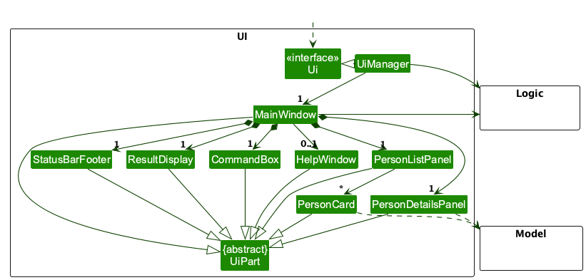

The UI consists of a `MainWindow` and its parts, such as `CommandBox`, `ResultDisplay`, `PersonListPanel`, and `StatusBarFooter`. All of these, including `MainWindow`, inherit from the abstract `UiPart` class, which captures common behavior among classes that represent visible GUI parts.

The `UI` component uses the JavaFX UI framework. The layouts of these UI parts are defined in matching `.fxml` files in `src/main/resources/view`. For example, [`MainWindow.fxml`](https://github.com/se-edu/addressbook-level3/tree/master/src/main/resources/view/MainWindow.fxml) specifies the layout of [`MainWindow`](https://github.com/AY2627S1-CS2103T-F11-1/tp/tree/master/src/main/java/seedu/address/ui/MainWindow.java).

The `UI` component,

* executes user commands using the `Logic` component.
* listens for changes to `Model` data so that the UI can be updated with the modified data.
* keeps a reference to the `Logic` component, because the `UI` relies on the `Logic` to execute commands.
* depends on some classes in the `Model` component because it displays `Person` objects from the model.

### Logic component

**API** : [`Logic.java`](https://github.com/AY2627S1-CS2103T-F11-1/tp/tree/master/src/main/java/seedu/address/logic/Logic.java)

Here's a (partial) class diagram of the `Logic` component:

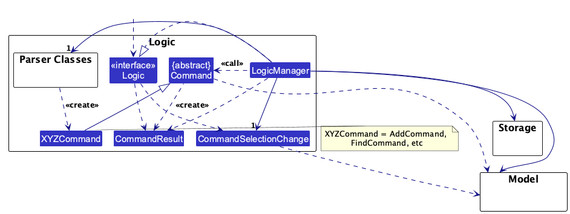

The sequence diagram below illustrates the interactions within the `Logic` component, taking `execute("delete 1")` API call as an example.


<div markdown="span" class="alert alert-info">:information_source: **Note:** The lifeline for `DeleteCommandParser` should end at the destroy marker (X), but due to a limitation of PlantUML, it continues to the end of the diagram.
</div>

How the `Logic` component works:

1. When `Logic` is called upon to execute a command, the command is passed to an `AddressBookParser` object, which in turn creates a parser that matches the command (e.g., `DeleteCommandParser`) and uses it to parse the command.
1. This results in a `Command` object (more precisely, an object of one of its subclasses e.g., `DeleteCommand`) which is executed by the `LogicManager`.
1. The command can communicate with the `Model` when it is executed (e.g. to delete a person).<br>
   Note that although this is shown as a single step in the diagram above for simplicity, the code can require several interactions between the command object and the `Model` to complete the operation.
1. The result of the command execution is encapsulated as a `CommandResult` object which is returned from `Logic`.

Here are the other classes in `Logic` (omitted from the class diagram above) that are used for parsing a user command:


How the parsing works:
* When called upon to parse a user command, the `AddressBookParser` class creates an `XYZCommandParser` (`XYZ` is a placeholder for the specific command name, e.g., `AddCommandParser`). The parser uses the other classes shown above to parse the user command and create an `XYZCommand` object (e.g., `AddCommand`). The `AddressBookParser` returns that object as a `Command` object.
* All `XYZCommandParser` classes, such as `AddCommandParser` and `DeleteCommandParser`, implement the `Parser` interface so they can be treated similarly where appropriate, for example during testing.

### Model component
**API** : [`Model.java`](https://github.com/AY2627S1-CS2103T-F11-1/tp/tree/master/src/main/java/seedu/address/model/Model.java)

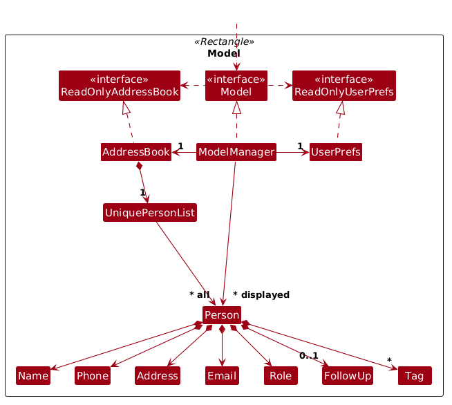


The `Model` component,

* stores the address book data i.e., all `Person` objects (which are contained in a `UniquePersonList` object). Each `Person` contains a `Name`, `Phone`, `Email`, `Address`, `Role`, a set of `Tag` objects, and an optional `FollowUp`.
* maintains a `FilteredList<Person>` backed by the address book's contact list, and a `SortedList<Person>` wrapping that filtered view. The `getFilteredPersonList()` API exposes the filtered and sorted displayed list as an unmodifiable `ObservableList<Person>`. The UI and index-based commands use the same displayed ordering, while the underlying contact order remains unchanged.
* stores a `UserPrefs` object that represents the user’s preferences (currently, just the GUI settings). This is exposed to the outside as a `ReadOnlyUserPrefs` object.
* does not depend on any of the other three components (as the `Model` represents data entities of the domain, they should make sense on their own without depending on other components)

<div markdown="span" class="alert alert-info">:information_source: **Note:** The alternative, arguably more object-oriented, design below keeps a unique list of tags in `AddressBook`, and each `Person` references tags from that list. This lets `AddressBook` maintain one `Tag` object per unique tag instead of each `Person` holding its own `Tag` objects.<br>

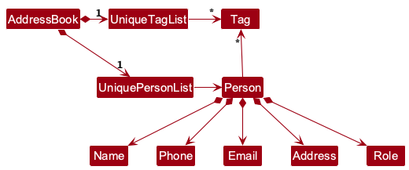

</div>


### Storage component

**API** : [`Storage.java`](https://github.com/AY2627S1-CS2103T-F11-1/tp/tree/master/src/main/java/seedu/address/storage/Storage.java)

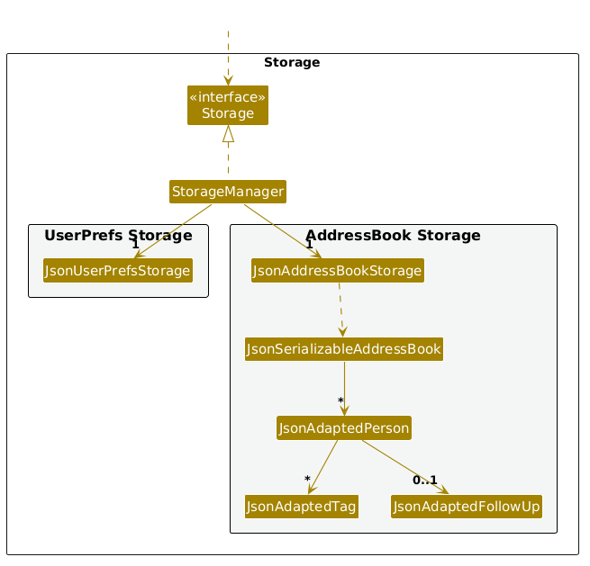

The `Storage` component,
* can save both address book data and user preference data in JSON format, and read them back into corresponding objects.
* is implemented by `StorageManager`, which delegates the actual JSON file access to `JsonAddressBookStorage` and `JsonUserPrefsStorage` (one class per data file).
* can create a timestamped backup copy of the address book data file when corrupted or invalid data is encountered on launch.
* writes files atomically using `FileUtil#writeToFile`, writing to a temporary sibling file before replacing the target file to prevent data corruption.
* depends on some classes in the `Model` component (because the `Storage` component's job is to save/retrieve objects that belong to the `Model`).

The sequence diagram below shows how the application recovers when a corrupted data file is encountered at startup:

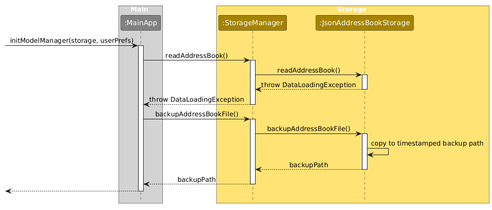

### Common classes

Classes used by multiple components are in the `seedu.address.commons` package.

--------------------------------------------------------------------------------------------------------------------

## **Implementation**

This section describes some noteworthy details on how certain features are implemented.

### Adding a contact

KeyBossWarriorsPro allows keyboard shop managers to add new contacts with an industry-specific `Role` (e.g., `Supplier`, `Employee`, `Partner`, `Customer`) and optional tags. Contact uniqueness is governed by communication identifiers (phone number and email address) rather than names.

#### Implementation details

The sequence diagram below illustrates how an `add` command travels through `Logic` and `Model` components when a user executes `add n/John Doe p/98765432 ... r/Supplier`:

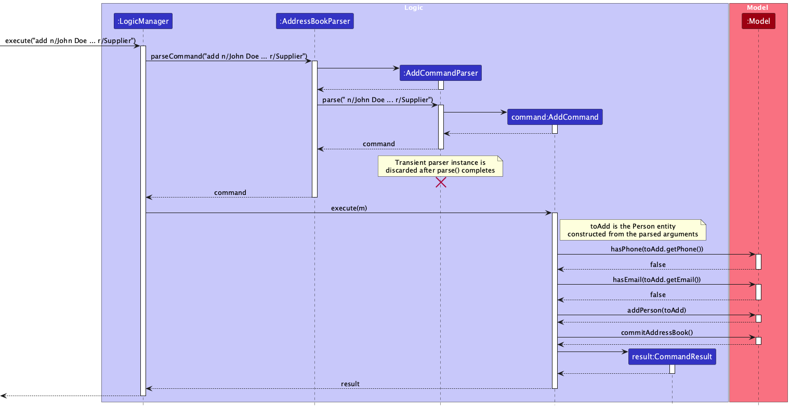

How the command parsing and execution works:

1. `LogicManager#execute()` calls `AddressBookParser#parseCommand()`.
2. `AddressBookParser` instantiates an `AddCommandParser` and invokes its `parse()` method.
3. `AddCommandParser` performs multi-tier input validation:
   * `ArgumentTokenizer#verifyNoUnrecognizedPrefixes()` ensures no unrecognized prefixes are supplied.
   * `ArgumentMultimap#verifyNoMissingPrefixesFor()` verifies that all compulsory prefixes (`n/`, `p/`, `e/`, `a/`, `r/`) are present.
   * Checks that the preamble is empty.
   * `ArgumentMultimap#verifyNoDuplicatePrefixesFor()` rejects repeated compulsory prefixes.
   * Parses individual fields into domain value objects (`Name`, `Phone`, `Email`, `Address`, `Role`, and a set of `Tag` objects) via `ParserUtil`.
4. A new `Person` entity `toAdd` is constructed, and `AddCommandParser` returns an `AddCommand` object (labeled `command`). Because `AddCommandParser` is a transient parser instance created solely to parse a single command string, it is discarded immediately after `parse()` completes, as indicated by the destroy marker (`X`).
5. `LogicManager` executes `AddCommand#execute(Model)`.
6. `AddCommand` queries `Model` to verify uniqueness:
   * `Model#hasPhone(toAdd.getPhone())`
   * `Model#hasEmail(toAdd.getEmail())`
7. If uniqueness validation passes, `Model#addPerson(toAdd)` inserts the contact into `UniquePersonList`, and `Model#commitAddressBook()` saves the state snapshot into `VersionedAddressBook` to support undo/redo.
8. A `CommandResult` containing success feedback (labeled `result`) is returned to `LogicManager`.

The activity diagram below illustrates the duplicate resolution and defensive error-handling branching during `AddCommand#execute()`. Each decision node specifies explicit, mutually exclusive guard conditions on all outgoing branches, and all execution paths converge cleanly to a single final node:

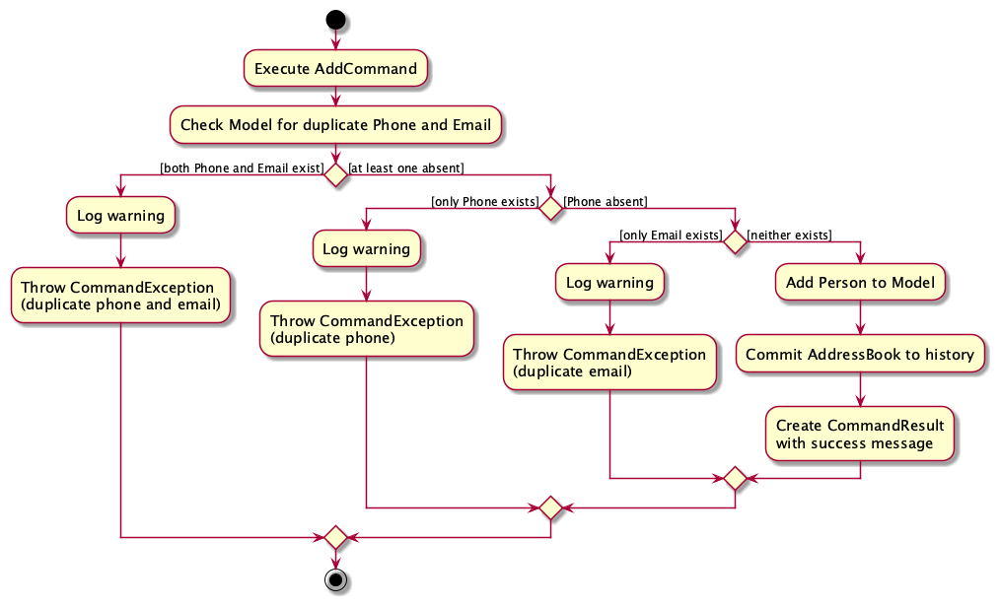

#### Design considerations

**Aspect: Contact identity and duplicate criteria**

* **Alternative 1 (current choice):** Identity uniqueness enforced independently on phone number and email address.
  * Pros: Matches realistic keyboard shop management where multiple contacts may share identical names (e.g., common customer names), but communication channels must remain unique. Provides targeted error feedback indicating whether the phone, email, or both clashed.
  * Cons: Requires multiple uniqueness checks against `UniquePersonList` before insertion.
* **Alternative 2:** Identity determined solely by contact name (baseline AB3).
  * Pros: Simpler lookup logic.
  * Cons: Disallows contacts sharing a name and allows duplicate phone numbers and email addresses to enter the pipeline undetected.

**Aspect: Input prefix validation**

* **Alternative 1 (current choice):** Strict rejection of unrecognized prefixes via `ArgumentTokenizer#verifyNoUnrecognizedPrefixes()`.
  * Pros: Prevents user typos from failing silently (e.g., mistyping `r/Supplier` as `w/Supplier` or supplying extra unsupported prefixes).
  * Cons: Requires maintaining explicit prefix whitelists for each command parser.
* **Alternative 2:** Permissive parsing where unrecognized prefixes are treated as part of preamble or ignored.
  * Pros: Simpler parsing code.
  * Cons: Causes silent input drops where mistyped fields are omitted without warning the user.

### Command-specific help

`AddressBookParser` parses the optional command name after `help` and creates a `HelpCommand`. Bare `help` opens the full help window, while `help COMMAND` displays usage for a supported command in the result area.

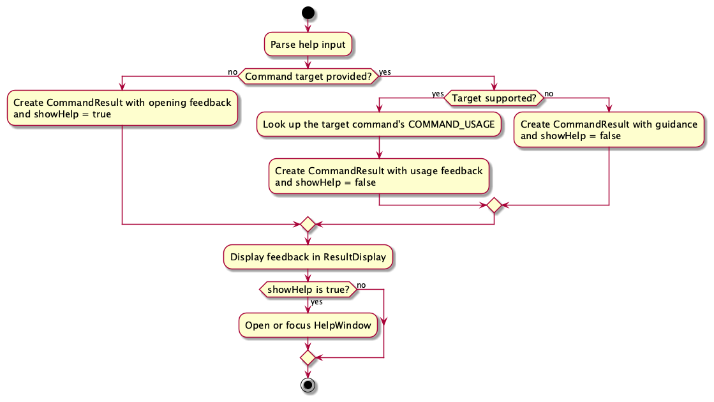

* Bare `help` returns opening feedback in a `CommandResult` with `showHelp` set to `true`.
* For a supported target, `HelpCommand` retrieves the command's `COMMAND_USAGE` from `COMMAND_USAGE_BY_NAME` and returns it as feedback with `showHelp` set to `false`.
* An unsupported target returns guidance with `showHelp` set to `false`. The supported command names in the guidance are derived from the same map.

`MainWindow` displays the feedback in `ResultDisplay` and opens or focuses `HelpWindow` only when `showHelp` is `true`. The activity diagram assumes at most one command target; input with multiple target words is rejected during parsing, and the parser error is displayed in the result area.

### Adding and deleting contact tags

The `edit` command supports incremental tag changes using `edit INDEX [t/TAG_TO_ADD]... [dt/TAG_TO_DELETE]...`, alongside the existing contact fields. Additions preserve existing tags, and deletions remove only explicitly named tags. The complete edit succeeds or leaves all contact details and the displayed list unchanged.

#### Parsing and descriptor

`CliSyntax` defines `PREFIX_TAG` (`t/`) and `PREFIX_DELETE_TAG` (`dt/`). `EditCommandParser` recognizes both prefixes and permits repeated occurrences of each.

`EditCommand.EditPersonDescriptor` stores `tagsToAdd` and `tagsToDelete` separately. Each setter makes a defensive copy, and each getter returns an `Optional<Set<Tag>>` containing an unmodifiable set. An absent optional means that operation was not supplied. Both sets participate in the copy constructor, `isAnyFieldEdited()`, `equals()`, and `toString()`.

After parsing the index and other contact fields, `EditCommandParser`:

1. Parses additions, then deletions, using `parseTagsForEdit()`. An absent prefix produces an empty optional. A supplied blank tag is rejected, including bare `t/` and `dt/`; neither clears all tags.
2. Uses `ParserUtil.parseTags()` to validate tag names and construct sets. `Tag` collapses consecutive internal spaces, and its equality and hash code support case-insensitive comparison and deduplication.
3. Rejects any tag present in both sets. If several tags conflict, the first tag alphabetically, ignoring case, is reported using the spelling from the additions set.
4. Rejects a command with no fields or tag operations, or returns an `EditCommand` containing a copy of the descriptor.

Invalid tag values are rejected before add/delete conflicts. Missing deletions require the selected contact's current data and are checked during execution.

#### Execution and validation

`EditCommand#execute()` resolves the index against the currently displayed list. `createEditedPerson()` checks every requested deletion against the original contact's tags before constructing the edited contact. If any requested tag is absent, it throws a `CommandException`; if several are absent, the first alphabetically, ignoring case, is reported.

For valid deletions, `createEditedPerson()` copies the original tag set into a new `HashSet`, removes `tagsToDelete`, adds `tagsToAdd`, and constructs a new `Person` using the supplied or existing contact details. Adding an existing tag succeeds without creating a duplicate. Removing every tag requires explicitly listing every tag for deletion.

`execute()` then performs the existing duplicate phone and email checks. Only after all validation succeeds does it call `Model#setPerson()` and reset the displayed list with `PREDICATE_SHOW_ALL_PERSONS`. A validation failure therefore changes neither the original contact nor the displayed list, including when a command combines valid deletions, a missing deletion, additions, and other field edits.

Condition | Error constant | Exception
--------|------------------|----------
Blank value after `t/` or `dt/` | `EditCommand.MESSAGE_EMPTY_TAG` | `ParseException`
Invalid tag name | `Tag.MESSAGE_CONSTRAINTS` | `ParseException`
Same tag in both operations | `EditCommand.MESSAGE_TAG_CONFLICT` | `ParseException`
Requested deletion absent from the selected contact | `EditCommand.MESSAGE_TAG_NOT_FOUND` | `CommandException`

#### Test coverage

* `EditPersonDescriptorTest` covers independent tag operations, defensive copying, unmodifiable getters, equality, and string output.
* `EditCommandParserTest` covers both prefixes, repeated and empty values, invalid names, case-insensitive conflicts, and validation order.
* `EditCommandTest` covers additions, selective deletions, combined operations, filtered lists, existing tags, missing deletions, and preservation of the full model on failure. It also parses command text through `AddressBookParser` before execution to cover the acceptance examples and failure cases.
* `AddressBookParserTest` checks that an edit containing both operations is routed to the edit parser.


### Contact follow-up management

Each `Person` owns an `Optional<FollowUp>`. A contact can have zero or one follow-up.

#### Model and persistence
`FollowUp` stores an immutable `LocalDate` due date and description. Both fields are mandatory when a follow-up exists.
* Due dates accept past values and restrict years to `0000`–`9999`.
* Descriptions are stripped of surrounding whitespace, must be non-blank, and must not exceed 200 UTF-16 code units, as measured by `String.length()`.
* Internal ISO control characters and Unicode line and paragraph separators are rejected. Other casing and internal spacing are preserved.
* Equality and hashing include both fields, with case-sensitive description comparison.
  `FollowUp` has no back-reference to `Person`. The owning contact establishes the association, so changing contact details does not require updating a separate contact identifier.

`Person.equals()` and `hashCode()` include the optional follow-up. `isSamePerson()` retains its existing phone/email identity rules. Contact edits preserve the follow-up, while deleting a contact removes it.

`JsonAdaptedFollowUp` converts the nested JSON representation to and from the model. `JsonAdaptedPerson` treats missing or null follow-ups as absent, preserving compatibility with older files. A present follow-up with missing or invalid fields is rejected through the existing invalid-data handling mechanism.

#### Setting and clearing follow-ups
`AddressBookParser` routes `followup` to `FollowUpCommandParser`, which returns one of two commands:
* `SetFollowUpCommand` creates or replaces a follow-up using a displayed contact index, due date, and description.
* `ClearFollowUpCommand` removes the selected contact's follow-up and rejects contacts without one.

The abstract `FollowUpCommand` holds the shared command word and usage message.

The parser uses the existing tokenizer and prefix-validation utilities. Both set fields are mandatory, duplicate and unknown prefixes are rejected, and clear syntax cannot be combined with set parameters. `ParserUtil.parseFollowUpDate()` enforces the exact four-digit-year format and rejects impossible calendar dates.

Each modifying command resolves the index against the currently displayed list, constructs a replacement `Person`, calls `Model#setPerson()`, and commits once to undo history. Other contact fields and the current filter are preserved. Failed validation does not modify data or history. Automatic persistence uses the existing logic/storage flow.

#### Querying follow-ups
`FollowUpsCommandParser` supports an empty query, `overdue`, or a single `by/` date cutoff. These map to the `all()`, `overdue()`, and `dueBy()` factories of `FollowUpsCommand`.
The command replaces the model's current contact predicate, searching the entire address book:

* `ALL` accepts contacts with a follow-up.
* `OVERDUE` accepts follow-ups due strictly before today.
* `BY_DATE` accepts follow-ups due on or before the cutoff.

The overdue query uses an injectable `Clock`. Today's date is captured when the command executes and remains fixed in the predicate until the query is rerun. Results retain address-book order.

Queries do not commit snapshots or alter contact data. An empty result displays `No follow-ups found.`

#### UI integration
`PersonCard` populates the follow-up date and description defined in `PersonListCard.fxml`. Contacts without follow-ups hide the section and set it unmanaged so it occupies no layout space.

The existing observable-list and cell-update mechanism refreshes cards when contacts are replaced. No separate follow-up listener is required.

#### Test coverage

* Model tests cover validation, normalization, equality, and contact identity.
* Storage tests cover JSON round trips, older records, and malformed nested follow-ups.
* Command tests cover creation, replacement, removal, filtered indexes, failure preservation, and undo/redo.
* Query tests use fixed clocks to verify date boundaries, time zones, filtering, and history preservation.
* Parser tests cover supported forms, invalid arguments, shared date parsing, and command routing.


### Sorting contacts

The sort feature changes the displayed contact order without rearranging the address book's underlying contact list.
It supports case-insensitive, ascending ordering by name, role, or both, with field order determining priority.

#### Parsing and validation

`AddressBookParser` delegates sort arguments to `SortCommandParser`. Empty or whitespace-only arguments default to
`SortField.NAME`. Otherwise, the parser splits arguments on whitespace and maps standalone `n/` and `r/` tokens to
an ordered list of `SortField` values. Duplicate fields, values attached to prefixes, and unsupported tokens produce
specific `ParseException` messages before any model state changes.

`SortCommand` independently requires one or two distinct, non-null fields and makes an immutable defensive copy of
the supplied list. This preserves field priority even if the caller later modifies its original list.

#### Comparator construction and execution

`SortCommand#execute()`:

1. Creates a comparator for the first field using `Comparator.comparing()` with `String.CASE_INSENSITIVE_ORDER`.
2. Chains any subsequent field using `thenComparing()`, so it breaks ties in the preceding field.
3. Clears the active filter using `Model#updateFilteredPersonList(PREDICATE_SHOW_ALL_PERSONS)`.
4. Applies the comparator using `Model#updateSortedPersonList()`.
5. Returns a `CommandResult`, selecting empty-address-book feedback when the underlying contact list is empty.

The empty-address-book check affects feedback only: sorting is still applied so contacts added afterwards follow
the selected order. An empty search result does not trigger this feedback if the underlying address book has contacts.
Executing another sort command replaces the previous comparator rather than adding to the previous sorting criteria.

#### Model integration, persistence, and history

`ModelManager` constructs `filteredPersons` from the address book's observable contact list, then constructs
`sortedPersons` from `filteredPersons`. `updateFilteredPersonList()` changes the predicate on the filtered view;
`updateSortedPersonList()` changes the comparator on the sorted view. Neither operation rearranges stored contacts.
With no comparator, the sorted view follows its source order.

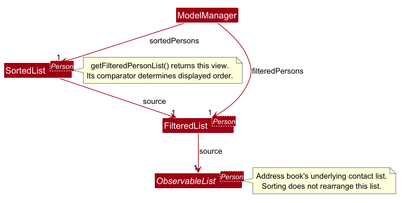

The partial class diagram shows each view's source relationship. The sorted view supplies displayed order;
the underlying contact list retains its source order for persistence. Unrelated model classes and list inheritance
relationships are omitted for clarity.

`getFilteredPersonList()` retains its existing API name but returns `sortedPersons`. The UI and commands such as
`EditCommand` and `DeleteCommand` therefore resolve displayed indices against the same list. Changes to the source
contacts propagate through both views, including repositioning a contact when an edit changes its sort keys.
`ModelManager#equals()` also compares the displayed lists so models with different visible ordering are distinguished.

After successful execution, `LogicManager` saves `model.getAddressBook()`, not the displayed view. The comparator is
not serialized, so sorting does not change saved contact order and is reset on restart.

Sort does not call `commitAddressBook()`, so it creates no undo snapshot and does not discard redo history.
Undo and redo restore contact data and clear the filter without replacing the active comparator. Subsequent find
and list commands also retain the selected sort order.

#### Design considerations

**Aspect: Sorting a displayed view rather than the stored list**

* **Current choice:** Wrap the filtered list in a `SortedList`. This separates presentation order from stored data
  and undo history, keeps displayed indices consistent, and automatically maintains ordering after contact changes.
* **Alternative:** Reorder the underlying contact list. This would change the order saved to storage and require
  additional handling to separate sorting from contact-data history and maintain ordering after later changes.

**Aspect: Sorting all contacts rather than only search results**

Sort explicitly resets the filter so it provides a way to browse the complete address book in a chosen order.
Filtering remains independent: users can run find afterwards to narrow the sorted view without losing its comparator.

#### Test coverage

* `SortCommandParserTest` covers default sorting, field priority, whitespace, and invalid arguments.
* `SortCommandTest` covers constructor validation, defensive copying, comparator priority, case handling, empty and
  single-contact lists, filter clearing, replacement sorting, and sorting contacts added after an empty-book sort.
* `ModelManagerTest` covers displayed ordering, chained comparators, filtering, live add/edit/delete updates through
  an existing list reference, and model equality.
* `AddressBookParserTest` checks command dispatch to the sort parser.
* `LogicManagerTest` exercises complete command sequences involving displayed indices, filtering, editing,
  deletion, undo/redo, invalid sorts, equal-key contact identities, and preservation of saved contact order.


### Undo/redo feature

#### Implementation

The proposed undo/redo mechanism is facilitated by `VersionedAddressBook`. It extends `AddressBook` with an undo/redo history, stored internally as an `addressBookStateList` and `currentStatePointer`. Additionally, it implements the following operations:

* `VersionedAddressBook#commit()` — Saves the current address book state in its history.
* `VersionedAddressBook#undo()` — Restores the previous address book state from its history.
* `VersionedAddressBook#redo()` — Restores a previously undone address book state from its history.
* `canUndoAddressBook()` — Indicates whether a previous snapshot exists.
* `canRedoAddressBook()` — Indicates whether a next snapshot exists.

These operations are exposed in the `Model` interface as `Model#commitAddressBook()`, `Model#undoAddressBook()` and `Model#redoAddressBook()` respectively.

`AddCommand`, `DeleteCommand`, `EditCommand`, `ClearCommand`, `SetFollowUpCommand` and `ClearFollowUpCommand` commit once after successful execution, immediately before returning their result. Validation failures do not commit. Successful modifying commands commit even when the resulting contact data is unchanged.

`UndoCommandParser` and `RedoCommandParser` accept empty or whitespace-only arguments and reject additional arguments. Their commands check availability before requesting the corresponding model operation. Undo and redo do not create new snapshots.

The underlying `VersionedAddressBook` also checks its boundaries and throws `NoUndoableStateException` or `NoRedoableStateException` when navigation is unavailable.

Given below is an example usage scenario and how the undo/redo mechanism behaves at each step.

Step 1. The user launches the application for the first time. The `VersionedAddressBook` will be initialized with the initial address book state, and the `currentStatePointer` pointing to that single address book state.


Step 2. The user executes `delete 5` command to delete the 5th person in the address book. The `delete` command calls `Model#commitAddressBook()`, causing the modified state of the address book after the `delete 5` command executes to be saved in the `addressBookStateList`, and the `currentStatePointer` is shifted to the newly inserted address book state.


Step 3. The user executes `add n/David …​` to add a new person. The `add` command also calls `Model#commitAddressBook()`, causing another modified address book state to be saved into the `addressBookStateList`.


<div markdown="span" class="alert alert-info">:information_source: **Note:** If a command fails its execution, it will not call `Model#commitAddressBook()`, so the address book state will not be saved into the `addressBookStateList`.

</div>

Step 4. The user now decides that adding the person was a mistake, and decides to undo that action by executing the `undo` command. The `undo` command will call `Model#undoAddressBook()`, which will shift the `currentStatePointer` once to the left, pointing it to the previous address book state, and restores the address book to that state.


<div markdown="span" class="alert alert-info">:information_source: **Note:** If the `currentStatePointer` is at index 0, pointing to the initial AddressBook state, then there are no previous AddressBook states to restore. The `undo` command uses `Model#canUndoAddressBook()` to check if this is the case. If so, it will return an error to the user rather
than attempting to perform the undo.

</div>

The following sequence diagram shows how an undo operation goes through the `Logic` component:


<div markdown="span" class="alert alert-info">:information_source: **Note:** The lifeline for `UndoCommand` should end at the destroy marker (X), but due to a limitation of PlantUML, it continues to the end of the diagram.

</div>

Similarly, how an undo operation goes through the `Model` component is shown below:


The `redo` command does the opposite — it calls `Model#redoAddressBook()`, which shifts the `currentStatePointer` once to the right, pointing to the previously undone state, and restores the address book to that state.

<div markdown="span" class="alert alert-info">:information_source: **Note:** If the `currentStatePointer` is at index `addressBookStateList.size() - 1`, pointing to the latest address book state, then there are no undone AddressBook states to restore. The `redo` command uses `Model#canRedoAddressBook()` to check if this is the case. If so, it will return an error to the user rather than attempting to perform the redo.

</div>

Step 5. The user then decides to execute the command `list`. Commands that do not modify the address book, such as `list`, will usually not call `Model#commitAddressBook()`, `Model#undoAddressBook()` or `Model#redoAddressBook()`. Thus, the `addressBookStateList` remains unchanged.


Step 6. The user executes `clear`, which calls `Model#commitAddressBook()`. Since the `currentStatePointer` is not pointing at the end of the `addressBookStateList`, all address book states after the `currentStatePointer` will be purged. Reason: It no longer makes sense to redo the `add n/David …​` command. This is the behavior that most modern desktop applications follow.


The following activity diagram summarizes what happens when a user executes a new command:


#### Persistence and failures

After successful command execution, `LogicManager` saves the current contact
data through `Storage`. Only contact data is serialized; snapshots and the
history pointer remain in memory.

If saving after undo or redo throws `IOException`, `LogicManager` reports a
`CommandException`. The restored contact data and moved history pointer remain
in memory; no rollback is performed.

#### Design considerations:

**Aspect: How undo & redo execute:**

* **Alternative 1 (current choice):** Saves the entire address book.
  * Pros: Easy to implement.
  * Cons: May have performance issues in terms of memory usage.

* **Alternative 2:** Individual command knows how to undo/redo by
  itself.
  * Pros: Will use less memory (e.g. for `delete`, just save the person being deleted).
  * Cons: We must ensure that the implementation of each individual command is correct.

_{more aspects and alternatives to be added}_

### \[Proposed\] Data archiving

_{Explain here how the data archiving feature will be implemented}_

### Atomic file persistence

#### Overview
To prevent data corruption during unexpected process terminations or disk write failures, file persistence uses atomic replacement through `FileUtil#writeToFile`.

#### Implementation details
When `LogicManager` executes a command, it requests `Storage` to persist the updated address book:
1. `JsonAddressBookStorage` serializes the address book into JSON via `JsonUtil#saveJsonFile`.
2. `JsonUtil` delegates writing to `FileUtil#writeToFile(Path file, String content)`.
3. `FileUtil#writeToFile` creates any missing parent directories, then creates a temporary file in the same parent directory (`tmp_<filename>.<rand>.tmp`). Using the same directory ensures the temporary file resides on the same filesystem volume, enabling atomic file replacement.
4. The serialized JSON content is written to the temporary file using UTF-8 encoding.
5. `FileUtil#writeToFile` atomically replaces the destination file using `Files.move(..., StandardCopyOption.ATOMIC_MOVE, StandardCopyOption.REPLACE_EXISTING)`.
6. If the filesystem does not support atomic moves (`AtomicMoveNotSupportedException`), it falls back to `StandardCopyOption.REPLACE_EXISTING`.
7. If an error occurs during writing or moving, a `finally` block deletes the temporary file and the `IOException` is re-thrown.
8. `LogicManager` catches `AccessDeniedException` or `IOException`, converts it into a `CommandException`, and `MainWindow` displays the save error to the user in the command result display. The original file on disk remains untouched.

The sequence diagram below illustrates the interactions across components during an atomic write operation:

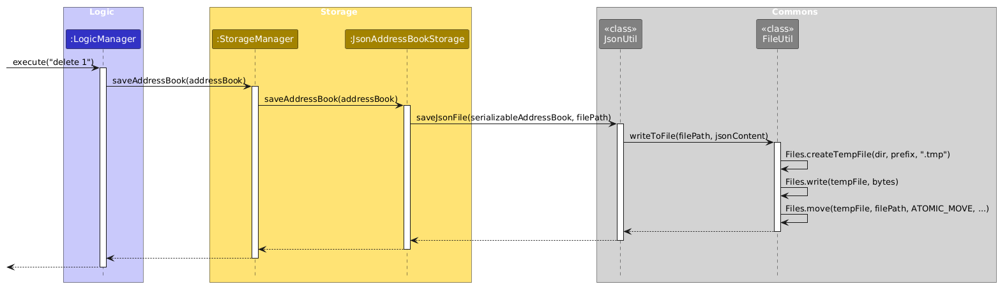

#### Design considerations
**Aspect: How file writes are performed**
* **Alternative 1 (current choice):** Write to a sibling temporary file and atomically replace the destination file.
  * Pros: Guarantees file integrity. A crash during serialization or disk writing leaves the existing data file intact.
  * Cons: Requires temporary disk space equal to the size of the saved file during the write operation.
* **Alternative 2:** Direct in-place file write using `Files.writeString` with standard truncation.
  * Pros: Simpler implementation without temporary files.
  * Cons: The file is truncated before new content is written. A crash or disk error mid-write leaves the data file empty or partially written, corrupting user data.


--------------------------------------------------------------------------------------------------------------------

## **Documentation, logging, testing, dev-ops**

* [Documentation guide](Documentation.md)
* [Testing guide](Testing.md)
* [Logging guide](Logging.md)
* [DevOps guide](DevOps.md)

--------------------------------------------------------------------------------------------------------------------

## **Appendix: Requirements**

### Product scope

**Target user profile**:

* owns or manages a small artisan keyboard shop
* has a need to organize and find contacts for employees, suppliers and service providers
* prefers desktop apps over other types of applications
* is proficient in typing
* is reasonably comfortable using keyboard commands and CLI apps

**Value proposition**: KeyBossWarriorsPro helps small artisan keyboard shop owners and managers
organize and find employee, supplier, and service provider contacts using keyboard commands,
enabling experienced users to coordinate daily operaitons faster than with a typical mouse-driven
GUI application.


### User stories

Priorities: High (must have) - `* * *`, Medium (nice to have) - `* *`, Low (unlikely to have) - `*`

| Priority | As  an …                      | I want to …                                                                                | So that I can…                                                            |
|----------|-------------------------------|--------------------------------------------------------------------------------------------|---------------------------------------------------------------------------|
| `* * *`  | artisan keyboard shop manager | add contacts with their names, phone numbers, emails and addresses                         | keep all shop contacts in one place.                                      |
| `* * *`  | artisan keyboard shop manager | delete outdated contacts by index or identifier                                            | have a contact list that stays relevant.                                  |
| `* * *`  | artisan keyboard shop manager | edit contact details                                                                       | reach the right people using updated communication details.               |
| `* * *`  | artisan keyboard shop manager | list all contacts in a compact table                                                       | quickly review staff, suppliers and service providers.                    |
| `* * *`  | artisan keyboard shop manager | tag contacts as employees, suppliers, or service providers                                 | distinguish staff from external partners.                                 |
| `* * *`  | artisan keyboard shop manager | search contacts by full or partial names regardless of letter case                         | quickly find a particular contact's details.                              |
| `* * *`  | artisan keyboard shop manager | filter contacts by component tags                                                          | find alternative suppliers when stock is low.                             |
| `* * *`  | artisan keyboard shop manager | contact and tag changes to be saved automatically to a local JSON file                     | persist changes between sessions.                                         |
| `* * *`  | artisan keyboard shop manager | load saved contacts automatically at startup                                               | begin work without re-entering all details.                               |
| `* * *`  | artisan keyboard shop manager | view command syntax and parameters using the help command                                  | learn commands within the application.                                    |
| `* * *`  | artisan keyboard shop manager | exit the application using a CLI command                                                   | exit gracefully while keeping my terminal open.                           |
| `* *`    | artisan keyboard shop manager | sort contacts by name, role, or both in my chosen priority                                  | browse contacts alphabetically or group contacts with matching roles.      |
| `* *`    | artisan keyboard shop manager | tag contacts with finer-grain details like suppliers by the components supplied            | find suitable suppliers and service providers for custom keyboard builds. |
| `* *`    | artisan keyboard shop manager | record suppliers' minimum order quantities                                                 | check order requirements before placing group-buy orders.                 |
| `* *`    | artisan keyboard shop manager | record suppliers' manufacturing and shipping lead times in days                            | estimate delivery dates for keyboard pre-orders.                          |
| `* *`    | artisan keyboard shop manager | record payment terms on supplier profiles                                                  | arrange payments according to agreements with suppliers.                  |
| `* *`    | artisan keyboard shop manager | tag technicians by their verified assembly skills                                          | assign suitable staff for custom builds.                                  |
| `* *`    | artisan keyboard shop manager | associate contacts with keyboard group-buy projects                                        | view all suppliers and artisans involved in a particular project.         |
| `* *`    | artisan keyboard shop manager | record emergency phone numbers for part-time soldering staff                               | contact them during urgent builds.                                        |
| `* *`    | artisan keyboard shop manager | record hourly pay rates of staff                                                           | calculate payroll for my employees.                                       |
| `* *`    | artisan keyboard shop manager | record part-time staff's weekly availability                                               | schedule shifts without repeatedly asking when they are free.             |
| `* *`    | artisan keyboard shop manager | filter staff by their availability on a specific weekend                                   | quickly arrange staffing for major assembly sessions.                     |
| `* *`    | artisan keyboard shop manager | filter contacts using a combination of tags                                                | find contacts matching several requirements.                              |
| `* *`    | artisan keyboard shop manager | view a supplier's notes, tags and transaction history in an expanded card                  | review the relationship before negotiating a contract renewal.            |
| `* *`    | artisan keyboard shop manager | use single-letter command aliases and shortened prefixes                                   | manage my contacts with fewer keystrokes.                                 |
| `* *`    | artisan keyboard shop manager | browse recent commands using the Up and Down arrow keys                                    | reuse or edit commands without retyping them.                             |
| `* *`    | artisan keyboard shop manager | export all contacts to a formatted CSV file using one command                              | share supplier details or use them in spreadsheets.                       |
| `* *`    | artisan keyboard shop manager | import contacts from a CSV backup with automatic format validation                         | migrate existing contact lists into KeyBossWarriorsPro.                   |
| `*`      | artisan keyboard shop manager | create timestamped contact backups automatically after operations                          | restore data after accidental changes or deletions.                       |
| `*`      | artisan keyboard shop manager | record defect rates and quality ratings for suppliers                                      | avoid suppliers with recurring product defects.                           |
| `*`      | artisan keyboard shop manager | toggle terminal notifications for upcoming supplier contract expiries and restocking dates | place orders before assembly supplies run out.                            |
| `*`      | artisan keyboard shop manager | customize CLI theme colors                                                                 | personalize my workspace                                                  |
| `*`      | artisan keyboard shop manager | check shipment tracking from a supplier's contact card using a tracking code               | monitor incoming product deliveries.                                      |
| `*`      | artisan keyboard shop manager | track past unit-price quotes for products                                                  | compare prices and negotiate better deals.                                |

### Use cases

(For all use cases below, the **System** is the `KeyBossWarriorsPro` and the **Actor** is the `user`, unless specified otherwise)

**Use Case: UC1 - Add a Contact**

**MSS**

1.  User requests to add a contact, providing its name, phone number, email, address, role, and any optional tags.
2.  `KeyBossWarriorsPro` adds the contact and confirms the addition.

    Use case ends.

**Extensions**

*  1a. One or more mandatory fields are missing.

  *  1a1. `KeyBossWarriorsPro` shows an error message indicating the missing parameter(s).

     Use case ends.

*  1b. A provided field value is invalid or extraneous arguments are provided.

  *  1b1. `KeyBossWarriorsPro` shows an error message.

     Use case ends.

*  1c. The phone number or email belongs to an existing contact.

  *  1c1. `KeyBossWarriorsPro` shows an error message.

    Use case ends.


**Use Case: UC2 - Find a Contact**

**MSS**

1.  User requests to find contacts by specifying one or more search criteria
    (by name, role, or tag).

2.  `KeyBossWarriorsPro` displays all contacts matching the given criteria.

    Use case ends.

**Extensions**

*  1a. No search criteria are provided, or all provided values are blank.
  *  1a1. `KeyBossWarriorsPro` shows an error message.
       
       Use case ends.

*  1b. A provided search criterion is invalid (e.g. unrecognised prefix).
  *  1b1. `KeyBossWarriorsPro` shows an error message.
       
     Use case ends.

*  2a. No contacts match the given criteria.
  *  2a1. `KeyBossWarriorsPro` informs the user that no contacts were found.
       
       Use case ends.


**Use Case: UC3 - Delete a Contact**

**Preconditions**

*  `KeyBossWarriorsPro` is running and a contact list is displayed.

**MSS**
1.  User requests to delete a contact by specifying its index in the currently displayed contact list.
2.  `KeyBossWarriorsPro` deletes the selected contact.

    Use case ends.

**Extensions**

*  1a. No contacts are currently displayed (contact list is empty).

  *  1a1. `KeyBossWarriorsPro` informs the user that there are no contacts to delete.

     Use case ends.

*  1b. The DELETE request contains a missing or invalid argument.

  * 1b1. `KeyBossWarriorsPro` shows an error message.

    Use case ends.


**Use Case: UC4 - Add or Delete Contact Tags**

**MSS**

1.  User requests to find contacts using a name keyword.
2.  `KeyBossWarriorsPro` displays matching contacts and their details.
3.  User requests to add or delete named tags on a contact using its displayed index. Both operations may be supplied in one edit.
4.  `KeyBossWarriorsPro` applies the tag changes, preserves the remaining tags, and displays the updated contact information.

    Use case ends.

**Extensions**

*  2a. No contacts match the keyword.

  *  2a1. `KeyBossWarriorsPro` informs the user that no contacts were found.

     Use case ends.
 
*  3a. A tag prefix has an empty or invalid value.

  * 3a1. `KeyBossWarriorsPro` shows an error message and leaves all contact details unchanged.

       Use case resumes at step 3.

*  3b. Tags are repeated within the same operation, or an addition names a tag already on the contact.

  *  3b1. `KeyBossWarriorsPro` retains one instance of each tag, comparing names case-insensitively.
  
     Use case resumes at step 4.

*  3c. The same tag is supplied for addition and deletion, including with different letter casing.

  *  3c1. `KeyBossWarriorsPro` shows a conflict error and leaves all contact details unchanged.

     Use case resumes at step 3.

*  3d. At least one requested deletion names a tag the contact does not have.

  *  3d1. `KeyBossWarriorsPro` identifies a missing tag and rejects the entire edit. Valid deletions, additions, and other field edits in the same command are not applied.

     Use case resumes at step 3.


**Use Case: UC5 - List Contacts**

**MSS**

1.  User requests to list contacts.
2.  `KeyBossWarriorsPro` resets the active search filter (if any) and shows a list of contacts.
    
    Use case ends.

**Extensions**

*  1a. The user supplies additional arguments.
  *  1a1. `KeyBossWarriorsPro` displays a warning that additional arguments are ignored.

     Use case resumes at step 2.

*  2a. The address book is empty.

  *  2a1. `KeyBossWarriorsPro` informs the user that no contacts were found.

     Use case ends.

**Use Case: UC6 - Sort Contacts**

**MSS**

1. User requests to sort contacts, optionally specifying name, role,
   or both in the desired priority.
2. `KeyBossWarriorsPro` displays all contacts in ascending,
   case-insensitive order using the requested criteria, defaulting
   to name when none are specified.

   Use case ends.

**Extensions**

* 1a. The sorting criteria are invalid, such as repeated fields,
  unsupported fields, or values supplied after a sorting field.

  * 1a1. `KeyBossWarriorsPro` explains the error and leaves the
    displayed list and active sorting criteria unchanged.

    Use case ends.

* 2a. The address book contains no contacts.

  * 2a1. `KeyBossWarriorsPro` informs the user that there are no
    contacts to sort. The selected sorting criteria remain active
    for contacts added afterwards.

    Use case ends.

### Non-Functional Requirements

1.  **Operating Environment:** Should work on any _mainstream OS_ (Windows 10/11, macOS, Linux) as long as it has Java `25` or above installed.
2.  **Portability:** The application should be packaged as a single standalone executable JAR file that runs without requiring an installer.
3.  **Network Independence:** Should function fully offline without requiring an active internet connection or any remote server.
4.  **Capacity:** Should be able to store and manage up to 1,000 contacts and 5,000 tags without noticeable sluggishness in performance for typical usage.
5.  **Responsiveness:** All standard commands (such as `list`, `filter`, `find`, `add`, `delete`) should respond and update the interface within 1.0 second under normal workloads.
6.  **Package Size:** The packaged application JAR file should not exceed 100 MB.
7.  **Data Persistence:** Data must be stored in a human-editable text file (JSON format) located at `data/keyboss.json`.
8.  **Fault Tolerance:** If the data file is corrupted or formatted incorrectly, the application should start gracefully (e.g., discard or isolate corrupted state and notify the user) without unexpected crashes.
9.  **Database Independence:** The system should not depend on a Relational Database Management System (RDBMS) like MySQL or SQLite.
10. **Typing-Preferred Usability:** A user with above-average typing speed for regular English text should be able to accomplish all routine contact and inventory management tasks faster using CLI commands than using a mouse.
11. **Display Adaptability:** The user interface should remain fully functional and legible on screen resolutions of 1920x1080 with display scaling up to 150%, and on 1280x720 at 100% scaling (effective minimum viewport of 1280x720).
12. **Single-User Scope:** The software is designed for a single artisan keyboard shop manager working locally; concurrent multi-user access is out of scope.
13. **Data Integrity:** File saves must be atomic so that unexpected crashes or disk write errors do not leave data files truncated or partially written.

### Glossary

#### Keyboard terms

* **Artisan keyboard**: A custom mechanical keyboard built from individual parts such as custom cases, switches, printed circuit boards (PCBs), and keycaps.
* **Switch**: The mechanical mechanism seated under each keycap that opens and closes an electrical circuit on keypress. Common types include linear, tactile, and clicky switches.
* **PCB (Printed Circuit Board)**: The internal circuit board that registers switch activations and connects to the computer, some using hot-swap sockets so users can replace switches without soldering.
* **Keycap**: A removable plastic cover mounted on a switch stem. Keycaps are commonly molded from PBT or ABS plastic.
* **Stabilizer**: A mechanical wire and housing assembly used on wider keys (such as space, enter, and shift) to keep the key level when pressed off-center.

#### Contact terms

* **Contact**: A person or commercial entity stored in the address book.
* **Duplicate contact**: Two contact entries that share either the same phone number or the same email address.
* **Private contact detail**: A contact detail that is not meant to be shared with others
* **Primary role**: The required top-level classification assigned to a contact (`employee`, `supplier`, or `service provider`). Every contact has exactly one primary role.
* **Tag**: An optional label added to a contact to record categories, supplied parts (such as `switches` or `keycaps`), or services. A contact can have zero or more tags.

#### Technical terms

* **Mainstream OS**: Windows, Linux, Unix, or macOS.
* **CLI (Command Line Interface)**: A text-based interface where the user types commands into a prompt to operate the application.
* **GUI (Graphical User Interface)**: A visual interface created with JavaFX that displays contact cards, command outputs, and application status.
* **JSON (JavaScript Object Notation)**: A lightweight, human-readable text file format used to save address book records locally on disk.

--------------------------------------------------------------------------------------------------------------------

## **Appendix: Instructions for manual testing**

Given below are instructions to test the app manually.

<div markdown="span" class="alert alert-info">:information_source: **Note:** These instructions only provide a starting point for testers to work on;
testers are expected to do more *exploratory* testing.

</div>

### Launch and shutdown

1. Initial launch

   1. Download the JAR file and copy it into an empty folder.

   1. Double-click the JAR file.<br>
      Expected: The GUI opens with a set of sample contacts. The window size may not be optimal.

1. Saving window preferences

   1. Resize the window to an optimal size. Move the window to a different location. Close the window.

   1. Relaunch the app by double-clicking the JAR file.<br>
       Expected: The most recent window size and location are retained.

1. _{ more test cases …​ }_

### Deleting a person

1. Deleting a person while all persons are being shown

   1. Prerequisites: List all persons using the `list` command, with multiple persons in the list.

   1. Test case: `delete 1`<br>
      Expected: The first contact is deleted from the list. The status message shows the deleted contact's details.

   1. Test case: `delete 0`<br>
      Expected: No person is deleted. The status message shows error details.

   1. Other incorrect delete commands to try: `delete`, `delete x`, `...` (where x is larger than the list size)<br>
      Expected: Similar to previous.

1. _{ more test cases …​ }_

### Editing contact tags

Create a test contact with a unique phone number and email, for example `add n/TagEditExample p/12345678 e/tagedit@example.com a/Test Address r/Employee t/trainee t/supplier`. Run `find TagEditExample` and confirm this is the only result. Before each command below, run `find TagEditExample` again because a successful edit displays all contacts. Perform the cases in the order shown.

Command | Expected result
--------|------------------
`edit 1 t/solderer` | Tags become `trainee`, `supplier`, and `solderer`; other fields are preserved.
`edit 1 dt/TRAINEE` | Tags become `supplier` and `solderer`.
`edit 1 t/builder dt/solderer` | Tags become `supplier` and `builder`.
`edit 1 n/Alex dt/supplier dt/trainee` | Missing-tag error for `trainee`. The name remains `TagEditExample`, both tags remain, and the filtered list is unchanged.
`edit 1 t/builder dt/BUILDER` | Conflict error for `builder`; the contact and filtered list are unchanged.
`edit 1 t/` and `edit 1 dt/` (separately) | Empty-tag error; the contact and filtered list are unchanged.
`edit 1 dt/supplier dt/builder` | Both named tags are removed, leaving no tags.

### Managing and viewing follow-ups

Create a contact with a unique name, phone number, and email. Run `find` with that name so only the test contact is displayed. Use valid dates relative to the computer's current local date.

Action | Expected result
-------|----------------
Set a follow-up using `followup 1 by/DATE abt/Confirm quotation`. | The card shows the date and description.
Set another follow-up with a different date and description. | Both values replace the existing follow-up.
Run `edit 1 r/Employee`, then find the test contact again. | The follow-up is preserved.
Run `followups overdue` with a follow-up due yesterday, then today. | Yesterday's follow-up appears; today's does not.
Run `followups by/DATE` using the follow-up's exact due date. | The contact appears because the cutoff is inclusive.
Find the test contact and run `followup 1 clear`. | The follow-up disappears; the contact remains.
Run `undo`, then `redo`. | The follow-up is restored, then removed again.
Try a missing field, duplicate prefix, impossible date, and invalid index. | An error appears without changing data or the view.
Restart after setting a follow-up. | The saved follow-up is restored.
Display a long description and resize the window. | Verify the full text remains accessible and record any horizontal-scrolling limitation.

### Sorting contacts

Use a disposable application copy in a separate folder: these tests replace saved contacts.
Before each numbered group, run `clear` and execute these setup commands separately, in order:

```text
add n/Zoe p/81000001 e/zoe@sort.example.com a/Test Address r/Employee
add n/ben p/81000002 e/ben@sort.example.com a/Test Address r/Supplier
add n/Alice p/81000003 e/alice.supplier@sort.example.com a/Test Address r/Supplier
add n/alice p/81000004 e/alice.distributor@sort.example.com a/Test Address r/Distributor
```

The roles and phone numbers distinguish the two Alice contacts. Perform each group's cases in order.

1. Sorting criteria

   1. Test case: `sort` (also try `sort n/`).<br>
      Expected: Both Alice contacts precede ben, then Zoe, ignoring case.
      Feedback: `Listed all contacts in sorted order.`

   1. Test case: `sort n/ r/`.<br>
      Expected: alice (Distributor), Alice (Supplier), ben, Zoe. Role breaks the matching-name tie.

   1. Test case: `sort r/ n/`.<br>
      Expected: alice (Distributor), Zoe, Alice (Supplier), ben. Name breaks the Supplier tie.

1. Filtering while sorting

   1. Test case: `find r/Supplier`, followed by `sort n/`.<br>
      Expected: Find shows two Suppliers; sort reveals all four contacts in name order.

   1. Test case: `sort r/ n/`, then `find r/Supplier`, then `list`.<br>
      Expected: Find shows Alice (Supplier), then ben. List restores all four in role-then-name order.

1. Editing and deleting by displayed index

   1. Prerequisites: Run `sort n/ r/`.

   1. Test case: `edit 1 n/Zara`.<br>
      Expected: Contact `81000004` is renamed and repositioned. Order: Alice (Supplier), ben, Zara, Zoe.

   1. Test case: `delete 3`, then `undo`, then `redo`.<br>
      Expected: Zara (`81000004`) is deleted, restored, then deleted again. Other contacts remain;
      name-then-role sorting is retained throughout.

1. Invalid arguments and empty contacts

   1. Prerequisites: Run `sort r/ n/`, then `find r/Supplier`.

   1. Test cases: `sort n/ n/`, `sort n/Alice`, and `sort t/` (separately).<br>
      Expected: Duplicate-field, unexpected-value, and unexpected-token errors respectively.
      The two displayed Suppliers and their details remain unchanged. Afterwards, `list` restores all four
      contacts in role-then-name order, confirming the comparator is unchanged.

   1. Test case: `clear`, then `sort n/`.<br>
      Expected: Empty list and feedback `Error: There are no contacts to sort.`
      Add Zoe and Alice (Supplier) using their setup commands: Alice appears before Zoe.

### Saving data

1. Dealing with missing/corrupted data files

   1. Missing data file
      1. Prerequisites: Close the application. Delete `data/addressbook.json` if it exists.
      1. Test case: Launch the application.<br>
         Expected: The application starts normally and creates a new `data/addressbook.json` file populated with sample contact data. No backup file is created.

   1. Corrupted data file
      1. Prerequisites: Close the application. Open `data/addressbook.json` in a text editor and corrupt its content (e.g., enter `{ invalid json content }` or delete required closing brackets).
      1. Test case: Launch the application.<br>
         Expected: The application starts with an empty contact list. A timestamped backup file named `data/addressbook.json.backup.YYYYMMDD_HHMMSS` (or with a `_1`, `_2` suffix if a file with the same name already exists) is created in the `data/` folder with the exact corrupted content. A warning message appears in the result display stating that the file is corrupted, identifying the backup path, and indicating that the application started with an empty contact book.

   1. Corrupted data file with failed backup (e.g., write-protected folder)
      1. Prerequisites: Close the application. Corrupt `data/addressbook.json` and make the `data/` directory read-only to prevent writing new files.
      1. Test case: Launch the application.<br>
         Expected: The application starts with an empty contact list. A warning message appears in the result display stating that the data file is corrupted and creating a backup failed.

1. _{ more test cases …​ }_
