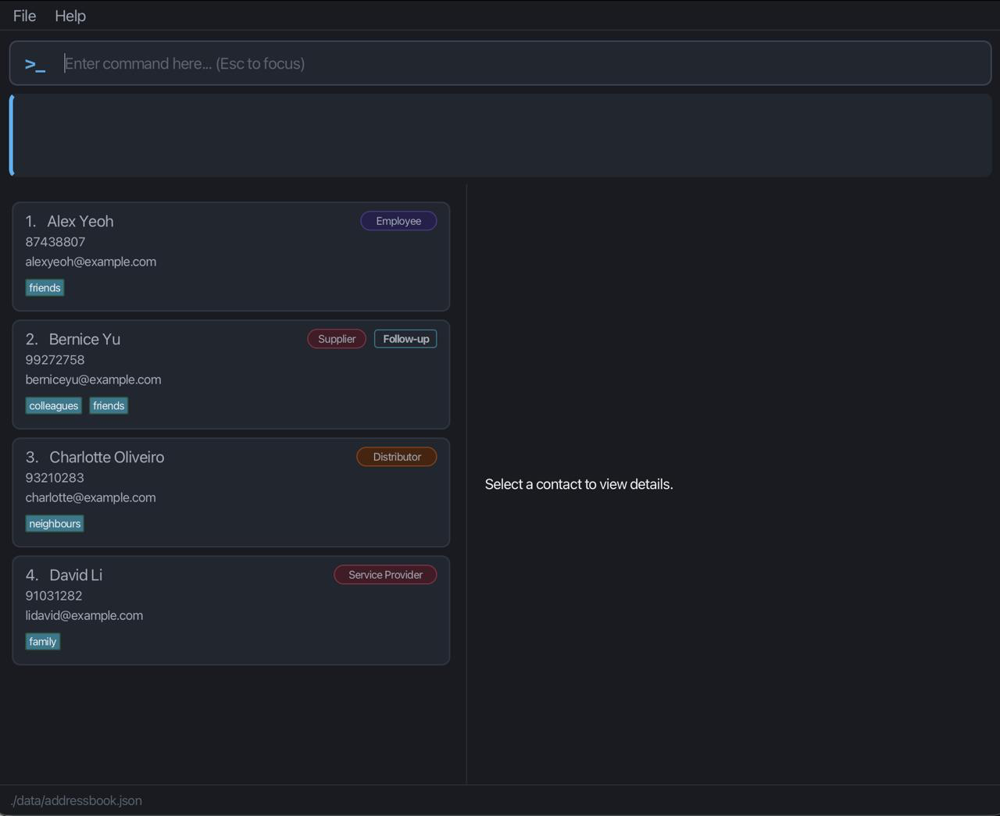
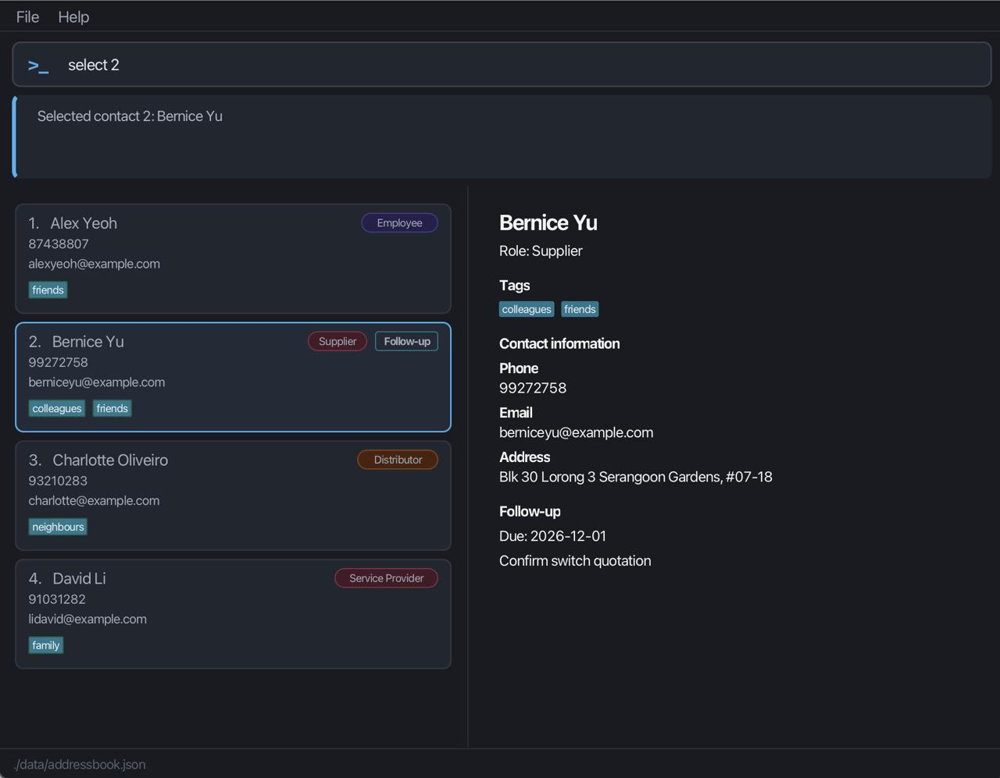
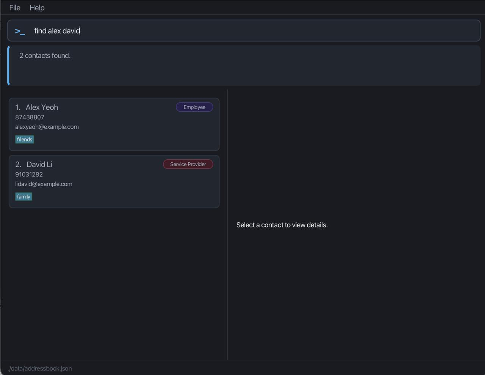
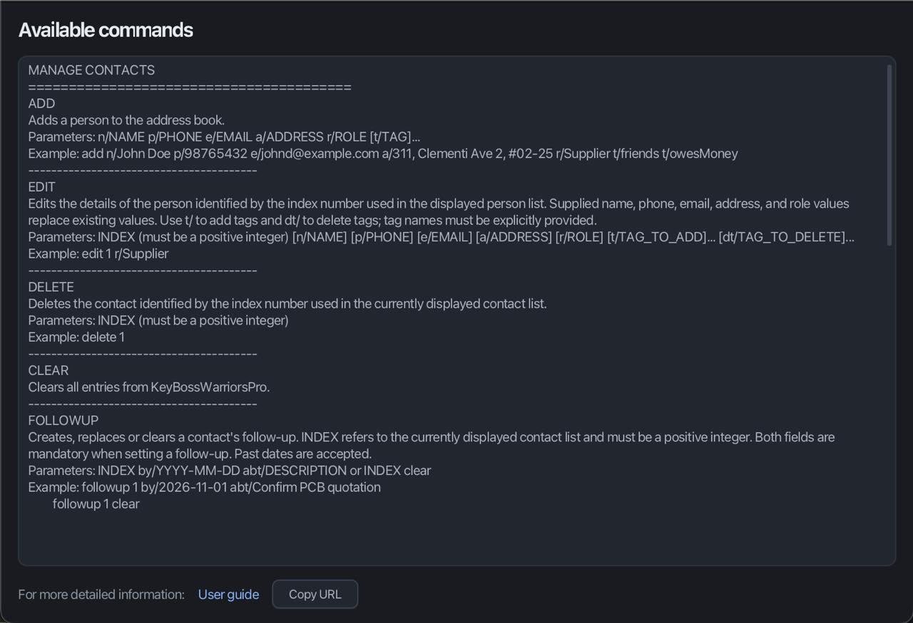
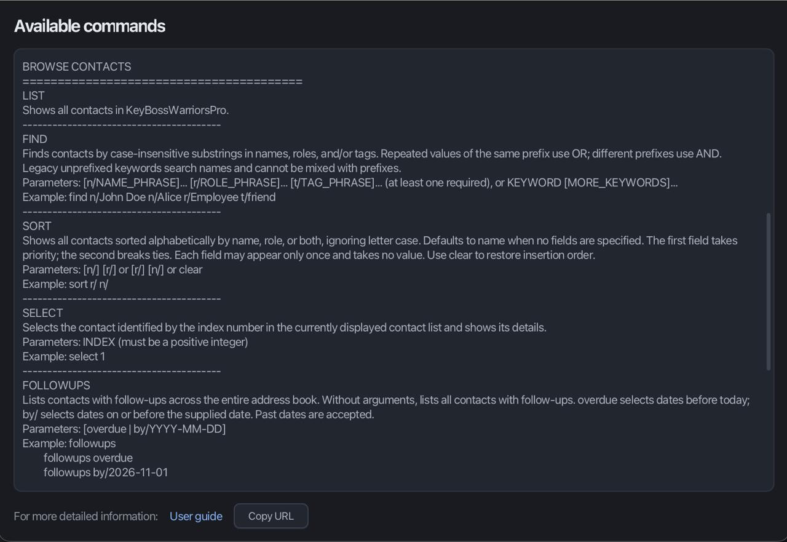
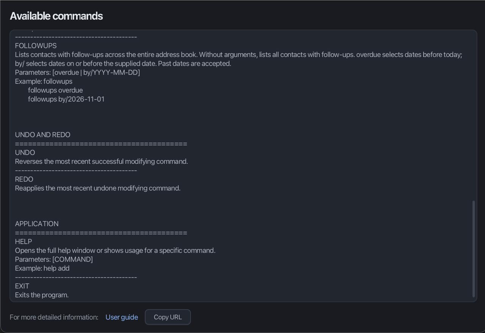

## Introduction

KeyBossWarriorsPro is a desktop contact manager for artisan mechanical keyboard shop managers.
Use typed commands to manage suppliers, distributors, employees, and other shop contacts, organise them by role and tags,
and track pending follow-ups. The graphical interface displays your contact list and each contact's full details.

**Guide version:** 1.6. Use the guide that matches your application version when working with a different release.

* Table of Contents
{:toc}

--------------------------------------------------------------------------------------------------------------------

## Quick start

1. Install a Java Development Kit (JDK) version **25 or later**. In a terminal, run `java -version` to check the installed version.

2. Download the application JAR from the [GitHub releases page](https://github.com/AY2627S1-CS2103T-F11-1/tp/releases).
   The examples below use the filename `keybosswarriorspro.jar`; substitute the downloaded filename if it differs.

3. Put the JAR in a folder where you have permission to save files. This will be your application folder.

4. Open a terminal, use `cd` to enter that folder, and launch the application:

   ```text
   java -jar keybosswarriorspro.jar
   ```

   Launch from this same folder each time so the application uses the same saved data.
   When no saved contact file exists, the application starts with sample contacts.

   

5. Enter commands in the command box, one at a time, and press **Enter**:

   Command | Expected result
   --------|----------------
   `list` | Displays all contacts.
   `select 1` | Shows the first displayed contact's details, if there is at least one contact.
   `find r/Supplier` | Displays contacts whose roles contain `Supplier`.
   `list` | Returns to all contacts.
   `help add` | Displays instructions for adding a contact.

6. To try adding a contact, first check that its phone number and email address are not already in use:

   ```text
   add n/John Doe p/98765432 e/johnd@example.com a/John street, block 123, #01-01 r/Supplier
   ```

   Result: Adds John Doe as a supplier and saves the contact. After a successful addition, you can immediately use `undo` to reverse it.

Refer to [Understanding the interface](#understanding-the-interface) for the controls and [Command reference](#command-reference)
for complete instructions. When finished, use `exit` to close the application. Undo and redo history is cleared when it closes.

--------------------------------------------------------------------------------------------------------------------

## Understanding the interface

### Viewing contact details

Read a contact's full information in the details panel on the right.

**Steps and controls**

1. Click a contact in the list, or enter `select INDEX` using its currently displayed number.
2. When the contact list has keyboard focus, use the Up and Down arrow keys to move between contacts.
   The details panel updates without moving keyboard focus.
3. Scroll the details panel to read long content. Drag the divider to adjust the two panel widths.
4. Press **Esc** from the contact list, details panel, or command feedback to return to command input.
   Your draft command, cursor position, text selection, and selected contact are preserved.

**Expected result**

The selected contact's name, role, tags, phone number, email address, address, and follow-up appear in the details panel.
Empty tags and absent follow-ups do not leave blank sections.

On startup, or when no contact is selected, the panel shows `Select a contact to view details.`



**Notes**

List cards show the name, role, phone number, email address, and tags. Long names and email addresses use an ellipsis;
hover over either to read it in full. Each panel scrolls independently. The window has a minimum size of 800 by 600 pixels.

A badge beside the role identifies contacts with a follow-up. Select the contact to read its date and description.
Badges use your computer's local date:

Follow-up due date | Badge
-------------------|------
After today | **Follow-up** (bold)
Today | **Due today** (bold)
Before today | **Overdue** (bold and underlined)
No follow-up | No badge or reserved space

A follow-up due before today is also marked **Overdue** in the details panel. A follow-up due today is not overdue.
The badges and selected contact's overdue display refresh approximately once per minute while the window is open,
and immediately when you return focus to the window or reopen it. Refreshing preserves your selection, scroll positions,
and draft command. After midnight or sleep, the next refresh uses the current local date.

* **Selection after commands:** Commands keep the selected contact when it remains visible, even if its list position changes.
  Editing that contact or changing its follow-up refreshes its details. Changing another contact keeps your current selection.
* **Contacts removed from view:** If the selected contact is deleted or filtered out, or all contacts are cleared, the panel
  returns to the selection prompt. Deleting a selected contact does not automatically select its neighbour.
* **Undo, redo, and invalid input:** Successful `undo` and `redo` commands clear selection. Commands rejected because of
  invalid input keep selection.
* **Saving errors:** If saving an addition, edit, deletion, clear, or follow-up change fails, the contact changes are rolled back.
  The original selection is retained when that contact still exists in the restored list; otherwise the panel returns to the
  selection prompt. Command feedback shows the saving error.

--------------------------------------------------------------------------------------------------------------------

## Command conventions

Type one command in the command box and press **Enter** to execute it.

* Words in `UPPER_CASE` are placeholders for values you supply. In `add n/NAME`, replace `NAME` with a value such as `John Doe`.
* Lowercase command names, prefixes such as `n/`, and keywords such as `clear` are entered as shown.
* Square brackets mark optional parts. For example, `[t/TAG]` can be omitted. Do not type the brackets.
* An optional part followed by `…` can be repeated: `[t/TAG]…` allows no tags, one tag, or several `t/` fields. Do not type the ellipsis.
* Named fields can usually be supplied in any order. Keep positional arguments, such as `INDEX`, in the positions shown in the command's format.
  For `sort`, field order determines sorting priority.
* `INDEX` is a positive whole number starting at 1 and refers to the **currently displayed list**. Check the numbers again after a search,
  follow-up query, sort, edit, or deletion. Commands using an index target that displayed contact.
* Command-specific requirements, such as supplying at least one search criterion or one field to edit, appear with the command's format and parameters.
* See [Input rules](#input-rules) for accepted values and for entering prefix-like text inside a field value.

If you use a PDF version of this guide, take care when copying commands across line breaks: spaces may be lost when pasting into the application.

--------------------------------------------------------------------------------------------------------------------

<a id="features"></a>

## Command reference

Commands are grouped by task. The index-based commands use the numbers in your current displayed list.

### Manage contacts

#### Adding a contact: `add`

Adds a new contact to KeyBossWarriorsPro.

**Format:** `add n/NAME p/PHONE_NUMBER e/EMAIL a/ADDRESS r/ROLE [t/TAG]…`

**Parameters**

* Name, phone number, email address, address, and role are required. Supply each once, in any order.
* Tags are optional. Repeat `t/` to add multiple tags; there is no limit on the number of tags.
* Separate fields with a space. Unknown prefixes are rejected, and a recognised prefix starts the next field.

See [Input rules](#input-rules) for accepted field values, spacing, character limits, and slash escaping.

**Behaviour**

* Adds the contact and saves the change automatically.
* Clears any active search or follow-up filter and displays all contacts. The current sort order is retained,
  so the new contact's position depends on that order.
* Rejects the addition if either the phone number or email matches an existing contact, including one hidden by a filter.
  See the [duplicate-contact rules](#contact-duplicates) for how values are compared.
* Supports [undo](#undoing-a-change-undo) and [redo](#redoing-a-change-redo) during the current session.

**Examples**

Before running either example, check that its phone number and email address are not already used by another contact.

Basic use:

```text
add n/John Doe p/98765432 e/johnd@example.com a/John street, block 123, #01-01 r/Supplier
```

Result: Adds John Doe as a supplier with no tags and displays all contacts in the current order.

Adding a keyboard-parts supplier with multiple tags:

```text
add n/José Tan p/91234568 e/o'connor@example.com a/王 Street 1 r/Supplier (PCB) t/62.5g t/PCB v1.6 t/Switches (5-pin)
```

Result: Adds José Tan with the role `Supplier (PCB)` and the tags `62.5g`, `PCB v1.6`, and `Switches (5-pin)`.

**Common mistakes and recovery**

Problem | What to do
--------|-----------
A required field is missing or supplied more than once | Supply `n/`, `p/`, `e/`, `a/`, and `r/` exactly once each.
The phone number or email is already used | Check existing contacts. Use `edit` to update an existing contact, or ensure both values are unique when adding a new contact.
The phone number contains spaces, `+`, or punctuation | Use 3–20 digits (`0`–`9`) only.
Text inside a value looks like a field prefix | Escape its slash with `\/`. See [slash escaping](#slash-escaping) for examples.
Saving fails | Resolve the file or folder problem reported in the command feedback, then try again. The addition is rolled back if saving fails.

#### Editing a contact: `edit`

Updates the details or tags of a contact in the currently displayed list.

**Format:** `edit INDEX [n/NAME] [p/PHONE_NUMBER] [e/EMAIL] [a/ADDRESS] [r/ROLE] [t/TAG_TO_ADD]… [dt/TAG_TO_DELETE]…`

**Parameters**

* `INDEX` identifies a contact in the [currently displayed list](#command-conventions).
* Supply at least one field or tag operation. Supply each of `n/`, `p/`, `e/`, `a/`, and `r/` at most once.
* Repeat `t/` to add tags or `dt/` to remove tags. Both operations can be used in the same command, in any order.
* Every tag requested for deletion must already belong to the contact. To remove all tags, name each one using a separate `dt/`.
* Empty or whitespace-only tag values are invalid. A tag cannot be added and deleted in the same command, including different spellings that differ only in letter case.
* Use the shared [input rules](#contact-input-rules) and [slash-escaping rules](#slash-escaping), including for `dt/` values.
  Unknown prefixes, such as `xx/`, are rejected.

**Behaviour**

* Supplied name, phone number, email address, address, and role values replace the existing values. Omitted fields keep their values.
* `t/` adds tags without replacing existing tags. Adding a tag that is already present succeeds without creating a duplicate.
* Tag comparisons ignore letter case and recognise Unicode case equivalents. For example, `dt/TRAINEE` removes `trainee`,
  and `σ` and `ς` are treated as equivalent. See [Input rules](#input-rules) for spacing and comparison details.
* Neither the new phone number nor the new email may match another contact, including one hidden by a filter.
  Keeping this contact's own phone number or email is allowed. See [duplicate contacts](#contact-duplicates).
* Each edit succeeds in full or makes no contact changes. A missing tag deletion or another invalid value rejects the entire edit.
* A successful edit clears any search or follow-up filter and displays all contacts. The current sort order is retained;
  changing a name or role may change the contact's displayed index.
* The contact's follow-up is preserved. Changes are saved automatically and support [undo](#undoing-a-change-undo) and [redo](#redoing-a-change-redo).

**Examples**

Basic use, assuming contact 1 is displayed:

```text
edit 1 r/Supplier
```

Result: Changes the first displayed contact's role to `Supplier`, keeps the other details, and displays all contacts.

Updating contact details, assuming contact 1 exists and the new phone number and email are not used by another contact:

```text
edit 1 p/91234567 e/johndoe@example.com r/Supplier
```

Result: Updates the contact's phone number, email, and role in one command.

For each independent example below, assume contact 1 initially has the tags `trainee` and `supplier`:

Command | Expected result
--------|----------------
`edit 1 t/solderer` | Keeps `trainee` and `supplier`, and adds `solderer`.
`edit 1 dt/trainee` | Removes `trainee`, leaving `supplier`.
`edit 1 t/solderer dt/trainee` | Leaves `supplier` and `solderer`.
`edit 1 dt/trainee dt/supplier` | Removes both tags, leaving no tags.

**Common mistakes and recovery**

Problem | What to do
--------|-----------
`edit 1` supplies no change | Add at least one field or tag operation.
`edit 1 t/` or `edit 1 dt/` | The feedback is `Tag names cannot be empty. Specify a tag after t/ or dt/.` Supply a tag name.
`edit 1 t/trainee dt/TRAINEE` | The feedback is `Cannot add and delete the same tag: trainee. Remove it from either t/ or dt/.`
A requested tag is absent | Check the contact's tags before using `dt/`. For example, if contact 1 has only `trainee` and `supplier`, `edit 1 n/Alex dt/trainee dt/solderer` reports `Cannot delete tag: solderer. The selected contact does not have this tag.` The name and both original tags remain unchanged.
An index is no longer valid after a search or sort | Check the displayed numbers again. Use `list` if you want to choose from all contacts.

#### Managing a contact's follow-up: `followup`

Creates, replaces, or removes a contact's pending follow-up. Each contact can have zero or one follow-up, regardless of role.

**Format**

Command | Purpose
--------|--------
`followup INDEX by/DUE_DATE abt/DESCRIPTION` | Creates or replaces a follow-up.
`followup INDEX clear` | Removes an existing follow-up without deleting the contact.

**Parameters**

* `INDEX` identifies a contact in the [currently displayed list](#command-conventions).
* When setting a follow-up, supply `by/` and `abt/` exactly once each, in either order.
* `DUE_DATE` must be a valid calendar date in `YYYY-MM-DD` format, with a year from `0000` to `9999`. Past dates are accepted.
* `DESCRIPTION` follows the [text validation and trimming rules](#text-field-rules), while preserving capitalisation and internal spacing.
  The limit is **200 [characters](#character-counting) after slash decoding and trimming**.
* Descriptions use the [slash-escaping rules](#slash-escaping). For example, `abt/Confirm PCB\/Case quotation` stores `Confirm PCB/Case quotation`.
* For removal, the contact must already have a follow-up. `clear` cannot be combined with `by/`, `abt/`, or extra arguments.

**Behaviour**

* Setting a follow-up replaces any existing follow-up in full. To change only the date or description, supply both fields again.
* Clearing a follow-up can be used when its action is completed or cancelled. Completed follow-ups are not retained in a history.
* Successful changes preserve the contact's other details, the current filter, and sorting. A contact may disappear from a follow-up query
  if the new date no longer matches, or if its follow-up is cleared.
* Contacts with a follow-up show **Follow-up**, **Due today**, or **Overdue** in the list. Select a contact to read its date and description
  in the details panel. See [Viewing contact details](#viewing-contact-details).
* Changes are saved automatically and support [undo](#undoing-a-change-undo) and [redo](#redoing-a-change-redo).
* Editing other contact details preserves the follow-up. Deleting the contact removes its follow-up.

**Examples**

Basic use, assuming contact 1 is displayed:

```text
followup 1 by/2026-11-01 abt/Confirm PCB quotation
```

Result: Sets or replaces the first displayed contact's follow-up with the specified date and description.

Setting a follow-up for a supplier (enter each command separately, and continue only if the search returns a contact):

```text
find r/Supplier
followup 1 by/2026-11-02 abt/Confirm delivery availability
```

Result: Sets the follow-up for the first displayed supplier. Other contact details are preserved.

<a id="removing-a-follow-up"></a>

Removing a follow-up, assuming the currently displayed contact 1 already has one:

```text
followup 1 clear
```

Result: Removes that contact's follow-up while keeping the contact.

**Common mistakes and recovery**

Problem | What to do
--------|-----------
Only a new date or description is supplied | Supply both `by/` and `abt/`; the follow-up is replaced as a whole.
A date is invalid or has the wrong format | Use a real calendar date in `YYYY-MM-DD` format, such as `2026-11-01`.
`followup 1 clear by/2026-11-01` mixes removal with setting fields | Use either the setting format or `followup INDEX clear`.
The contact has no follow-up to clear | Select it to check its details; there is no pending follow-up to remove.
Confusing `followup INDEX clear` with `clear` | The first removes one follow-up. The standalone `clear` command deletes all contacts.

#### Deleting a contact: `delete`

Deletes one contact from the currently displayed list.

**Format:** `delete INDEX`

**Parameters**

* Supply exactly one `INDEX`: a positive number identifying a contact in the [currently displayed list](#command-conventions).
* After a search, follow-up query, or sort, use the numbers shown in that view.

**Behaviour**

* **Deletes the contact immediately, without asking for confirmation. Check the displayed index before executing the command.**
* Removes the contact and its follow-up, if present. The change is saved automatically.
* Keeps the current filter and sort order. Remaining contacts are renumbered.
* If the deleted contact was selected, the details panel returns to its selection prompt without selecting a neighbour.
* Supports [undo](#undoing-a-change-undo) and [redo](#redoing-a-change-redo) during the current session.

**Examples**

Basic use, assuming contact 1 is displayed:

```text
delete 1
```

Result: Deletes the first displayed contact and renumbers the remaining contacts.

Deleting a supplier from search results (enter each command separately, and check the first result before deleting):

```text
find r/Supplier
delete 1
```

Result: Deletes the first matching contact. The supplier filter remains active. Continue with `delete` only if the search returned a contact.

**Common mistakes and recovery**

Problem | What to do
--------|-----------
`delete`, `delete 0`, or a non-numeric index | Supply one positive whole number from the displayed list.
`delete 1 2` | Delete one contact per command; extra indexes are rejected.
The index refers to a previous view | Check the current displayed numbers after filtering, sorting, or another deletion.
No contacts are displayed | The feedback is `No contacts are currently displayed.` Use `list` to show all contacts before choosing an index.
The wrong contact was deleted | Use `undo` before closing the application. If later changes were made, each `undo` reverses the latest change first.

<a id="clearing-all-entries-clear"></a>

#### Clearing all contacts: `clear`

Deletes every contact in KeyBossWarriorsPro.

**Format:** `clear`

**Behaviour**

* **Deletes all contacts immediately, including contacts hidden by a search or follow-up filter. No confirmation is requested.**
* Removes the contacts' follow-ups as well and saves the change automatically.
* The list becomes empty and the details panel returns to its selection prompt.
* A successful clear can be reversed with [undo](#undoing-a-change-undo) during the current session. Undo history is lost when the application closes.
* If the contact book is already empty, displays `KeyBossWarriorsPro is already empty; no contacts were cleared.` and records no new change.

**Examples**

```text
clear
```

Result: Removes all contacts. Use this command only when you intend to empty the entire contact book.

**Common mistakes and recovery**

* `clear 1` still clears **all contacts**; the extra text is ignored. When contacts are cleared, a warning explains that the arguments were ignored.
  Use `delete 1` to delete only the first displayed contact.
* To recover from an accidental clear, use `undo` before closing the application. Changes from previous sessions cannot be undone.

### Browse contacts

#### Listing all contacts: `list`

Displays all contacts in KeyBossWarriorsPro.

**Format:** `list`

**Behaviour**

* Clears any active search or follow-up filter and displays the complete contact list.
* Retains the current sort order. Use [sort](#sorting-all-contacts-sort) to change it or restore insertion order.
* Does not change contact details or undo/redo history.
* If there are no contacts, displays `No contacts found.`

**Examples**

Basic use:

```text
list
```

Result: Displays all contacts in the current order.

Returning to all contacts after a search (enter each command separately):

```text
find r/Supplier
list
```

Result: The first command shows contacts whose roles contain `Supplier`. The second removes that filter and displays
all contacts again, retaining the current sort order.

**Common mistakes and recovery**

`list 3` displays all contacts and warns that `3` was ignored; it does not select contact 3. To view that contact's details,
use `select 3` if that index exists in the displayed list. Other extra text, such as `list abc xyz`, is also ignored with a warning.
Whitespace-only arguments are treated as empty input and do not produce this warning.

#### Locating contacts: `find`

Finds contacts by name, role, or tag using partial matches, ignoring letter case.

**Format**

Search mode | Command
------------|--------
Prefixed search | `find [n/NAME_PHRASE]… [r/ROLE_PHRASE]… [t/TAG_PHRASE]…`
Simple name search | `find NAME_KEYWORD [NAME_KEYWORD]…`

**At least one search criterion is required.** Choose one search mode per command.

**Parameters**

<a id="prefixed-search"></a>

* **Prefixed search:** Use `n/` for names, `r/` for roles, and `t/` for tags. Each prefix needs a non-blank value and can be repeated.
* Each prefixed value is one continuous phrase up to the next prefix or the end of the command. A phrase may contain spaces;
  for example, `find t/good friend` searches for that phrase within a tag.
* Prefixed phrases are trimmed and repeated ordinary spaces are collapsed using the shared [spacing rules](#text-field-rules).
  For example, `find r/Regional   Supplier` and `find r/Regional Supplier` return the same results.

<a id="legacy-search"></a>

* **Simple name search:** Supply space-separated keywords without prefixes. This searches names only, and each word is a separate keyword.
* Do not mix unprefixed keywords with prefixed values. Use the [slash-escaping rules](#slash-escaping) for prefix-like text inside either search mode.

**Behaviour**

* Searches the entire contact book and replaces any previous search or follow-up filter. The current sort order is retained.
* Matches a phrase or keyword anywhere within its field. For example, `han` matches `Hans Bo` and `Johan Meyer`.
* Matching ignores letter case and recognises Unicode case equivalents: `σ` and `ς` match each other.
  Accents are preserved: `JOSÉ` matches `José`, but `Jose` does not match `José`.
* **Prefixed search uses OR within a prefix and AND across different prefixes.** Repeating `r/` accepts any matching role phrase;
  combining `n/` with `r/` requires both a matching name and a matching role.
* **Simple name search uses OR between keywords.** Keyword order does not matter, and adding more keywords broadens the results.
  For example, `find Bo Hans` can match `Hans Bo`.
* Does not change contact details or undo/redo history. Use `list` to return to all contacts.

**Examples**

Basic name search:

```text
find alex david
```

Result: Shows contacts whose names contain `alex` or `david`. With the original sample contacts, this finds Alex Yeoh and David Li.



Finding suppliers whose names contain a phrase:

```text
find n/John Doe r/Supplier
```

Result: Shows contacts whose names contain `John Doe` **and** whose roles contain `Supplier`.

Other prefixed searches:

Command | Expected result
--------|----------------
`find n/alex` | Names containing `alex`, such as `Alex Yeoh`, `alexander`, or `Alexis Tan`.
`find n/John Doe` | Names containing the continuous phrase `John Doe`, such as `John Doe` or `John Doeder`.
`find r/distrib` | Roles containing `distrib`, such as `Distributor` or `Regional Distributor`.
`find t/frie` | A tag containing `frie`, such as `friend` or `Friendly`.
`find r/supp r/distrib` | Roles containing either `supp` or `distrib`.
`find t/friend t/family` | At least one tag containing either `friend` or `family`.
`find n/ali r/emp` | A name containing `ali` and a role containing `emp`, such as Alice with the role Employee.
`find n/John n/ali r/supp` | A name containing either `John` or `ali`, together with a role containing `supp`.

**Common mistakes and recovery**

Problem | What to do
--------|-----------
`find` has no criteria, or a prefix such as `n/` has no value | Supply at least one keyword or a non-blank value after each prefix.
`find Alice r/Supplier` mixes the two modes | Use `find n/Alice r/Supplier`, or use simple name search without prefixes.
Expecting `find John Doe` to require both words | Simple name search matches either keyword. Use `find n/John Doe` to search for the continuous phrase.
A search value contains prefix-like text such as `s/o` | Escape the slash: `find n/David s\/o John` searches for the phrase `David s/o John`, while `find s\/o` searches names for `s/o`.
No contacts match | Change or broaden the criteria, or use `list` to show all contacts. A new `find` searches the entire book again.

#### Sorting all contacts: `sort`

Displays all contacts sorted by name, role, or both, or restores their insertion order.

**Format**

Command | Purpose
--------|--------
`sort` | Sorts by name.
`sort n/` | Sorts by name.
`sort r/` | Sorts by role.
`sort n/ r/` | Sorts by name, then role for contacts with matching names.
`sort r/ n/` | Sorts by role, then name for contacts with matching roles.
`sort clear` | Restores insertion order.

**Parameters**

* Use the lowercase prefixes `n/` and `r/`, separated by whitespace. Each may appear only once and takes no value.
* When both are supplied, the first field takes priority and the second breaks ties.
* `sort` without arguments defaults to name order. `clear` cannot be combined with fields or other arguments.

**Behaviour**

* Sorting is ascending and case-insensitive. For example, `alice` and `Alice` are treated as equal when comparing names.
* Every sort command, including `sort clear`, removes any active search or follow-up filter and displays **all contacts**.
* Contact indexes follow the displayed order. Check them again before using an index-based command.
* `find`, `list`, and `followups` retain the selected sort order. Adding, editing, or deleting contacts updates the displayed order automatically.
  Editing a name or role may move that contact to a different index.
* A new sort command replaces the previous sorting criteria. `sort clear` restores insertion order.
* Sorting changes only the displayed order, not contact details, saved insertion order, or undo/redo history.
  Use `sort clear`, rather than `undo`, to remove sorting. Sorting is reset when the application restarts.
* If the book is empty, the selected sorting still applies to contacts added later. The feedback is
  `No contacts are currently available. The selected sort order will apply to contacts added later.`

**Examples**

Basic use:

```text
sort
```

Result: Displays all contacts in name order.

Browsing by role and then name:

```text
sort r/ n/
```

Result: Groups contacts in ascending role order, then orders contacts with matching roles by name.

Restoring insertion order:

```text
sort clear
```

Result: Displays all contacts in insertion order and reports `Sorting cleared. Contacts will be displayed in insertion order.`

**Common mistakes and recovery**

Problem | What to do
--------|-----------
`sort n/Alice` supplies a value | Use `sort n/`. Sorting accepts field prefixes without values.
`sort n/ n/` repeats a field | Supply each field at most once.
`sort clear r/` combines incompatible modes | Use either `sort clear` or a field-based sort.
Expecting sorting to apply only to search results | Sort first, then run `find` or `followups` again. Those queries retain the selected sorting.

<a id="selecting-a-contact-select-index"></a>

#### Selecting a contact: `select`

Selects a contact from the currently displayed list and shows its full details in the panel on the right.

**Format:** `select INDEX`

**Parameters**

* Supply exactly one `INDEX`: a positive whole number from the [currently displayed list](#command-conventions).
* After `find`, `followups`, or `sort`, use the numbers shown in that view. An index from an earlier view may refer to a different contact.

**Behaviour**

* Highlights the contact, scrolls its card into view, and displays its details. Keyboard focus stays in command input.
* Selecting the same contact again brings its card back into view while keeping the details panel's scroll position.
* Does not change contacts, filters, sorting, or undo/redo history, and preserves available redo history.
* Selection is cleared on restart and after successful `undo` or `redo` commands.
* Invalid input or an empty displayed list leaves the current selection and details unchanged.
* If an automatic save fails after a valid selection, the contact remains selected and the feedback shows the saving error.
  Selection itself does not alter contact data.

**Examples**

Basic use, assuming at least one contact is displayed:

```text
select 1
```

Result: Shows the first displayed contact's full details without changing the current filter or sorting.

Selecting from a search (enter each command separately, and continue only if the search returns a contact):

```text
find r/Supplier
select 1
```

Result: Shows the first displayed supplier's details while keeping the supplier filter active.

Selecting from a sorted list, assuming the contact book is not empty:

```text
sort n/
select 1
```

Result: Shows the first contact in name order.

**Common mistakes and recovery**

Input or condition | Feedback and recovery
-------------------|----------------------
`select` | `INDEX is required.` Supply a displayed index.
`select 0`, `select -1`, `select abc`, or an integer larger than 2147483647 | `INDEX must be a whole number between 1 and 2147483647.` Choose a positive whole number from the displayed list.
`select 1 2` | `select accepts only one INDEX.` Select one contact at a time.
No contacts are displayed | `No contacts are currently displayed.` Use `list` to show all contacts before selecting.
`select 4` when three contacts are displayed | `INDEX 4 is outside the displayed contact list (valid range: 1-3).` Choose one of the displayed numbers.

When exactly one contact is displayed, an out-of-range error states that the only valid index is `1`.

#### Viewing contacts with follow-ups: `followups`

Displays contacts with pending follow-ups, optionally limited by their due dates.

**Format**

Command | Purpose
--------|--------
`followups` | Displays all contacts with a follow-up.
`followups overdue` | Displays contacts with follow-ups due before today.
`followups by/DUE_DATE` | Displays contacts with follow-ups due on or before the specified date.

**Parameters**

* Choose one query mode. `overdue` and `by/` cannot be combined, and contact indexes are not accepted.
* `DUE_DATE` follows the same [date requirements as followup](#managing-a-contacts-follow-up-followup): a valid date in `YYYY-MM-DD` format,
  with a year from `0000` to `9999`. Past cutoffs are accepted.

**Behaviour**

* Searches the entire contact book and replaces any previous search or follow-up filter. Contacts without follow-ups are excluded.
* Retains the current sort order, or insertion order if no sorting is active. Results are numbered from 1;
  use those displayed indexes for subsequent contact commands.
* A follow-up due today is not overdue. `overdue` uses your computer's local date when the command executes.
* Rerun the query after the date changes to refresh date-based results. The interface's automatic badge refresh does not rerun the query.
* Does not change contact details or undo/redo history.
* If no contacts match, displays an empty list and `No follow-ups found.`

**Examples**

Basic use:

```text
followups
```

Result: Displays every contact with a pending follow-up, in the current order.

Checking overdue work:

```text
followups overdue
```

Result: Displays contacts with follow-ups due before today. If there is at least one result, use `select 1` to read the first contact's follow-up.

Checking work due by a particular date:

```text
followups by/2026-11-01
```

Result: Displays contacts with follow-ups due on or before 1 November 2026, including any earlier dates.

**Common mistakes and recovery**

Problem | What to do
--------|-----------
`followups overdue by/2026-11-01` combines modes | Use `followups overdue` or `followups by/2026-11-01` separately.
`followups 1` supplies an index | Use `followups` to query contacts, then `select 1` if that index exists in the results.
Expecting a previous supplier search to remain active | A follow-up query replaces that filter and searches all contacts.
No follow-ups are found | Check the cutoff or use `followups` without a date restriction. Use `list` to return to all contacts.

### Undo and redo

#### Undoing a change: `undo`

Reverses the most recent successful modifying command: `add`, `edit`, `followup`, `delete`, or `clear`.

**Format:** `undo`

**Behaviour**

* Reverses one change at a time. Repeat `undo` to move back through changes made during the current session.
* Undoing `followup` restores the previous follow-up, or removes the newly added follow-up if none existed before.
  Undoing `followup INDEX clear` restores the cleared follow-up.
* A successful undo displays `Undo success!`, shows all contacts, and clears selection. The current sort order is retained.
* Commands such as `find`, `list`, `sort`, `select`, `help`, and the `followups` query do not create undoable contact changes.
* History is cleared when the application closes. Changes from previous sessions cannot be undone.
* The resulting contact data is saved automatically. If saving fails, the undo remains applied in the running application,
  but the saved file is unchanged.

**Examples**

Recovering a deleted contact, assuming contact 1 is displayed (enter each command separately):

```text
delete 1
undo
```

Result: Restores the deleted contact and displays all contacts, with no contact selected.

Reversing a follow-up change, assuming contact 1 is displayed:

```text
followup 1 by/2026-11-01 abt/Confirm quotation
undo
```

Result: Restores the contact's previous follow-up, or removes the new one if none existed before.

**Common mistakes and recovery**

Problem | What to do
--------|-----------
`No more commands to undo!` | There are no earlier changes available in this session. Closing and reopening the application clears history.
`undo 2` supplies an argument | Use `undo` without arguments. To reverse two changes, execute it twice.
Saving fails after undo | Resolve the saving problem reported in the feedback, then run `list` to retry saving the current contact data before closing.

#### Redoing a change: `redo`

Reapplies the most recently undone modifying command.

**Format:** `redo`

**Behaviour**

* Reapplies one undone change at a time. Repeat `redo` while undone changes remain available.
* A successful redo displays `Redo success!`, shows all contacts, and clears selection. The current sort order is retained.
* A new successful modifying command after undo discards the remaining redo history.
* Failed validation and commands such as `find`, `list`, `sort`, `select`, `help`, and the `followups` query preserve redo history.
* History is cleared when the application closes.
* The resulting contact data is saved automatically. If saving fails, the redo remains applied in the running application,
  but the saved file is unchanged.

**Examples**

Reapplying a deletion, assuming contact 1 is displayed (enter each command separately):

```text
delete 1
undo
redo
```

Result: Deletes a contact, restores it, then deletes the same contact again. Successful undo and redo each display all contacts and clear selection.

**Common mistakes and recovery**

Problem | What to do
--------|-----------
`No more commands to redo!` | There is no available undone change. Redo history may have been exhausted, discarded by a new modifying command, or cleared when the application closed.
`redo 2` supplies an argument | Use `redo` without arguments. Execute it once for each change to reapply.
Saving fails after redo | Resolve the saving problem reported in the feedback, then run `list` to retry saving the current contact data before closing.

### Application

<a id="viewing-help-help-command"></a>

#### Viewing help: `help`

Opens the full Help window or displays usage instructions for one command in the result display.

**Format:** `help [COMMAND]`

**Parameters**

* `COMMAND` is optional. Omit it to open the full Help window.
* Supply one supported command name to show its usage: `add`, `edit`, `followup`, `delete`, `clear`, `list`, `find`, `sort`,
  `select`, `followups`, `undo`, `redo`, `help`, or `exit`.

**Behaviour**

* `help` opens the full Help window. `help COMMAND` displays targeted help without opening that window.
* Targeted help for commands without parameters (`clear`, `exit`, `list`, `redo`, and `undo`) contains a brief description.
* Help for commands with required or optional parameters includes a description, syntax, and examples.
  This includes `help`, `sort`, and `followups`, which also work without arguments.
* An unsupported target displays guidance and a list of supported commands instead of opening the Help window.
* Help does not change contact details, filters, sorting, selection, or undo/redo history.

The full Help window uses these categories:

Category | Purpose | Commands
---------|---------|---------
Manage contacts | Add, update, or remove contact data, including follow-ups. | `add`, `edit`, `delete`, `clear`, `followup`
Browse contacts | View, select, filter, or sort contacts. | `list`, `find`, `sort`, `select`, `followups`
Undo and redo | Reverse or restore contact changes. | `undo`, `redo`
Application | View help or exit. | `help`, `exit`

**Examples**

Basic use:

```text
help
```

Result: Opens the full Help window.

Looking up a command:

```text
help add
```

Result: Displays the `add` command's usage, parameters, and an example in the result display.
Similarly, `help select` explains how to select a displayed contact, while `help undo` shows only a brief description.



The screenshot below illustrates the Help window layout. Its `find` wording is from an earlier revision;
see [Locating contacts](#locating-contacts-find) for the current syntax and examples.





**Common mistakes and recovery**

Problem | What to do
--------|-----------
`help unknown` or `help 123` uses an unsupported target | Read the supported command names in the feedback, or use `help` to open the full window.
`help add edit` supplies multiple targets | Request help for one command at a time.
The Help window remains minimised | Restore it manually. See [Known issues and limitations](#known-issues-and-limitations).

#### Exiting the program: `exit`

Closes KeyBossWarriorsPro.

**Format:** `exit`

**Behaviour**

* Displays a closing message briefly, then exits without asking for confirmation.
* Closing the application clears undo and redo history. Changes cannot be undone across sessions.

**Examples**

```text
exit
```

Result: Displays the closing message and closes the application.

**Common mistakes and recovery**

Extra text after `exit` is ignored. For example, `exit -f` exits in the same way as `exit`; the closing message explains
that the extra text was ignored.

--------------------------------------------------------------------------------------------------------------------

## Input rules

Refer to this section for accepted field values, duplicate detection, and slash escaping.
Each command explains which fields it accepts and any command-specific requirements.

<a id="contact-input-rules"></a>

**Contact field requirements**

Field | Accepted input
------|---------------
`NAME` | Unicode text, including punctuation, spaces and literal backslashes. Examples: `John A. Tan`, `José Tan`, `王小明`.
`PHONE_NUMBER` | **3–20 ASCII digits** (`0`–`9`). Spaces, `+`, hyphens, brackets and extensions are not accepted.
`EMAIL` | An address following the [supported email syntax](#supported-email-syntax), such as `o'connor@example.com` or `sales@keyboard--shop.com`.
`ADDRESS` | Unicode text, including punctuation, spaces and literal backslashes. Examples: `123 Street, #01-02`, `王 Street 1`.
`ROLE` | Unicode text, including punctuation, spaces and literal backslashes. Examples: `Supplier (PCB)`, `Employee`, `Customer`.
`TAG` | Unicode text, including punctuation, spaces and literal backslashes. Maximum **50 characters after slash decoding, trimming and collapsing repeated ordinary spaces**. Examples: `62.5g`, `PCB v1.6`, `Switches (5-pin)`.

<a id="text-field-rules"></a>

**Text validation and spacing**

Names, roles, tags and addresses must contain at least one character other than whitespace or invisible
formatting characters. After trimming, control characters (such as internal tabs/newlines) and Unicode
line/paragraph separators are rejected. Other Unicode spaces inside text are allowed.

Trimming removes surrounding ordinary spaces, tabs, line breaks and Unicode whitespace such as em spaces.
It does not remove non-breaking spaces or invisible formatting characters such as zero-width spaces;
these remain literal alongside visible text, even at the edges.

Names, roles, and tags also collapse repeated **ordinary spaces** into one: `n/Anne-Marie   O'Connor`
stores `Anne-Marie O'Connor`. Other Unicode spaces are not collapsed. Addresses preserve internal
spacing. All four fields preserve capitalisation; names, roles and addresses have no maximum length.
Duplicate tags are combined using Unicode-aware, case-insensitive comparison, preserving the first spelling.

<a id="character-counting"></a>

Length limits use Java string length: most characters count as one; some, such as emoji, count as two.

**Phone number limitation**

Formatted numbers, extensions and separate mobile/office numbers can be useful, but this release supports
one digits-only number per contact. Support for formatted or multiple numbers is possible future work.
See the [duplicate-contact rules](#contact-duplicates) for how phone numbers are compared.

<a id="supported-email-syntax"></a>

**Supported email syntax**

Email validation uses the [WHATWG HTML email syntax](https://html.spec.whatwg.org/multipage/input.html#valid-e-mail-address),
which checks the address's form rather than whether the mailbox exists:

* Supply one non-empty local part, an `@`, and a domain. Internal whitespace is not allowed.
* The local part accepts ASCII letters, digits and these characters: `` .!#$%&'*+/=?^_`{|}~- ``.
  Dots may appear at the start/end or consecutively, as permitted by WHATWG.
* Domain labels are separated by dots. Each label contains **1–63 ASCII letters, digits or hyphens**,
  and must start and end with a letter or digit. Consecutive internal hyphens are allowed.
* Single-label domains, such as `user@localhost`, and one-character domain labels are accepted.
* Quoted local parts, address literals such as `user@[127.0.0.1]`, and raw non-ASCII email characters are unsupported.
  International domain names must already use ASCII/Punycode spelling, such as `sales@xn--bcher-kva.example`.

<a id="contact-duplicates"></a>

**Duplicate contacts**

A new contact is rejected if **either** its phone number **or** its email matches
any existing contact, including contacts hidden by the current filter:

* Phone numbers are compared as exact digit strings, including leading zeroes. Local/international forms are not normalised.
* Email capitalisation is preserved, but comparison ignores case. For example, `John@example.com` and `john@example.com` are treated as the same email.
* Names are not used to detect duplicates. Contacts with identical or similar names can be added if both their phone numbers and emails differ.

<a id="slash-escaping"></a>

<div markdown="block" class="alert alert-warning">

**:warning: Entering `/` as part of a value**

**Write `\/` when text after a space looks like a command prefix but belongs to
your value.** For example, `n/David s/o John` is rejected because `s/` is treated
as an unknown prefix. Write `n/David s\/o John` to store `David s/o John`.
A recognised prefix such as `p/` after a space starts another field; escape its slash
too if it belongs to the value.

Field value entered | Stored value
--------------------|-------------
`n/David s\/o John` | `David s/o John`
`r/Supplier p\/Manufacturer` | `Supplier p/Manufacturer`
`t/parts xx\/custom` | `parts xx/custom`
`a/123 Street c\/o John` | `123 Street c/o John`

A slash within a word does not need escaping: `t/key/board` works as written.
However, `t/ key/board` is rejected because the space before `key/` makes it look
like a prefix; write `t/ key\/board` instead.

**If unsure, escape any slash inside a text value.** Both `n/John\/Tan` and
`n/John/Tan` store `John/Tan`. Keep actual field prefixes such as `n/` unchanged.

* This rule applies to names, roles, tags and addresses in `add`/`edit`, tags removed with `dt/`, name/role/tag searches in `find`, and descriptions in `followup`.
* Each `\/` becomes `/` once, before validation and length checks. The removed backslash does not count towards a length limit. Saving and reloading do not change the decoded value.
* Other backslashes remain literal in all five text fields. For example, `n/John\Tan` and `a/C:\Users\John` are unchanged. To retain a backslash immediately before a slash, enter two: `a/Archive \\/` stores `Archive \/`.
* Phone numbers, email addresses and dates do not use this escape syntax. In emails, enter `/` literally: `e/sales/parts@example.com` works, while `e/sales\/parts@example.com` is rejected because it contains a backslash.

</div>

Example of adding a contact whose name, address, and tag contain prefix-like text:

```text
add n/David s\/o John p/91234567 e/david@example.com a/123 Street c\/o John r/Supplier t/parts xx\/custom
```

Result: Stores the name `David s/o John`, address `123 Street c/o John`, and tag `parts xx/custom`.

--------------------------------------------------------------------------------------------------------------------

## Saving, transferring, and recovering data

### Saving the data

KeyBossWarriorsPro attempts to save contact data after each successfully executed command, including browsing commands such as `list`.
Commands rejected because of invalid input do not reach this saving step. You do not need a separate save command.

The application writes updated data to a temporary file before replacing the saved file. This reduces the risk of incomplete writes;
it does not replace keeping a separate backup of important contacts.

If saving fails, read the command feedback and resolve the reported file or folder problem. The effect on the running application depends on the command:

Command type | Result after a saving error | What to do
-------------|-----------------------------|-----------
`add`, `edit`, `delete`, `clear`, or `followup` | The contact-data change is rolled back. | Resolve the saving problem, check the displayed contacts and indexes again, then retry the intended change.
`undo` or `redo` | The change remains applied in the running application but has not been saved successfully. | Resolve the saving problem, then run `list` to retry saving the current data before closing.
Browsing or help, such as `list` or `select` | No contact-data change needs to be rolled back. | Resolve the saving problem and run `list` to retry saving. A valid selection remains selected after a saving error.

### Locating your data

The application uses these paths relative to the **folder from which you launch it**:

File | Purpose
-----|--------
`data/addressbook.json` | Saved contacts, tags, roles, and follow-ups.
`preferences.json` | Window size and position preferences.

Following the Quick start makes this launch folder the folder containing the JAR. If you launch the JAR from another folder,
the application looks for these files there instead. The data-file path is also shown in the application's status bar.

### Backing up your contacts

1. Ensure recent changes have saved successfully, then close the application.
2. Copy `data/addressbook.json` to a separate backup location. Keep the original file in place for normal use.
3. Before replacing a saved contact file, preserve a separate copy of both the existing file and the backup you plan to restore.

Automatic timestamped backups are attempted when an existing data file cannot be loaded. They are recovery copies of that file,
and may contain invalid data; they are not a history of every successful save.

### Transferring contacts to another computer

1. Ensure recent changes on the original computer have saved successfully, then close the application on both computers.
2. Make a separate backup of the original computer's `data/addressbook.json`.
3. Install the application on the destination computer. Use the same version for the transfer, and launch it from its intended application folder.
   Close it before copying files.
4. If the destination already has `data/addressbook.json`, back it up before replacing it.
5. Copy the original contact file into the destination folder's `data/` subfolder as `addressbook.json`.
   Create the `data/` subfolder if needed.
6. Relaunch from that destination application folder and check that your contacts and follow-ups are present.

This replaces the destination contact book; it does not merge two books. Window preferences and undo/redo history are not part of the contact file.

### Recovering data that fails to load

If any saved contact is invalid, the entire contact book fails to load; valid contacts are not loaded separately.
The application attempts to create a timestamped backup in the same `data/` folder, such as
`addressbook.json.backup.20261012_123456`, and starts with an empty book. The launch warning gives the backup path or explains that backup creation failed.

**Stop entering commands if the application reports invalid saved data. A successful command, including `list` or `exit`, can save the empty book.**

1. Close the application using the window's close button, without entering further commands.
2. Preserve a separate copy of the backup named in the warning. If backup creation failed, copy the original `addressbook.json` before editing anything.
3. Work on a copy. Correct both JSON syntax and values that violate the [input rules](#contact-input-rules), or use a known-good backup.
   Examples of invalid older values include phone numbers exceeding 20 digits, email domain labels exceeding 63 characters, and addresses with internal tabs.
4. Place the corrected or known-good content in `data/addressbook.json` in the intended launch folder.
5. Relaunch from that folder and check the contacts and follow-ups. Keep the recovery copies until you have confirmed the result.

### Editing the data file

Manual editing is intended for users familiar with JSON. Use application commands for routine contact changes.

1. Ensure recent changes have saved successfully, close the application, and make a separate backup of `data/addressbook.json`.
2. Edit the file while the application is closed. Preserve its JSON structure and follow the current [input rules](#contact-input-rules),
   including duplicate-contact constraints. Follow-up dates and descriptions must also satisfy the [follow-up requirements](#managing-a-contacts-follow-up-followup).
3. Save the file, relaunch from the same folder, and check the edited contacts.
4. If loading fails, follow [Recovering data that fails to load](#recovering-data-that-fails-to-load).

--------------------------------------------------------------------------------------------------------------------

## FAQ

**Q: How do I transfer my contacts to another computer?**

Follow [Transferring contacts to another computer](#transferring-contacts-to-another-computer).
Close both applications and back up the destination file before replacing it.

**Q: What should I do if the application starts with an empty book and a loading warning?**

Stop entering commands and close the window. Follow [Recovering data that fails to load](#recovering-data-that-fails-to-load)
to preserve the available backup or original file before correcting it.

--------------------------------------------------------------------------------------------------------------------

<a id="known-issues"></a>

## Known issues and limitations

### Severity scale

Severity describes user impact. The ratings below follow the documented symptoms; appearance can vary with the operating system and display scaling.

Severity | Meaning
---------|--------
High | Core tasks are blocked or data is at risk.
Medium | A feature is significantly hindered but a practical workaround exists.
Low | Minor inconvenience or cosmetic inconsistency.

### Known defects

#### Application opens off-screen after changing monitors

**Severity:** Medium.

**Trigger:** Move the application to a secondary screen, close it, then relaunch when only the primary screen is available.

**User impact:** The saved window position may place the application outside the visible screen, preventing access to its controls.

**Workaround:** Close the application. Back up and remove `preferences.json` from the [launch folder](#locating-your-data),
then relaunch. This resets saved window size and position. Keep `data/addressbook.json` in place to preserve contacts.

#### Help window remains minimised

**Severity:** Low.

**Trigger:** Minimise the Help window, then request full help again using `help`, the Help menu, or **F1**.

**User impact:** The existing Help window stays minimised instead of becoming visible.

**Workaround:** Restore the Help window manually. You can also use `help COMMAND` to read a command's usage in the result display.

#### Role styling differs between panels

**Severity:** Low.

**Trigger:** Select a contact and compare its role in the list card and details panel.

**User impact:** The list uses a coloured pill badge, while the details panel uses plain text. Contact data and functionality are unaffected.

**Workaround:** No action is required; the role remains available in both panels.

#### Role badge text has tight vertical spacing

**Severity:** Low.

**Trigger:** View contact role badges at display scalings where letters sit close to the badge border.

**User impact:** Letters such as `g`, `p`, and `y` may appear close to the border. This is a cosmetic spacing issue; contact management is unaffected.

**Workaround:** No action is required to use the contact. Select it to read the role as plain text in the details panel.

#### Help window does not close via Escape key

**Severity:** Low.

**Trigger:** Open the full Help window and press the `Esc` key.

**User impact:** The Help window remains open instead of dismissing.

**Workaround:** Close the window using the window close button (`X`) or standard keyboard shortcuts (`Alt+F4` on Windows/Linux, `Cmd+W` on macOS).

### Intentional limitations

These are supported-behaviour limits, separate from the defects above:

Limitation | How to work within it
-----------|----------------------
One digits-only phone number per contact | Use 3–20 digits without spaces, punctuation, or extensions. See [contact field requirements](#contact-input-rules).
One pending follow-up per contact | Setting a follow-up replaces the previous one. Clear it when completed; completed follow-ups have no retained history.
Undo and redo apply within the current session | Reverse changes before closing. Keep separate file backups for recovery across sessions.
Sorting resets on restart | Run `sort` again when starting a new session.
Corrupted file overwrites after recovery | Starting after file corruption uses an empty contact book; subsequent modifying commands will write over the original file. Keep separate copies of the automatic backup before saving changes.

<a id="archiving-data-files-coming-in-v20"></a>

This version has no built-in archiving command. Use the [backup instructions](#backing-up-your-contacts) to keep separate copies of contact data.

--------------------------------------------------------------------------------------------------------------------

## Command summary

Use this quick reference to choose a command. Follow a command name for its full instructions, input rules, and examples.
`INDEX` always refers to the [currently displayed list](#command-conventions), including filtered or sorted results.
Square brackets mark optional parts; `…` marks repetition. Do not type these notation symbols.

**Manage contacts**

Command | Format | Key points
--------|--------|-----------
[`add`](#adding-a-contact-add) | `add n/NAME p/PHONE_NUMBER e/EMAIL a/ADDRESS r/ROLE [t/TAG]…` | All five contact fields are required. Repeat `t/` for multiple tags. Displays all contacts after adding.
[`edit`](#editing-a-contact-edit) | `edit INDEX [n/NAME] [p/PHONE_NUMBER] [e/EMAIL] [a/ADDRESS] [r/ROLE] [t/TAG_TO_ADD]… [dt/TAG_TO_DELETE]…` | Supply at least one change. `t/` adds tags; `dt/` removes existing tags. Displays all contacts after editing.
[`followup`](#managing-a-contacts-follow-up-followup) | `followup INDEX by/DUE_DATE abt/DESCRIPTION`<br>`followup INDEX clear` | Setting requires both fields and replaces the existing follow-up. Clearing requires an existing follow-up and keeps the contact.
[`delete`](#deleting-a-contact-delete) | `delete INDEX` | Deletes one displayed contact immediately, without confirmation. Check its current index first.
[`clear`](#clearing-all-contacts-clear) | `clear` | Deletes **all contacts**, including hidden contacts, immediately and without confirmation. Use `undo` before closing to reverse the change.

**Browse contacts**

Command | Format | Key points
--------|--------|-----------
[`list`](#listing-all-contacts-list) | `list` | Clears the active filter and shows all contacts. Retains sorting.
[`find`](#locating-contacts-find) | `find [n/NAME_PHRASE]… [r/ROLE_PHRASE]… [t/TAG_PHRASE]…`<br>`find NAME_KEYWORD [NAME_KEYWORD]…` | Supply at least one criterion; do not mix modes. Prefixed search uses OR within a prefix and AND across prefixes. Simple name search matches any keyword.
[`sort`](#sorting-all-contacts-sort) | `sort`<br>`sort n/`<br>`sort r/`<br>`sort n/ r/`<br>`sort r/ n/`<br>`sort clear` | No arguments means name order. The first field takes priority; each field appears at most once and takes no value. Every variant shows all contacts. `sort clear` restores insertion order.
[`select`](#selecting-a-contact-select) | `select INDEX` | Shows one displayed contact's full details without changing the filter or sorting.
[`followups`](#viewing-contacts-with-follow-ups-followups) | `followups`<br>`followups overdue`<br>`followups by/DUE_DATE` | Choose one mode. Searches all contacts and retains sorting. Overdue excludes today; the date cutoff includes the specified date. Dates use `YYYY-MM-DD`.

**Undo and redo**

Command | Format | Key points
--------|--------|-----------
[`undo`](#undoing-a-change-undo) | `undo` | Reverses one modifying command from the current session. Shows all contacts and clears selection.
[`redo`](#redoing-a-change-redo) | `redo` | Reapplies one undone change. A new successful modifying command discards remaining redo history. Shows all contacts and clears selection.

**Application**

Command | Format | Key points
--------|--------|-----------
[`help`](#viewing-help-help) | `help [COMMAND]` | Omit `COMMAND` for the full Help window; supply one supported command name for targeted help.
[`exit`](#exiting-the-program-exit) | `exit` | Closes the application and clears undo/redo history.
