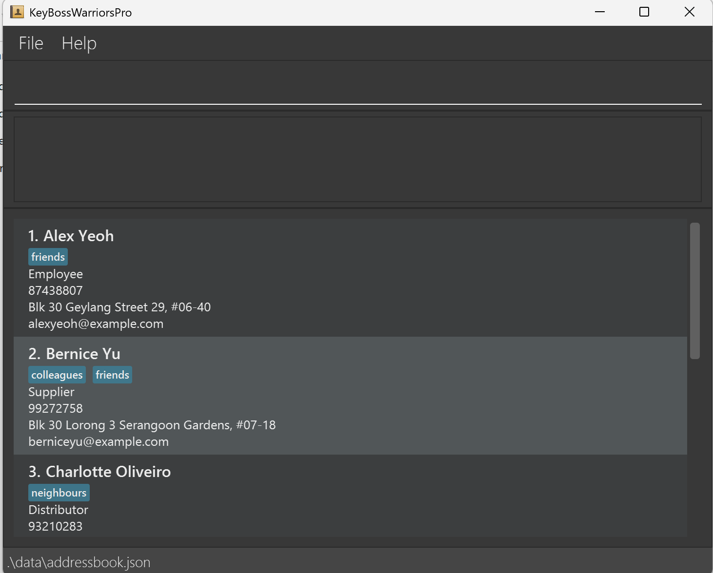
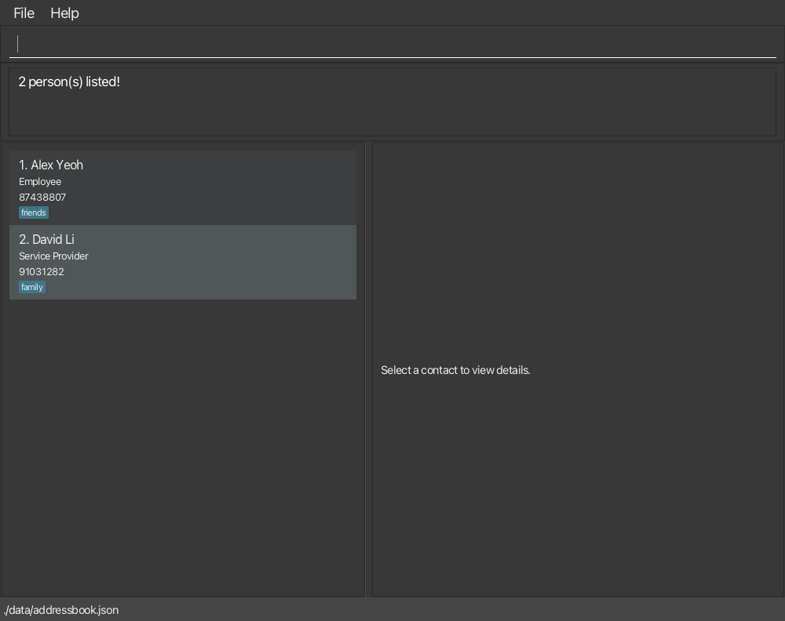
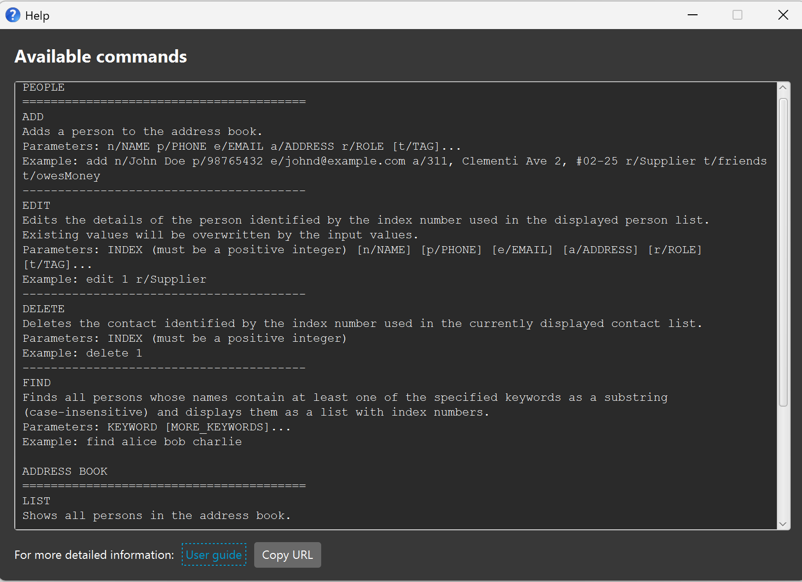

KeyBossWarriorsPro is a specialized **desktop application for managing contacts and vendor pipelines, optimized for Artisan Mechanical Keyboard Shop Managers through a Command Line Interface (CLI)** while retaining the benefits of a Graphical User Interface (GUI). If you type quickly, KeyBossWarriorsPro can help you manage your keyboard shop associates, hardware suppliers, and fabrication partners faster than traditional GUI applications.

* Table of Contents
{:toc}

--------------------------------------------------------------------------------------------------------------------

## Quick start

1. Ensure that Java `25` or later is installed on your computer.<br>
   **Mac users:** Ensure you have the precise JDK version prescribed [here](https://se-education.org/guides/tutorials/javaInstallationMac.html).

1. Download the latest `.jar` file from [here](https://github.com/AY2627S1-CS2103T-F11-1/tp/releases).

1. Copy the file to the folder you want to use as the _home folder_ for your KeyBossWarriorsPro.

1. Open a terminal, `cd` to the folder containing the JAR file, and run `java -jar keybosswarriorspro.jar`.<br>
   A GUI similar to the one below should appear in a few seconds. Note how the app contains some sample data.<br>
   

1. Type a command in the command box and press Enter to execute it. For example, type **`help`** and press Enter to open the help window.<br>
   Some example commands you can try:

   * `list` : Lists all contacts.

   * `add n/John Doe p/98765432 e/johnd@example.com a/John street, block 123, #01-01 r/Supplier` : Adds a contact named `John Doe` to KeyBossWarriorsPro.

   * `delete 3` : Deletes the 3rd contact shown in the current list.

   * `clear` : Deletes all contacts.

   * `exit` : Exits the app.

1. Refer to the [Features](#features) section below for details of each command.

--------------------------------------------------------------------------------------------------------------------

## Features

<div markdown="block" class="alert alert-info">

**:information_source: Notes about the command format:**<br>

* Words in `UPPER_CASE` are the parameters to be supplied by the user.<br>
  For example, in `add n/NAME`, replace `NAME` with a value such as `John Doe`.

* Items in square brackets are optional.<br>
  For example, `n/NAME [t/TAG]` can be used as `n/John Doe t/friend` or as `n/John Doe`.

* Items followed by `…`​ can appear zero or more times.<br>
  For example, `[t/TAG]…​` may be omitted, or written as `t/friend` or `t/friend t/family`.

* Parameters can be in any order.<br>
  For example, if the command specifies `n/NAME p/PHONE_NUMBER`, `p/PHONE_NUMBER n/NAME` is also acceptable.

* Extraneous parameters for commands that take no parameters are ignored.<br>
  For example, `help 123` is interpreted as `help`.
* For `list`, additional arguments are ignored and a warning is displayed.
  For example, `list 3` lists all contacts and does not navigate to contact 3.
* For `exit`, a message explains that any extra text is ignored before the application closes.

* If you are using a PDF version of this document, be careful when copying and pasting commands that span multiple lines as space characters surrounding line-breaks may be omitted when copied over to the application.
</div>

### Adding a contact: `add`

Adds a contact to KeyBossWarriorsPro.

**Format:** `add n/NAME p/PHONE_NUMBER e/EMAIL a/ADDRESS r/ROLE [t/TAG]…​`
* `ROLE` represents the contact's role or affiliation in your keyboard shop (e.g., `Supplier`, `Employee`, `Partner`, `Customer`). It cannot be empty.
* Contacts are identified as duplicates by phone number or email address (email comparisons are case-insensitive). You cannot add a contact who shares a phone number or email address with an existing contact, but contacts may share the same name.
* Unrecognized prefixes and extraneous arguments are not permitted and will be rejected with an error message indicating the unrecognized prefix(es).

**Field Constraints**

Field | Constraint
--------|------------------
`NAME` | May contain alphanumeric characters and spaces.
`PHONE_NUMBER` | Must contain at least 3 digits. Only digits are accepted.
`EMAIL` | Must follow a valid email format, such as `john@example.com`.
`ADDRESS` | May contain spaces and special characters.
`ROLE` | May contain spaces and special characters.
`TAG` | Optional. Contains one or more alphanumeric characters.


<div markdown="span" class="alert alert-primary">:bulb: **Tip:**
A contact can have any number of tags, including zero.
</div>

Examples:
* `add n/John Doe p/98765432 e/johnd@example.com a/John street, block 123, #01-01 r/Supplier`
* `add n/Betsy Crowe t/friend e/betsycrowe@example.com a/Newgate Prison p/1234567 r/Employee t/criminal`


### Clearing all entries: `clear`

Clears all entries from KeyBossWarriorsPro.

**Format:** `clear`


### Deleting a contact: `delete`

Deletes the contact at the specified position in the currently displayed contact list.

**Format:** `delete INDEX`

* `INDEX` **must be a positive integer** 1, 2, 3, …​
* `INDEX` refers to the contact's position in the contact list currently displayed to the user.
* The index is temporary and may change when commands such as `list`, `find`, `add`, `edit`, or `delete` change the displayed list.

Examples:
* `list` followed by `delete 2` deletes the second contact in the currently displayed list.
* `find Betsy` followed by `delete 1` deletes the 1st contact in the results of the `find` command.


### Editing a contact: `edit`

Edits an existing contact in KeyBossWarriorsPro.

**Format:** `edit INDEX [n/NAME] [p/PHONE_NUMBER] [e/EMAIL] [a/ADDRESS] [r/ROLE] [t/TAG]…​`

* `INDEX` must be a positive integer and must refer to a contact in the currently displayed list.
* At least one of the optional fields must be provided.
* Existing values will be updated to the input values.
* Field constraints described under `add` apply to every field supplied with `edit`.
* You cannot edit a contact's phone number or email address to match another existing contact in KeyBossWarriorsPro (email comparisons are case-insensitive).
* When editing tags, all of the contact's existing tags are removed; adding tags is not cumulative.
* To remove all of a contact's tags, enter `t/` without a tag after it.

Examples:
* `edit 1 r/Employee` Changes the role of the 1st contact to `Employee`.
* `edit 1 p/91234567 e/johndoe@example.com r/Supplier` Updates the 1st contact's phone number, email address, and role.
* `edit 2 n/Betsy Crower r/Customer t/` Changes the 2nd contact's name and role, and clears all existing tags.


### Exiting the program: `exit`

Exits the program after displaying a closing message for a short time.

**Format:** `exit`

Any extra text after `exit` is ignored. The closing message explains this, and the application exits without asking for confirmation.

For example, `exit -f` exits in the same way as `exit`.


### Locating contacts: `find`

Finds contacts whose names and/or roles contain the search terms. All searches are case-insensitive and support partial matching (substring matching).

#### Prefixed Search
Finds contacts matching specified name phrases, role phrases, or both.

**Format:** `find [n/NAME_PHRASE]... [r/ROLE_PHRASE]...`

* At least one `n/` or `r/` prefix must be provided.
* `n/` specifies a name search phrase; `r/` specifies a role search phrase.
* Each value after a prefix is treated as a continuous search phrase until the next prefix or the end of the command.
* Leading and trailing whitespace around each value is trimmed. Spaces within a phrase are preserved.
* **Partial & Case-Insensitive Matching**: Matches if the term appears anywhere within the field, regardless of upper or lower case (e.g., `n/alex` matches `Alexander`, `r/distrib` matches `Distributor`).
* **Search Logic:**
    * **Repeated prefixes use `OR` logic**: Matches contacts satisfying *at least one* of the specified values for that field.
    * **Different prefixes use `AND` logic**: Matches contacts satisfying *both* the name and role criteria.
* Blank prefix values (e.g., `n/`, `r/`) and unrecognised prefixes (e.g., `p/`) are rejected.
* Each matching contact appears only once.

Examples:
* `find n/alex` matches `Alex Yeoh`, `alexander`, and `Alexis Tan` *(partial match & case-insensitive)*.
* `find n/John Doe` matches `John Doe` and `John Doeder` *(multi-word phrase match)*.
* `find r/distrib` matches any contact whose role contains `distrib` (e.g., `Distributor`, `Regional Distributor`).
* `find r/supp r/distrib` matches contacts whose role contains either `supp` (e.g., `Supplier`) **or** `distrib` (e.g., `Distributor`).
* `find n/ali r/emp` matches contacts whose name contains `ali` (e.g., `Alice`) **and** whose role contains `emp` (e.g., `Employee`).
* `find n/John n/ali r/supp` matches contacts whose name contains `John` **or** `ali`, **and** whose role contains `supp`.
* `find n/` or `find r/` is invalid because search values cannot be blank.

#### Legacy Search
Searches contacts by name using space-separated keywords without prefixes.

**Format:** `find NAME_KEYWORD [NAME_KEYWORD]...`

* Searches contacts by **name only**.
* Space-separated words are treated as individual name keywords.
* **Search Logic**: Keywords use `OR` logic. A contact is returned if its name contains *at least one* of the specified keywords.
* **Partial & Case-Insensitive Matching**: Matches if the keyword appears anywhere within a name, regardless of upper or lower case (e.g., `han` matches `Hans Bo` and `Johan Meyer`).
* Keyword order does not matter (e.g., `Hans Bo` matches `Bo Hans`).
* Adding more keywords broadens the search results; it does not narrow them.
* **Cannot Mix with Prefixes**: Legacy unprefixed keywords cannot be combined with prefixed search values (e.g., `find Alice n/Bob` or `find Alice r/Employee` is rejected).
* Each matching contact appears only once, even if multiple keywords match its name.

Examples:
* `find John` matches `john` and `John Doe` *(case-insensitive)*.
* `find han` matches `Hans Bo` and `Johan Meyer` *(partial substring match)*.
* `find alex david` matches `Alex Yeoh` and `David Li` *(OR logic: matches either keyword)*.<br>
  
* `find Alice n/Bob` or `find Alice r/Employee` is invalid because legacy keywords and prefixed values cannot be mixed.


### Viewing help: `help`

Opens the help window, which lists the available commands and their usage instructions. For detailed explanations and examples, refer to this user guide.



**Format:** `help`


### Listing all contacts: `list`

Displays all contacts in KeyBossWarriorsPro and resets any active search filter.

**Format:** `list`

Examples:

* `list` displays all contacts.
* `list 3` displays all contacts and warns that `3` was ignored.
* `list abc xyz` displays all contacts and warns that the arguments were ignored.

Whitespace-only arguments are treated as empty input.

If there are no contacts, the application displays:

```text
No contacts found.
```


### Saving the data

KeyBossWarriorsPro automatically saves data after every command. You do not need to save manually.

Data saves are performed atomically. The application writes updates to a temporary file before replacing the saved data file. This prevents file corruption if the application closes unexpectedly or experiences a disk error during a save. If saving fails, the application leaves your existing data file untouched and displays an error message explaining the failure.

### Editing the data file

KeyBossWarriorsPro data is saved automatically as a JSON file `[JAR file location]/data/addressbook.json`. Advanced users are welcome to update data directly by editing that data file.

<div markdown="block" class="alert alert-warning">

:exclamation: **Caution:**<br>

If manual edits make the data file invalid or corrupted:

* KeyBossWarriorsPro automatically creates a timestamped backup copy in the `data/` folder (for example, `addressbook.json.backup.20261012_123456`).

* A warning message appears in the result box on launch showing the backup file path.

* KeyBossWarriorsPro starts with an empty contact book so that you can continue using the application without immediately overwriting your corrupted data file.

* To restore your contacts, close KeyBossWarriorsPro, open the backup file in a text editor to fix any syntax errors, and rename it back to `addressbook.json` before relaunching the app.

Certain invalid values can also cause unexpected behavior. Edit the data file only if you are confident in editing JSON formatted files.
</div>


### Archiving data files `[coming in v2.0]`

_Details coming soon ..._

--------------------------------------------------------------------------------------------------------------------


## FAQ

**Q**: How do I transfer my data to another computer?<br>
**A**: Install the app on the other computer and overwrite the data file it creates with the data file from your previous KeyBossWarriorsPro home folder.

**Q**: What should I do if my data file is corrupted?<br>
**A**: When KeyBossWarriorsPro detects a corrupted data file on startup, it automatically creates a timestamped backup in the `data/` folder and starts with an empty contact list. Close KeyBossWarriorsPro, open the backup file in a text editor to fix any invalid syntax, and rename it back to `addressbook.json` before relaunching the app.

--------------------------------------------------------------------------------------------------------------------

## Known issues

1. **When using multiple screens**, if you move the application to a secondary screen, and later switch to using only the primary screen, the GUI will open off-screen. The remedy is to delete the `preferences.json` file created by the application before running the application again.
2. **If you minimize the Help Window** and then run the `help` command (or use the `Help` menu, or the keyboard shortcut `F1`) again, the original Help Window will remain minimized, and no new Help Window will appear. The remedy is to manually restore the minimized Help Window.

--------------------------------------------------------------------------------------------------------------------

## Command summary

Action | Format, Examples
--------|------------------
**Add** | `add n/NAME p/PHONE_NUMBER e/EMAIL a/ADDRESS r/ROLE [t/TAG]…​` <br> e.g., `add n/James Ho p/22224444 e/jamesho@example.com a/123, Clementi Rd, 1234665 r/Supplier t/friend t/colleague`
**Clear** | `clear`
**Delete** | `delete INDEX`<br> e.g., `delete 3`
**Edit** | `edit INDEX [n/NAME] [p/PHONE_NUMBER] [e/EMAIL] [a/ADDRESS] [r/ROLE] [t/TAG]…​`<br> e.g., `edit 2 n/James Lee e/jameslee@example.com r/Employee`
**Exit** | `exit` 
**Find** | `find [n/NAME_PHRASE]... [r/ROLE_PHRASE]...` or `find KEYWORD [MORE_KEYWORDS]` (Legacy Search)<br> e.g., `find n/John r/Supplier`, `find James Jake`
**Help** | `help`
**List** | `list`
