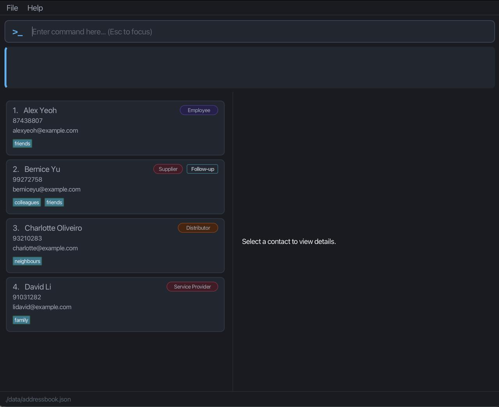

**KeyBossWarriorsPro is a specialized desktop contact and vendor management application tailored for Artisan Mechanical Keyboard Shop Managers.** Optimized for keyboard-centric operations, it delivers the speed of a Command Line Interface (CLI) alongside the visual clarity of a Graphical User Interface (GUI).

### Key Features
* **Contact Management (`add`, `edit`, `delete`, `clear`)**: Maintain workshop contacts with names, phone numbers, email addresses, addresses, and customizable roles such as Supplier, Service Provider, or Employee.
* **Component and Service Tags**: Organize contacts with tags such as `switches`, `keycaps`, or `soldering`. Add or remove tags using `edit`.
* **Flexible Search (`find`)**: Find contacts by name, role, or tag using case-insensitive partial matching. Combine criteria to narrow your search, for example, `find r/Supplier t/switches`.
* **Contact Browsing (`list`, `sort`, `select`)**: Display all contacts, sort by name or role, and select a contact to view its full details.
* **Follow-up Tracking (`followup`, `followups`)**: Set, replace, or clear a contact's pending follow-up with a date and description. View all pending follow-ups, overdue items, or those due by a specified date.
* **Undo and Redo (`undo`, `redo`)**: Reverse contact changes, including follow-up updates, and restore undone changes during the current session.
* **Automatic Local Saving**: Save contact data automatically to a local JSON file. If corrupted data is detected at startup, the application attempts to back it up and starts with an empty contact book.
* **Built-in Help (`help`)**: Browse the command reference or use `help COMMAND` for a specific command's usage.

### Getting Started
* If you are interested in using KeyBossWarriorsPro, head over to the [_Quick Start_ section of the **User Guide**](UserGuide.html#quick-start).
* If you are interested in developing or contributing to KeyBossWarriorsPro, the [**Developer Guide**](DeveloperGuide.html) is a good place to start.
* Meet our development team on the [**About Us**](AboutUs.html) page.

---

**Acknowledgements**
* Based on the AddressBook-Level 3 project created by the [SE-EDU initiative](https://se-education.org).
* Libraries used: [JavaFX](https://openjfx.io/), [Jackson](https://github.com/FasterXML/jackson), [JUnit5](https://github.com/junit-team/junit5).
